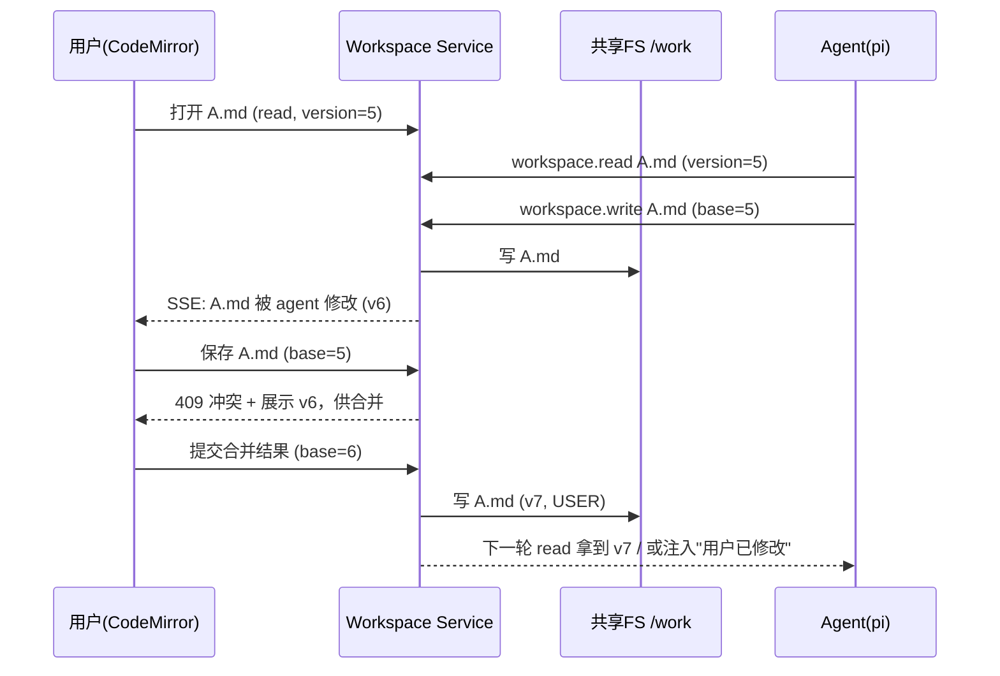
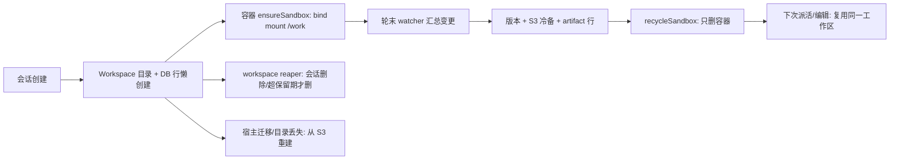

# Code 模式工作区（2026-10-08 立项）

> 上游基准：`01-整体需求与实施步骤.md`（TaskAgent / 产物交付 / 沙箱安全）、`02-后端设计.md`（§七 TaskAgent 编排、§4.8 产物、§十 安全）、`03-前端设计.md`（对话页与产物面板）、`子方案/沙箱与引擎集成.md`（容器生命周期、引擎桥、产物收集）。
> 定位：在现有 **TaskAgent + 沙箱 + 产物** 之上，新增「**人机共享、可实时编辑、可并发、可持久**」的工作区能力，即 **Code 模式**。
> 状态：**设计讨论稿**（2026-10-08 立项；**2026-10-10 完成一轮设计讨论定案**——部署形态、轮末变更集、保留期、多用户、产物口径、轮级撤销，见 §十三「已决」；仅落设计，未动代码）。
> 本文**新增一个产品能力**（不是纯实现细则），因此它同时是 `01/02/03/06` 的**需求增量候选**；落地前需按需求变更流程回写上游四份文档。

---

## 一、问题与目标

### 1. 现状（代码事实，改之前先认清）

| 事实 | 位置 | 后果 |
|------|------|------|
| 工作区 = 容器内 `/work`，背后是具名卷 `doubulea-work-<conversationId>` | `backend/src/sandbox/spec.ts:64`、`:117` | 工作区与容器**同生共死** |
| 回收容器时**连具名卷一起删** | `backend/src/sandbox/manager.ts:487`（`recycleSandbox`，删容器 + 卷 + 账本 + 名额） | 用户停止 / 空闲 30min / 启动对账后，`/work` 文件消失 |
| 持久副本只有 `artifacts` 表 + S3，按轮 diff 生成 | `backend/src/sandbox/artifacts.ts`（`snapshotWorkFiles` / `diffWorkFiles` / `collectRoundArtifacts`） | 产物是**只读输出**，不是可编辑工作区 |
| 浏览器侧对文件**只读**：列表 / 下载 / 预览 / 删除 | `backend/src/routes/artifacts.ts` | 没有任何写入 / 编辑 / 文件树端点 |
| 唯一的「写进容器」通道 = `execInSandbox`（docker exec），**`stdin:false`、`cmd` 数组不过 shell** | `backend/src/sandbox/docker.ts:535` | 没有「写文件」原语；且它是后端内部工具，不是浏览器可用端点 |
| 引擎（pi）的 `read/write/edit/bash` **都跑在容器内**，后端拦不到逐次文件写 | 容器内 pi 原生工具 | 人改的与 agent 改的是**两份不同的字节** |
| 容器面向的后端代理 listener（token 鉴权） | `backend/src/sandbox/proxy.ts` + `listener.ts` | 它是给**容器**用的，不是给**浏览器**用的；新端点别挂这里 |
| 派活前只从 DB 重建一份「记忆文档」，产物由 agent **按需** `fetch` 回容器 | `backend/src/orchestrator/memoryDoc.ts` | 没有自动 rehydrate；agent 何时拉、拉不拉不受控 |

### 2. 要解决的问题（用户原话）

> 「我让 agent 帮我生成 xx 文件后，agent 在更改，我又在更改，此时 agent 又不知道我在更改。」

拆成三条：

1. **共享**：人和 agent 必须编辑**同一份**工作区，而不是容器私有拷贝 + 后端副本。
2. **感知**：agent 的读要能看到人的最新写入；人的编辑器要能实时看到 agent 的写入；**写不能静默覆盖**。
3. **持久**：工作区不能随容器回收而消失；跨容器重建、跨主机迁移都要能恢复。

### 3. 目标与不变量

| # | 不变量 | 含义 |
|---|--------|------|
| I1 | **单一真相** | 一个会话一份 canonical 工作区，人和 agent 读写同一份 |
| I2 | **无静默覆盖** | 任何写入都可版本化、可审计、可合并；冲突必须显式暴露 |
| I3 | **双向感知** | agent 读拿到最新；人能实时看到 agent 改动 |
| I4 | **容器可丢弃** | 容器死了工作区不丢，重建后自动挂回 |
| I5 | **归属唯一** | 会话 owner（及协作者）；越权一律 404 |

**非目标（本设计不解决）**：同一文件的多光标实时协同（CRDT）——见 §七 4，作为独立可选层，第一版不做。

---

## 二、核心结论（架构总览）

### 1. 一句话

> **工作区升格为后端拥有的一等资源（共享文件系统 + 版本索引 + 事件总线 + S3 冷备）；容器降级为「挂载它的一次性计算运行时」；agent 的文件 I/O 必须被中介，写入走版本校验。**

### 2. 三层职责

```
┌───────────────────────────────────────────────────────────────┐
│                     Workspace Service（后端）                  │
│  ┌────────────┐  ┌────────────┐  ┌────────────┐  ┌──────────┐ │
│  │ 版本索引/锁 │  │ 事件总线    │  │ 冷备/恢复  │  │ 冲突解析  │ │
│  │ (Postgres) │  │ (SSE/Redis)│  │   (S3)     │  │  diff3   │ │
│  └─────┬──────┘  └─────┬──────┘  └─────┬──────┘  └────┬─────┘ │
│        │               │               │              │       │
│  ┌─────▼───────────────▼───────────────▼──────────────▼─────┐ │
│  │          canonical 工作区目录（宿主 / 共享 FS）            │ │
│  └───────┬─────────────────────────────────────┬────────────┘ │
└──────────┼─────────────────────────────────────┼──────────────┘
           │ bind mount / 共享卷                  │ watcher（inotify）
     ┌─────▼──────┐                        ┌─────▼──────┐
     │ 容器 pi 引擎│                        │ 浏览器编辑器│
     │(workspace  │                        │(CodeMirror6)│
     │   工具)    │                        └────────────┘
     └────────────┘
```

| 层 | 角色 | 技术选型 |
|----|------|----------|
| **canonical 字节** | 实时真相、双方共享 | 宿主目录 bind mount 进容器 `/work`；多主机时换 NFS/CephFS 或 FUSE 工作区守护 |
| **版本 / 锁 / 事件** | 版本号、CAS、claim、审计 | Postgres（`workspace_files` / `_versions` / `_claims` / `_events`） |
| **冷备 / 交付** | 持久、跨主机恢复、产物导出 | S3（内容寻址，异步 debounce 同步） |

**为什么必须是共享文件系统**：只有双方看到**同一批字节**，"agent 的读"才天然看到人的最新写入，"人的编辑器"才能通过 watcher 实时看到 agent 的写入。DB / S3 都不解决这一点——它们是**元数据与冷备**，不是实时真相。

### 3. 与现状的关键改动清单

| # | 改动 | 现状 → 目标 |
|---|------|-------------|
| C1 | 工作区存储 | 具名卷（容器私有） → 宿主 bind mount（共享）+ DB 索引 + S3 冷备 |
| C2 | 回收语义 | `recycleSandbox` 连卷删 → **只删容器**，工作区保留（新增 workspace reaper 单独清理） |
| C3 | agent 文件工具 | pi 原生 read/write/edit → **workspace 扩展**（版本校验 + claim + 事件） |
| C4 | 浏览器端点 | 无 → 工作区树 / 读 / 写 / 增删改 / SSE 事件 |
| C5 | 并发 | 无（隐式 last-write-wins） → 四层防护（串行 + claim + CAS + 三方合并） |
| C6 | 前端 | 只读产物面板 → 可编辑工作区面板（CodeMirror 6） |
| C7 | 开关 | 无 → 会话级 `codeMode` 标志 |

---

## 三、数据模型（Prisma 草案）

> 命名约定沿用 `schema.prisma` 文件头：Prisma camelCase、DB snake_case（`@map` / `@@map`），日期一律 `Timestamptz(3)`，主键 `uuid(7)`。

```prisma
/// 工作区（一个会话一份）。rootPath 是宿主 canonical 目录。
model Workspace {
  conversationId String   @id @map("conversation_id") @db.Uuid
  rootPath       String   @map("root_path") @db.Text
  headVersion    BigInt   @default(0) @map("head_version")   // 工作区级单调修订号
  createdAt      DateTime @default(now()) @map("created_at") @db.Timestamptz(3)
  updatedAt      DateTime @updatedAt @map("updated_at") @db.Timestamptz(3)

  conversation Conversation @relation(fields: [conversationId], references: [id], onDelete: Cascade)

  @@map("workspaces")
}

/// 工作区文件索引（**只是索引**：字节在共享 FS 与 S3，不在这里）。
model WorkspaceFile {
  id             String    @id @default(uuid(7)) @db.Uuid
  conversationId String    @map("conversation_id") @db.Uuid
  path           String    @db.VarChar(1024)         // 归一化相对路径，锁死在 root 内
  size           BigInt
  mime           String    @db.VarChar(255)
  contentHash    String    @map("content_hash") @db.VarChar(64)  // sha256
  version        Int       @default(1)               // 每文件单调版本（CAS 的 base）
  s3Key          String?   @map("s3_key") @db.VarChar(512)      // 冷备对象（内容寻址）
  updatedBy      WorkspaceActor @map("updated_by")   // AGENT | USER | SYSTEM
  updatedById    String?   @map("updated_by_id") @db.VarChar(128) // userId / turnId
  deletedAt      DateTime? @map("deleted_at") @db.Timestamptz(3)  // 墓碑（软删）
  updatedAt      DateTime  @updatedAt @map("updated_at") @db.Timestamptz(3)

  versions WorkspaceFileVersion[]

  @@unique([conversationId, path])
  @@index([conversationId, path])
  @@map("workspace_files")
}

/// 文件历史（diff / 三方合并 / 审计）。
model WorkspaceFileVersion {
  id          String   @id @default(uuid(7)) @db.Uuid
  fileId      String   @map("file_id") @db.Uuid
  version     Int
  contentHash String   @map("content_hash") @db.VarChar(64)
  s3Key       String?  @map("s3_key") @db.VarChar(512)
  actor       WorkspaceActor
  actorId     String?  @map("actor_id") @db.VarChar(128)
  createdAt   DateTime @default(now()) @map("created_at") @db.Timestamptz(3)

  file WorkspaceFile @relation(fields: [fileId], references: [id], onDelete: Cascade)

  @@unique([fileId, version])
  @@map("workspace_file_versions")
}

/// 文件级软锁（悲观层）。TTL + 心跳，防死锁。
model WorkspaceClaim {
  id             String   @id @default(uuid(7)) @db.Uuid
  conversationId String   @map("conversation_id") @db.Uuid
  path           String   @db.VarChar(1024)
  holder         WorkspaceActor
  holderId       String   @map("holder_id") @db.VarChar(128)
  turnId         String?  @map("turn_id") @db.VarChar(128)  // agent 侧：哪个 turn 声明的
  expiresAt      DateTime @map("expires_at") @db.Timestamptz(3)
  heartbeatAt    DateTime @map("heartbeat_at") @db.Timestamptz(3)

  @@unique([conversationId, path, holder])
  @@index([conversationId, expiresAt])
  @@map("workspace_claims")
}

/// 事件日志（SSE 断线补发 + 审计；SSE 实时通道另走内存/Redis）。
model WorkspaceEvent {
  id             String   @id @default(uuid(7)) @db.Uuid
  conversationId String   @map("conversation_id") @db.Uuid
  type           String   @db.VarChar(48)   // created/updated/deleted/renamed/claim/release
  path           String   @db.VarChar(1024)
  version        Int?
  actor          WorkspaceActor
  actorId        String?  @map("actor_id") @db.VarChar(128)
  at             DateTime @default(now()) @map("at") @db.Timestamptz(3)

  @@index([conversationId, at])
  @@map("workspace_events")
}

enum WorkspaceActor {
  AGENT
  USER
  SYSTEM

  @@map("workspace_actor")
}
```

> **S3 键规则**：内容寻址 `workspaces/{conversationId}/blobs/{sha256}`。相同内容零新增对象；删除只删 DB 行，blob 由后台 GC（复用 `reapExpiredArtifacts` 那套 reaper 模式）。
> **为什么不在表里存内容**：canonical 字节在共享 FS（热路径），S3 只做冷备。DB 不承担文件内容，避免大字段与热点更新。

---

## 四、Workspace Service 设计

### 1. 存储与真相

- **热路径（实时真相）**：宿主目录 `WORKSPACE_ROOT/{conversationId}`，bind mount 到容器 `/work`。
- **索引（版本/锁/事件）**：Postgres。
- **冷备（持久）**：S3，内容寻址；宿主迁移或目录丢失时用它重建。
- **多主机形态（本批不做，只留接口）**：`rootPath` 指向共享存储（NFS / CephFS / EFS）；如无法共享 FS，退化为容器内 **FUSE 工作区守护**（把 Workspace Service 的 API 挂成 `/work`），代价是复杂度与容器特权。

**首发形态（2026-10-10 定案）：单机 bind mount。** 一台宿主跑 Workspace Service，`WORKSPACE_ROOT` 是本地 FS，`rootPath` 直接 bind 进容器 `/work`。

**多主机形态（2026-10-10 与 P1-14 对齐改口径）：走「路线 A —— 每机一实例 + 按会话路由」，不用共享 FS。** 即话题从第一次触达起**钉在一台机器**，工作区就在那台的本地盘上、bind 进那台起的容器；换机时从 S3 冷备重建（§九、§十六）。**共享 FS（NFS/CephFS）降级为备选**——只有在将来"取消按会话钉机器"时才需要。理由：P1-14 已否决"多机共享盘 / 远程 daemon"，改为粘性路由（见 `子方案/沙箱多机部署.md` §二、§三 5–6）；P1-9 必须与之同口径，否则会诱导施工去搭一套被弃用的共享存储。

**单机容量预算（量化口径，用于决定何时分片）：**

| 约束 | 决定因素 | 现实量级（估） |
|------|---------|--------------|
| 宿主磁盘 | 保留期（7 天）内活跃工作区数 × 平均体积 | 500GB / 200MB·仓库 ≈ 2500 个；/ 10MB·文本产物 ≈ 5 万个 |
| **inotify watch**（§四 3 watcher 按**目录**占 watch，不是按文件） | `fs.inotify.max_user_watches`（默认常见 8192～65536）、`fs.inotify.max_user_instances`（默认 128） | 65536 / 500 目录·仓库 ≈ **130 个并发被监听工作区**即顶到默认值 ⇒ 必须调 sysctl |
| 并发容器 | `SANDBOX_CONCURRENCY`（默认 10，`backend/src/config.ts`） | 已封顶，与工作区数无关 |
| S3 冷备上行 | 异步 debounce + 网络带宽 | 通常非瓶颈 |
| 宿主 FS / 属主 | 本地 FS + 目录属主 = `SANDBOX_AGENT_UID`（10001） | 部署细节，非容量 |

> **分片触发线**：宿主磁盘 70% 或 inotify watches 70% ⇒ 按 `conversationId` 哈希把新工作区落到第二台（"多主机接口"即此）。文本 / 产物为主时单机可容数千会话、**先撞 inotify**；完整代码仓库时单机约**几百～上千活跃工作区**、**磁盘先撞**。

### 2. 版本模型

| 概念 | 说明 |
|------|------|
| `version`（每文件） | 单调递增；每次成功写入 +1。读返回它，写携带 `baseVersion` 做 **CAS** |
| `contentHash`（sha256） | 判「内容是否真变」（mtime 不可靠）；冷备对象键 |
| `headVersion`（工作区级） | 事件序号 / 断线补发游标；只增 |
| tombstone | 删除写 `deletedAt`，保留 `version` 供合并判断"对方删了没" |

### 3. 事件总线

- watcher（chokidar / inotify）监听 `rootPath`，debounce 后产生 `WorkspaceEvent`。
- **agent 工具写**与**人 API 写**都会显式产生事件；watcher 负责捕获**未中介写**（如 `bash`）。
- 事件两条出口：① 会话级 SSE → 浏览器；② 落 `workspace_events` → 断线补发与审计。
- ⚠️ **多机下 watcher 是进程内的**（只装在持有该工作区的那台机器上）⇒ 工作区 SSE 事件流**必须粘性路由**到该实例（见 §十六 A）。

### 4. 冷备与恢复

- **同步时机**：人保存（debounce）+ 每轮 agent 结束批量 diff + 空闲兜底。
- **恢复时机**：容器/宿主重建且 `rootPath` 缺失时，从 S3 按最新版本重建目录。
- **GC**：孤儿 blob（无任何 `WorkspaceFile`/`_versions` 引用）与超保留期对象由 workspace reaper 清理。

---

## 五、Agent 侧集成（成败关键）

### 1. 共享挂载（替代具名卷）

- 把 `spec.ts#workVolumeName` 的具名卷改为宿主 bind mount：`rootPath → 容器 /work`。
- `manager.ts#createSandbox` 的 `Mounts` 由 `Type:'volume'` 改为 `Type:'bind'`（或保持卷、但卷的宿主路径固定且不随回收删除）。
- **`recycleSandbox` 不再删工作区**（当前 `manager.ts:487-506` 会删卷）：改为只删容器 + 账本 + 名额；工作区由 workspace reaper 按「会话是否还在 / 保留期」清理。
- **uid 对齐**：bind mount 属主要匹配容器内非 root `agent`（`spec.ts` 镜像用非 root，`/home/agent` 特意挂了 tmpfs）。写文件与 `putArchive` 都要按该 uid。

### 2. 工具中介：pi workspace 扩展

pi 已有扩展机制（现成例证：`infra/sandbox/base/pi-agent/extensions/mcp-bridge/index.ts`）。新增一个 **workspace 扩展**，把文件工具换成版本感知版：

```
workspace.read(path)                         → { content, version }
workspace.write(path, content, baseVersion)  → CAS：索引版本 ≠ baseVersion ⇒ 返回错误给模型：
                                               "文件已被用户修改（vN），请重新读取后再写"
workspace.edit(path, old, new, baseVersion)  → CAS + 应用补丁
```

- 工具写前向 Workspace Service 声明 **AGENT claim**（TTL + 心跳）。
- 工具写成功后 bump version、发事件、更新索引。
- ✅ **可行性已确认（2026-10-08，见 §十五）**：pi 官方示例 `examples/extensions/tool-override.ts` 明写 *"Extensions can register tools with the same name as built-in tools to replace them."* —— 用 `pi.registerTool({ name: 'read' | 'write' | 'edit', … })` 即可替换原生工具。另有两条同族能力可作补充：
  - `pi.on('tool_call', …)` 可**改写入参或 `{ block: true, reason }` 拦截**（可不替换工具而只做版本闸门）；
  - `withFileMutationQueue()` 是官方给"文件修改类工具"的 **read-modify-write 串行化**帮手，直接服务于 §七 的并发协议。

### 3. `bash` 兜底（无法中介时的安全网）

pi 的 `bash` 能绕过工具中介直接写文件：

- watcher 捕获「无对应工具写」的 FS 变化 ⇒ 以 `AGENT` 身份 bump version + 发事件 + 标记 `unmediated`。
- **轮末对账**：对照 turn 起点快照，找出「人改过 **且** agent 也改过」的文件 ⇒ 进冲突审阅（§七 3）。
- **终极形态**：容器内 `/work` 用 **FUSE** 承载，所有写（含 bash）都过版本层；代价是容器需 fuse 设备 / 特权，视部署安全策略取舍。

### 4. prompt / 记忆口径

`memoryDoc.ts` 与派活 prompt 明确写：

- 「`/work` 是与你的人类用户**共享**的工作区，文件可能已被用户修改。」
- 「写任何文件前先 `read`；若返回『已被修改』，重新读取后再改。」
- 记忆文档附最近工作区变更事件摘要（谁改了什么）。

### 5. 中途感知与注入（主动 awareness）

- **被动（必做，且已足够收敛）**：读拿最新 + 写 CAS 失败回喂模型。这就是「agent 知道你在改」的机制——**不是它主动轮询，而是它的写被挡下并被告知**。
- **主动（可选，机制已确认可用）**：watcher 检测到 `USER` 写且该轮 agent 正在跑 ⇒ 用 pi RPC 的 **`steer`** 命令注入 `"用户修改了 path（vN），请重新读取后再继续"`。
  - ✅ **通道已确认（2026-10-08，见 §十五）**：pi RPC 有 `steer` 命令，语义是「agent 运行中排队一条消息，**在它当前这一轮的工具调用执行完之后、下一次 LLM 调用之前投递**」；`prompt` 也支持 `streamingBehavior: "steer" | "followUp"`。投递粒度是**助手 turn 边界**（不是逐工具即时），这正是需要的粒度。
  - ⚠️ 与现有桥的关系：`bridge.ts` 目前只发一次 `prompt` + 等 `agent_settled`；要加 `steer` 需在桥上开一条「运行中发命令」的通道（`abort` 已经是同类命令）。仍保留 `clear_queue` / `abort` 作为降级手段。

### 6. 产物口径：产物 = 工作区变更集视图（clone 不算产物，2026-10-10 定案）

- **语义**：产物**不是**目录树快照，而是"**人认可的交付 / 变更子集**"（回归 §二 三层职责：工作区是真相，产物是交付视图）。**`git clone` 拉下来的整棵树属「工作区内容」，不算产物**。
- **现状会误伤**：产物判据是**每轮 diff**（`artifacts.ts#diffWorkFiles`）——派活前拍基线、收尾对照取"本轮新出现或修改的"。clone 发生在某一轮里 ⇒ 整棵树都是"本轮新出现" ⇒ 全进候选；仅靠 `.` 隐藏规则（吃掉 `.git/`）+ `ARTIFACT_EXCLUDED_DIRS=['node_modules']` + 单文件 50MB + 单轮 200 上限截断兜底（`artifacts.ts`）。**那是上限截断的巧合，不是语义**。
- **落地口径**：clone / 初始化应在**基线之前**完成（作为 setup 步），使本轮 diff 天然不含它；若允许**运行中** `git clone`，须区分"本轮初始填充"与"其后改动"，或改为 agent **显式声明交付物**（产物 = 被声明的子集，而非"所有变化"）。
- **忽略规则扩容**：`.git`（隐藏已覆盖）/ `node_modules`（已列）之外，补 `dist/ build/ target/ *.lock` 等生成物（与 §十三 待决 10 同条）。

---

## 六、人侧集成

### 1. 工作区 API（挂在**公网会话路由**，不是容器 listener）

| 方法 | 路径 | 作用 |
|------|------|------|
| GET | `/api/conversations/:id/workspace` | 文件树（DB 索引查询，**不** ListObjects） |
| GET | `/api/conversations/:id/workspace/file?path=` | 读字节 + `version`（文本 `text/plain`、图片 inline、其余 attachment） |
| PUT | `/api/conversations/:id/workspace/file?path=` | 保存（body 带 `baseVersion`，CAS） |
| POST | `/api/conversations/:id/workspace/file` | 新建 |
| POST | `/api/conversations/:id/workspace/move` | 改名 / 移动 |
| DELETE | `/api/conversations/:id/workspace/file?path=` | 删除（软删 + 墓碑） |
| GET | `/api/conversations/:id/workspace/events` | SSE：实时工作区事件 |

- 响应头复用 `routes/artifacts.ts#previewHeadersFor` 的分派与隔离头；`text` 一律压 `text/plain`（同现有口径）。
- 归属沿用「会话 → owner，仅本人」（`routes/artifacts.ts:20`），他人一律 404。
- ⚠️ **多机下本章全部路由必须粘性**（工作区字节在宿主本地 FS，**不在 PG/S3**）：不能像普通路由那样轮询到任意实例，否则会落到没有该工作区的机器上（§十六 A）。含 `GET .../workspace/events`（SSE，watcher 进程内）。

### 2. 实时推送

watcher + agent 工具事件 → 会话级 SSE → 前端：

- 文件树实时增删；
- 打开且**未修改**的编辑器自动 reload；
- 打开且**已修改**的编辑器弹「磁盘已被 agent / 他人修改」横幅 + diff。

### 3. 编辑器

- **CodeMirror 6**（按需语言包、可 tree-shake；符合本仓「零新增依赖」倾向的取舍）。
- 冲突横幅 + 三方合并视图；二进制 / 图片只读预览（复用 `components/ArtifactPreview/*`）。
- agent 活动徽标：用现有 `tool_call` 事件（`sandbox/map.ts` 的 `toolRecords` 带 `arguments`）best-effort 标出「agent 正在编辑 X」。

### 4. 开关

会话级 `codeMode` 标志（新建会话时选，或 TaskAgent 默认开）。**不动 `AgentType` 枚举**，灰度友好。

---

## 七、并发控制协议（核心）

### 1. 四层防护

| 层 | 机制 | 解决什么 | 位置 |
|----|------|----------|------|
| ① 轮级串行 | 复用活跃流锁 | agent 不并发跑两轮 | `orchestrator/sse.ts` |
| ② 文件级 claim | `WorkspaceClaim` + TTL 心跳 | 双方「知道」对方在碰哪个文件；UI 可锁 / 警示 | 新增 |
| ③ 乐观 CAS | `baseVersion` 校验 | **杜绝静默覆盖**（核心） | 新增 |
| ④ 三方合并 | base / current / incoming，diff3 | CAS 冲突后的收敛 | 新增 |

### 2. 冲突时序（用户描述的场景）



反向（人先写、agent 后写）同理：agent 的 `write(base=5)` 因 current=6 被拒，模型收到「请重读」而收敛。

### 3. 合并策略

- **文本**：diff3 自动三方合并；干净则自动落，冲突块进审阅 UI 由人裁决。
- **二进制**：不可合并 ⇒ 只能二选一（展示大小 / 时间 / 作者）。
- **删除冲突**：任一方删除、另一方修改 ⇒ 冲突，不静默删。
- **轮末审阅（2026-10-10 定案）：默认「自动应用」**——agent 边改边直接落 canonical `/work`，人通过 SSE 实时可见；轮末给一份「**本轮变更集**」diff 汇总（事后审阅）。**默认自动应用的前提是必须提供「撤销本轮」**（轮级变更集回滚，见 §七 5），否则回滚只能逐文件手动、难用。「事前拦截式审阅后应用」为**可选、后置**。

### 4. 多用户 / 实时协同 = 非目标（2026-10-10 定案）

- **明确不做跨用户协作**：会话单归属（`conversations.user_id`），**每个人只在自己的对话下编辑自己生成的内容**——不存在"同一工作区多人"的场景。
- 因此**不做** `workspace_collaborators`、不做协作者角色、不做权限矩阵扩展；越权判据不变：非会话 owner 一律 404（与产物同族）。
- **不做同文件多光标实时协同（CRDT / Yjs）**——§一 的"非目标"维持不变。
- 并发协议（§七 1）里的 `claim` holder 只有 `USER` / `AGENT` 两种，四层防护只在"**同一个人 vs agent**"之间跑，足够。
- **演进留口**：将来若真要多人，回归路径仍是加 `workspace_collaborators`（claim 按 `(path, holder=userId)`、CAS 仍按 `version`，不改协议）；CRDT 作为独立可选层再议。

### 5. 轮级变更集与「撤销本轮」（2026-10-10 新增）

> 背景：默认「自动应用」意味着 agent 一轮可能改几十个文件。"每文件版本"的模型下，想撤销**一整轮**要手动逐个回滚，且人可能已插入自己的改动 ⇒ 难用。故把「轮」提升为一个**可回滚的层级**。

- **轮级变更集（turn changeset）**：每轮 agent 开始时记录 `{path → beforeVersion}`（**基线快照从 `size+mtime` 升级为含 `version` / `contentHash`**），轮末对照得到 `{path, beforeVersion, afterVersion}` 集合。这份变更集**同时**服务于「撤销本轮」「轮末 diff 审阅」「轮末对账」（§五 3）——**三处共用一个原语**。
- **撤销本轮**：对变更集内每个文件按 `beforeVersion` 走同一套 CAS 回写——
  - 当前版本 == `afterVersion`（事后无人再动）⇒ 直接回滚；
  - 当前版本 ≠ `afterVersion`（人已改过）⇒ **不静默覆盖**，走 diff3 合并或标冲突交人裁决（与 §七 3 同一纪律）。
- **对既有产物的落点**：产物收集已"每轮拍基线"（`backend/src/sandbox/artifacts.ts#snapshotWorkFiles`）——把该基线从"读 `size/mtime`"扩展为"**同时记下 DB 里的 `version` / `contentHash`**"即可，**不新增基线机制**。
- **可选「审阅后应用」（后置）**：复用同一变更集，把"轮末 apply"改成"轮末先暂存、人 accept 再 apply"；与实时共享模型有张力，**不进 v1 默认**。

---

## 八、生命周期



关键：**工作区不再跟容器同生共死**（与现在 `recycleSandbox` 连卷删相反）。

**多机生命周期（路线 A，详见 §十六）**：

- 话题**钉机记录**（会话 → 实例）在**工作区首次创建 / 首次 code 触达**时就写（**早于建容器**——人会先于 agent 编辑），寿命**跟随工作区**（≥ 保留期），**不复用容器 2h 的 `sandbox:owner` TTL**；
- workspace reaper **只清本实例名下的工作区**（`instanceId = self`，与 P1-14 沙箱对账同口径）：本地目录 + DB 行 + S3 冷备一起收；
- 换机重建 = **容器重建 + 从 S3 重建工作区**（同一事件，§十六 E）。

---

## 九、安全与配额

| 项 | 措施 |
|----|------|
| 路径逃逸 | 归一化 + `realpath` 校验必须落在 `rootPath` 内；拒 `..`、绝对路径、符号链接外逃 |
| uid 对齐 | bind mount 属主匹配容器内 `agent` uid，否则 agent 读写失败 |
| 配额 | 单会话文件数、单文件大小、总字节上限；超限拒绝并留痕 |
| 二进制 | 只读预览 / 下载，编辑器只开文本 |
| 越权 | 所有端点按会话归属判权，他人一律 404（与产物同族） |
| 密钥 | 工作区不跨用户可见；日志脱敏沿用 `LOG_REDACT_PATHS` |
| 注入 | 路径参数进 `docker exec` / FS 操作前必须校验（现状 `execInSandbox` 用数组 form 防注入，新写路径要维持同一纪律） |

---

## 十、前端设计

- 对话页第三列升级为**工作区面板**（复用 `.chat--with-panel` 与 1280 断点，`pages/chat/ChatPage.tsx`）：
  - 文件树 + 多标签 + CodeMirror 6；
  - 保存 / ⌘S、dirty 标记、冲突横幅、轮末 diff 审阅（accept / reject / 手动合并）；
  - agent 活动徽标 + 实时刷新；
  - 二进制 / 图片走现有预览组件。
- 新增：`stores/workspace.ts`（打开的文件 / dirty / 冲突）、`features/chat/WorkspacePanel.tsx`、`features/chat/workspaceModel.ts`（零依赖纯逻辑）、`api/workspace.ts`。

---

## 十一、参数总表（施工唯一依据）

| 参数 | 默认值 | 单位 | 说明 |
|------|--------|------|------|
| `WORKSPACE_ROOT` | `/var/lib/doubulea/workspaces` | 路径 | 宿主 canonical 目录根；多主机指向共享存储挂载点 |
| `WORKSPACE_MAX_FILE_MB` | **10** | MB | 单文件上限（编辑器只开这以下的文本；更大只读 / 下载） |
| `WORKSPACE_MAX_FILES` | **2000** | 个 | 单会话文件数上限（防爆） |
| `WORKSPACE_MAX_TOTAL_MB` | **512** | MB | 单会话总字节上限 |
| `WORKSPACE_CLAIM_TTL_SEC` | **120** | 秒 | 文件 claim 存活期（心跳续期） |
| `WORKSPACE_EVENT_DEBOUNCE_MS` | **300** | ms | watcher 事件去抖窗口（**代码常量**） |
| `WORKSPACE_BACKUP_DEBOUNCE_MS` | **2000** | ms | 人保存后冷备去抖窗口（**代码常量**） |
| `WORKSPACE_RETENTION_DAYS` | **7** | 天 | 工作区保留期（**2026-10-10 定案：与 `ARTIFACT_RETENTION_DAYS` 共用同一值**，见 §十三 已决 4） |
| `WORKSPACE_TEXT_INLINE_MAX_MB` | **2** | MB | 读接口内联返回的文本上限（超过改走流式 / 只读下载） |

> **代码常量不进 env** 的取舍同 `PI_RPC_STDIO_MAX_BYTES` / `ACTIVITY_TOUCH_INTERVAL_MS`。

---

## 十二、分期与验收

| 阶段 | 内容 | 验收判据 |
|------|------|----------|
| P0 | Workspace Service 骨架：共享挂载 + DB 索引 + watcher + 事件总线 | 在宿主手工改文件，SSE 收到事件；容器 `read` 看到同一内容 |
| P1 | 人侧读写 API + 版本 CAS + 路径安全 | 浏览器可建 / 读 / 写；并发写返回 409 |
| P2 | pi workspace 扩展（read/write/edit 中介）+ claim + 冲突回喂模型 | agent 写到人改过的文件时被拒并重读，不静默覆盖 |
| P3 | 实时 SSE + CodeMirror 前端 + 会话开关 | 完整可编辑形态；agent 改动实时上屏 |
| P4 | 中途注入 / abort+重派 + 轮末 diff 审阅 + **「撤销本轮」**（轮级变更集回滚，§七 5） | 主动感知 + 变更集审阅 + **一键回滚整轮** |
| P5 | S3 冷备 / 恢复 + artifact 集成 + workspace reaper | 容器回收后工作区仍在；宿主迁移后从 S3 重建 |
| P6 | 配额 / 二进制 / 多用户协作（可选 Yjs） | 硬化与协同 |

每阶段需配套：`shared` 契约增量、验证脚本（对齐本仓 `verify:*` 文化）、README / `02` / `03` / `06` 回写。

---

## 十三、风险与待决

### 风险

1. **~~pi 原生工具能否被覆盖~~ ✅ 已确认可行**（§五 2、§十五）：官方 `tool-override.ts` 明确支持同名注册以替换原生工具。剩余动作只是**在 pin 版 `0.87.1` 上做一个最小原型**（注册一个同名 `read` 看是否生效），不是可行性风险。
2. **多主机（口径已改，2026-10-10）**：首发单机 bind mount；多主机走 **P1-14 路线 A**（每机一实例 + 按会话路由 + 本地盘 + 从 S3 重建），**不再是"重基础设施依赖"**（共享 FS 降为备选，见 §四 1）。残余风险转为"钉机记录 / 粘性路由要与 P1-14 对齐"（§十六）。
3. **FUSE 兜底 bash**：能力最全但要容器特权，视部署安全策略取舍。
4. **合并语义**：文本可 diff3；二进制只能二选一；代码库里 `.lock` / 生成物类文件可能反复冲突，需忽略规则。
5. **上下文陈旧**：即使 I/O 感知到位，agent 的**计划**仍可能基于旧视图——这是所有批处理 agent 的固有边界，只能缓解不能根除。

### 已决（2026-10-10 讨论定案，仅落设计、未动代码）

| # | 事项 | 结论 |
|---|------|------|
| 1 | pi 能否覆盖原生文件工具 / 中途注入 | ✅ **已确认支持**（2026-10-08，证据见 §十五）；仅需在 pin 版 `0.87.1` 做最小原型复核 |
| 2 | 部署形态 | **首发单机 bind mount**；多主机走 **P1-14 路线 A（每机一实例 + 按会话路由）**，**不用共享 FS**（§四 1、§十六）；单机容量预算与分片触发线见 §四 1 |
| 3 | 轮末变更集默认 | **默认「自动应用」** + 必配「**撤销本轮**」（轮级变更集回滚，§七 5）；「审阅后应用」可选、后置 |
| 4 | 工作区 / 产物保留期 | **共用同一个值**（`WORKSPACE_RETENTION_DAYS` 与 `ARTIFACT_RETENTION_DAYS` 同值，默认 7 天）；reaper 共用配置 |
| 5 | 多用户协作 / CRDT | **不做**。会话单归属，每人只在自己对话内编辑；无 `workspace_collaborators`、无 Yjs（§七 4 降为非目标） |
| 6 | `artifacts` 与工作区的关系 | **产物收敛为「工作区变更集视图」**：产物 = 交付 / 变更子集，非目录树快照；`git clone` 等初始填充**不算产物**（§五 6） |
| 7 | **git 的定位** | **git = agent 的普通工具**：clone/commit/branch 由 agent 在 `bash` 里跑，后端**不做 git-aware 端点 / UI**；`.git` 属**工作区内容**（保留）、**不进产物**（变更集永远排除 `.git/*`）、**进冷备**（否则换机重建丢历史）；**不预设"工作区 = 一个 repo"**，clone 是常规操作不是特例 |

### 待决（需用户拍板）

| # | 待决 | 影响 |
|---|------|------|
| 7 | **工作区配额是否与产物 / 冷备分层** | `WORKSPACE_MAX_FILES`(2000) / `WORKSPACE_MAX_TOTAL_MB`(512) 与真实仓库（含 `.git`）冲突；决定 §十一 参数 |
| 8 | **存储迁移的批次范围** | 具名卷 → bind mount 连带 `recycleSandbox` / reaper / 对账账本 / uid 对齐（`SANDBOX_AGENT_UID=10001`）需一起改，宜单列子阶段 |
| 9 | **无中介写（bash）的代码库忽略规则** | `.lock` / `dist` / 生成物反复冲突，需显式忽略名单（与 §五 6 忽略规则扩容同条） |
| 10 | 与 P1-8 记忆文档的接缝 | 共享工作区里记忆文件（`.doubulea/memory.md`）与"单一真相"如何合流，避免被当工作区文件误改 |
| 11 | **工作区「钉机记录」的载体与寿命** | Redis 长 TTL vs `Workspace.instanceId` 列（P1-14 用 Redis）；决定 §十六 C 的落地形态 |

---

## 十四、与现有代码的接回点（落地时改这些）

| 关注点 | 文件 |
|--------|------|
| 工作目录 / 卷命名 | `backend/src/sandbox/spec.ts`（`SANDBOX_WORK_DIR:64`、`workVolumeName:117`） |
| 容器创建 / 回收 | `backend/src/sandbox/manager.ts`（`createSandbox`、`recycleSandbox:487`） |
| 容器内执行 / 写文件原语 | `backend/src/sandbox/docker.ts`（`execInSandbox:535`，需加 stdin 或 `putArchive`） |
| 产物扫描 / diff / 收集 | `backend/src/sandbox/artifacts.ts`（`snapshotWorkFiles` / `diffWorkFiles` / `collectRoundArtifacts`） |
| 编排循环 | `backend/src/orchestrator/taskAgent.ts`（派活前 rehydrate、轮末 syncback） |
| 记忆 / prompt | `backend/src/orchestrator/memoryDoc.ts` |
| 活跃流锁 / SSE | `backend/src/orchestrator/sse.ts` |
| 事件映射（tool_call） | `backend/src/sandbox/map.ts` |
| 容器代理 listener | `backend/src/sandbox/proxy.ts`、`listener.ts` |
| pi 扩展机制 | `infra/sandbox/base/pi-agent/extensions/mcp-bridge/index.ts` |
| 产物路由 / 预览头 | `backend/src/routes/artifacts.ts` |
| 数据模型 | `backend/prisma/schema.prisma`（`Artifact`、`Sandbox`、`Conversation`） |
| 前端面板 / 预览 | `frontend/src/features/chat/ArtifactPanel.tsx`、`components/ArtifactPreview/*`、`api/artifacts.ts`、`pages/chat/ChatPage.tsx` |

---

## 十五、上游能力验证结论（2026-10-08，只读探查）

> 本地事实：pi 包名 `@earendil-works/pi-coding-agent`，**pin 版 `0.87.1`**（`infra/sandbox/versions.mjs:36/43`），构建期预烘焙进镜像（`infra/sandbox/base/Dockerfile` §3），仓库内**不 vendored** 其源码/文档。以下结论取自**上游 `main` 分支官方文档与官方示例**，落地方需在 `0.87.1` 上做一次最小原型复核（见文末动作项）。

| # | 问题 | 结论 | 上游证据 |
|---|------|------|----------|
| 1 | 扩展能否**覆盖原生 `read/write/edit`**？ | ✅ **能**。同名 `pi.registerTool({ name: 'read' })` 即替换原生实现 | 官方示例 `packages/coding-agent/examples/extensions/tool-override.ts` 头注释：*"Extensions can register tools with the same name as built-in tools to replace them."* |
| 2 | 不替换工具，能否只做**版本闸门**？ | ✅ 能。`pi.on('tool_call', …)` 可**改写入参**或返回 `{ block: true, reason }` **拦截执行**；`tool_result` 可组合改写 | `docs/extensions.md` §Events：*"`tool_call` can mutate input or block execution. `tool_result` handlers compose…"* |
| 3 | 有没有**文件修改类工具**的并发帮手？ | ✅ 有。`withFileMutationQueue(path, fn)` 用于包裹完整 read-modify-write | `docs/extensions.md` §Tools + `tool-override.ts` 的 `import { withFileMutationQueue }` |
| 4 | 能否**中途向运行中的 agent 投递消息**（主动 awareness）？ | ✅ 能。RPC `steer` 命令：运行中排队，**在当前助手 turn 的工具调用执行完之后、下一次 LLM 调用之前**投递 | `docs/rpc-commands.md#steer`：*"Queue a steering message while the agent is running. It is delivered after the current assistant turn finishes executing its tool calls, before the next LLM call."* |
| 5 | 投递粒度 / 模式可控吗？ | ✅ `prompt` 支持 `streamingBehavior: "steer" | "followUp"`；`set_steering_mode` / `set_follow_up_mode` 选 `all` 或 `one-at-a-time`；`clear_queue` / `abort` 可撤销 | `docs/rpc-commands.md`（`prompt` / `steer` / `follow_up` / `set_steering_mode` / `clear_queue`） |
| 6 | 能否让 agent 在「该继续」时再跑一轮？ | ✅ `turn_end` / `agent_before_settle` 可返回 `continue: true` 追加一次模型请求（有循环风险，需守卫） | `docs/extensions.md` §Events：*"`turn_end` and `agent_before_settle` are actionable boundaries… `continue: true` for one next model request."* |
| 7 | 现有桥能直接发 `steer` 吗？ | ❌ 不能。`bridge.ts` 目前只发一次 `prompt` + 等 `agent_settled`，需要新增一条「运行中发命令」通道（`abort` 已是同类命令，可参照） | `backend/src/sandbox/bridge.ts`（`PiRpcCommand` / `abort`） |

**对方案的影响**：

- §五 2 的「工具中介」**从"待验证"升级为"已确认可做"**；实现路径即「workspace 扩展同名覆盖 `read/write/edit` + `withFileMutationQueue` 串行化 + 可选 `tool_call` 闸门」。
- §五 5 的「主动注入」**从"若引擎支持"升级为"用 `steer` 实现"**；粒度是助手 turn 边界，**不是逐工具即时**——这正好匹配"agent 在工具间歇读到你的改动"的预期。
- **bash 仍绕过**：`bash` 是能执行任意命令的原生工具，无法逐条拦截其内部写；watcher 兜底（§五 3）与轮末对账**继续保留**。
- **剩余动作（唯一）**：在 pin 版 `0.87.1` 容器里做一个**最小原型** —— 注册一个同名 `read` 覆盖、发一条 `steer`，确认行为与 `main` 文档一致。这是**复核**不是**可行性验证**。

---

## 十六、与 P1-14「沙箱多机部署（路线 A）」的交互（2026-10-10 对齐）

> 背景：P1-14（`子方案/沙箱多机部署.md`）落地"每机一实例 + 按会话路由"。P1-9 的工作区在这一版是**宿主本地盘**（bind mount），与多机有两个必须对齐的点——**钉机记录**与**路由粘性**。下表 A–F 为结论、G 为排期。

| # | 交互点 | 结论 |
|---|--------|------|
| **A** | 工作区路由**不在** P1-14 粘性表（现仅 `/chat`、`/stream`、`/regenerate`） | ★ **工作区的读 / 写 / 树 / `events` 全部纳入粘性路由**（`events` 是 SSE、watcher 进程内）。否则"存文件"会落到没有该工作区的机器上 —— **丢改**。需回写 P1-14 §三 6 路由分类表 |
| **B** | `sandbox:owner` 只在 `ensureSandbox`（建容器）时写 | ★ **钉机记录提前到"工作区首次创建 / 首次 code 触达"**（人会先于 agent 编辑）。否则工作区建在 B、容器建在 C ⇒ bind mount 指空目录 |
| **C** | `sandbox:owner` TTL=2h（跟容器），工作区寿命 7 天 | ★ **工作区要有独立的、跟工作区同寿命的钉机记录**，**不复用容器 TTL**；否则容器回收后会话被重钉、工作区留在原机（载体见 §十三 待决 11） |
| **D** | P1-14 §三 3 已定"每实例只清自己的账本行" | P1-9 的 workspace reaper **同口径**：只清本实例名下的工作区（本地目录 + DB 行 + S3 一起收）。⚠️ 不是"A 跨机操作 B 的目录"（它看不见），而是"A 用**全局查询**会误删 B 的**共享元数据 / S3**，而文件系统动作落在 A 本盘、毫无意义" |
| **E** | P1-14 §六 2"owner 宕机 ⇒ 新实例重建容器" | 与 P1-9"宿主迁移从 S3 重建"**是同一事件，合并执行**：容器重建 + 工作区从 S3 重建。也正因此 **冷备要含 `.git`**（§十三 已决 7） |
| **F** | P1-9 §四 1 原写"多机 = `rootPath` 指向共享盘" | 已改为**路线 A**（§四 1）：钉机器 + 本地盘 + S3 重建；共享 FS 降为备选 |
| **G** | 排期 | P1-14 在 P1-9 之后；P1-9 先落单机（单机下 P1-14 增量退化为无操作），只需**预留 A–F 的钩子** |

**对 P1-14 的回写需求**：`子方案/沙箱多机部署.md` §三 6 路由分类表把**工作区读 / 写 / 树 / 事件**列为**粘性**；§三 5 补"钉机记录需早于建容器、且寿命跟随工作区（长于容器 TTL）"。

---

## 附：与「纯 S3 / 纯 DB」方案的对照（为什么选共享 FS）

| 维度 | 纯 S3 | 纯 DB | **本方案（共享 FS + DB 索引 + S3 冷备）** |
|------|-------|-------|-------------------------------------------|
| 频繁小改动热路径 | 每次 PUT | 每次 UPDATE | **本地 FS 写（最快）** |
| 列文件树 | ListObjects 分页 | 索引查询 | **索引查询** |
| agent 读看到人改动 | 否（需 rehydrate） | 否（需 rehydrate） | **是（同一批字节）** |
| 人看到 agent 改动 | 惰性 | 惰性 | **实时（watcher）** |
| 版本 / CAS / 冲突 | 需另造 | 天然 | **DB 索引天然支持** |
| 跨主机持久 | 是 | 是 | **S3 冷备兜底** |
| 部署复杂度 | 低 | 低 | **中（需共享 FS / bind mount）** |

**结论**：存储层不是难点，「双方看到同一批字节 + 写入可版本校验」才是。共享 FS 同时满足这两点，DB/S3 各司其职，是完整 Code 模式的最短路径。
