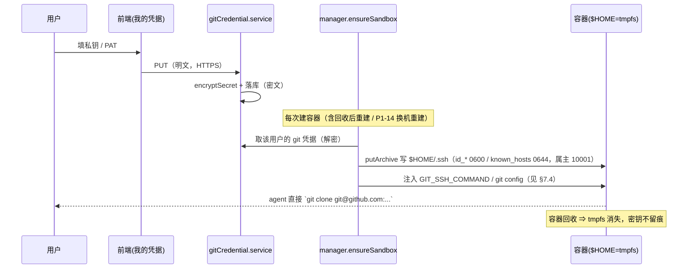
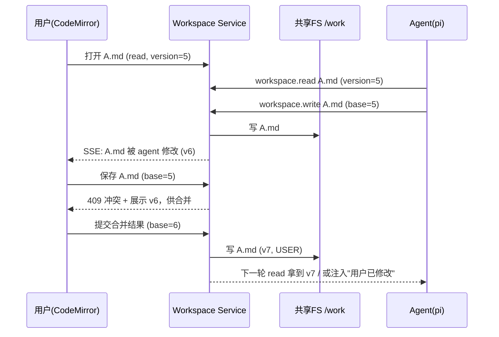
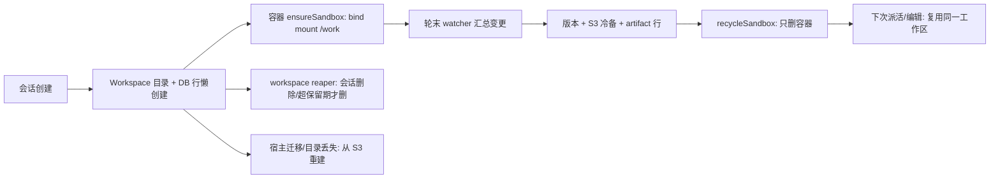

# Code 模式工作区（2026-10-08 立项）

> 上游基准：`01-整体需求与实施步骤.md`（TaskAgent / 产物交付 / 沙箱安全）、`02-后端设计.md`（§七 TaskAgent 编排、§4.8 产物、§十 安全）、`03-前端设计.md`（对话页与产物面板）、`子方案/沙箱与引擎集成.md`（容器生命周期、引擎桥、产物收集）。
> 定位：在现有 **TaskAgent + 沙箱 + 产物** 之上，新增「**人机共享、可实时编辑、可并发、可持久**」的工作区能力，即 **Code 模式**。
> 状态：**设计讨论稿**（2026-10-08 立项；**2026-10-10 完成一轮设计讨论定案**——部署形态、轮末变更集、保留期、多用户、产物口径、轮级撤销，见 §十三「已决」；**2026-10-12 补 git 凭据与出网口径**，见 §五 7、§十三「已决」8；**2026-10-14 补「出网范围 + 注册表专用代理」与「执行环境：运行时 + 依赖」**（⚠️ **不区分"执行档 / 默认档"：Code 模式即执行模式，非 Code 模式即不执行**），见 §五 7.5b、§五之二、§十三「已决」9/10 / 待决 13/14）。**2026-10-14 施工：P1-16a（平台级出网范围）已落地；P1-16b（注册表专用代理）经定案不做、关闭**（§五 7.5b）。**2026-10-14 施工：P1-17（执行环境：运行时 + 依赖，a+b+c 全量）已落地**（§五之二）。
> 本文**新增一个产品能力**（不是纯实现细则），因此它同时是 `01/02/03/06` 的**需求增量候选**；落地前需按需求变更流程回写上游四份文档。

---

## 一、问题与目标

### 1. 现状（代码事实，改之前先认清）

| 事实 | 位置 | 后果 |
|------|------|------|
| 工作区 = 容器内 `/work`，背后是具名卷 `doubulea-work-<conversationId>` | `backend/src/sandbox/spec.ts:64`、`:117` | 工作区与容器**同生共死** |
| 回收容器时**连具名卷一起删** | `backend/src/sandbox/manager.ts:487`（`recycleSandbox`，删容器 + 卷 + 账本 + 名额） | 用户停止 / 空闲 30min / 启动对账后，`/work` 文件消失 |
| 持久副本只有 `artifacts` 表 + S3，按轮 diff 生成 | `backend/src/sandbox/artifacts.ts`（`snapshotWorkFiles` / `diffWorkFiles` / `collectRoundArtifacts`） | 产物是**只读输出**，不是可编辑工作区 |
| 浏览器侧对文件**只读**：列表 / 下载 / 预览 / 删除 | `backend/src/routes/artifacts.ts` | 没有任何写入 / 编辑 / 文件树端点 |
| 唯一的「写进容器」通道 = `execInSandbox`（docker exec），**`stdin:false`、`cmd` 数组不过 shell** | `backend/src/sandbox/docker.ts:535` | 没有「写文件」原语；且它是后端内部工具，不是浏览器可用端点 |
| 引擎（pi）的 `read/write/edit/bash` **都跑在容器内**，后端拦不到逐次文件写 | 容器内 pi 原生工具 | 人改的与 agent 改的是**两份不同的字节** |
| 容器面向的后端代理 listener（token 鉴权） | `backend/src/sandbox/proxy.ts` + `listener.ts` | 它是给**容器**用的，不是给**浏览器**用的；新端点别挂这里 |
| 派活前只从 DB 重建一份「记忆文档」，产物由 agent **按需** `fetch` 回容器 | `backend/src/orchestrator/memoryDoc.ts` | 没有自动 rehydrate；agent 何时拉、拉不拉不受控 |

### 2. 要解决的问题（用户原话）

> 「我让 agent 帮我生成 xx 文件后，agent 在更改，我又在更改，此时 agent 又不知道我在更改。」

拆成三条：

1. **共享**：人和 agent 必须编辑**同一份**工作区，而不是容器私有拷贝 + 后端副本。
2. **感知**：agent 的读要能看到人的最新写入；人的编辑器要能实时看到 agent 的写入；**写不能静默覆盖**。
3. **持久**：工作区不能随容器回收而消失；跨容器重建、跨主机迁移都要能恢复。

### 3. 目标与不变量

| # | 不变量 | 含义 |
|---|--------|------|
| I1 | **单一真相** | 一个会话一份 canonical 工作区，人和 agent 读写同一份 |
| I2 | **无静默覆盖** | 任何写入都可版本化、可审计、可合并；冲突必须显式暴露 |
| I3 | **双向感知** | agent 读拿到最新；人能实时看到 agent 改动 |
| I4 | **容器可丢弃** | 容器死了工作区不丢，重建后自动挂回 |
| I5 | **归属唯一** | 会话 owner（及协作者）；越权一律 404 |

**非目标（本设计不解决）**：同一文件的多光标实时协同（CRDT）——见 §七 4，作为独立可选层，第一版不做。

---

## 二、核心结论（架构总览）

### 1. 一句话

> **工作区升格为后端拥有的一等资源（共享文件系统 + 版本索引 + 事件总线 + S3 冷备）；容器降级为「挂载它的一次性计算运行时」；agent 的文件 I/O 必须被中介，写入走版本校验。**

### 2. 三层职责

```
┌───────────────────────────────────────────────────────────────┐
│                     Workspace Service（后端）                  │
│  ┌────────────┐  ┌────────────┐  ┌────────────┐  ┌──────────┐ │
│  │ 版本索引/锁 │  │ 事件总线    │  │ 冷备/恢复  │  │ 冲突解析  │ │
│  │ (Postgres) │  │ (SSE/Redis)│  │   (S3)     │  │  diff3   │ │
│  └─────┬──────┘  └─────┬──────┘  └─────┬──────┘  └────┬─────┘ │
│        │               │               │              │       │
│  ┌─────▼───────────────▼───────────────▼──────────────▼─────┐ │
│  │          canonical 工作区目录（宿主 / 共享 FS）            │ │
│  └───────┬─────────────────────────────────────┬────────────┘ │
└──────────┼─────────────────────────────────────┼──────────────┘
           │ bind mount / 共享卷                  │ watcher（inotify）
     ┌─────▼──────┐                        ┌─────▼──────┐
     │ 容器 pi 引擎│                        │ 浏览器编辑器│
     │(workspace  │                        │(CodeMirror6)│
     │   工具)    │                        └────────────┘
     └────────────┘
```

| 层 | 角色 | 技术选型 |
|----|------|----------|
| **canonical 字节** | 实时真相、双方共享 | 宿主目录 bind mount 进容器 `/work`；多主机时换 NFS/CephFS 或 FUSE 工作区守护 |
| **版本 / 锁 / 事件** | 版本号、CAS、claim、审计 | Postgres（`workspace_files` / `_versions` / `_claims` / `_events`） |
| **冷备 / 交付** | 持久、跨主机恢复、产物导出 | S3（内容寻址，异步 debounce 同步） |

**为什么必须是共享文件系统**：只有双方看到**同一批字节**，"agent 的读"才天然看到人的最新写入，"人的编辑器"才能通过 watcher 实时看到 agent 的写入。DB / S3 都不解决这一点——它们是**元数据与冷备**，不是实时真相。

### 3. 与现状的关键改动清单

| # | 改动 | 现状 → 目标 |
|---|------|-------------|
| C1 | 工作区存储 | 具名卷（容器私有） → 宿主 bind mount（共享）+ DB 索引 + S3 冷备 |
| C2 | 回收语义 | `recycleSandbox` 连卷删 → **只删容器**，工作区保留（新增 workspace reaper 单独清理） |
| C3 | agent 文件工具 | pi 原生 read/write/edit → **workspace 扩展**（版本校验 + claim + 事件） |
| C4 | 浏览器端点 | 无 → 工作区树 / 读 / 写 / 增删改 / SSE 事件 |
| C5 | 并发 | 无（隐式 last-write-wins） → 四层防护（串行 + claim + CAS + 三方合并） |
| C6 | 前端 | 只读产物面板 → 可编辑工作区面板（CodeMirror 6） |
| C7 | 开关 | 无 → 会话级 `codeMode` 标志 |

---

## 三、数据模型（Prisma 草案）

> 命名约定沿用 `schema.prisma` 文件头：Prisma camelCase、DB snake_case（`@map` / `@@map`），日期一律 `Timestamptz(3)`，主键 `uuid(7)`。

```prisma
/// 工作区（一个会话一份）。rootPath 是宿主 canonical 目录。
model Workspace {
  conversationId String   @id @map("conversation_id") @db.Uuid
  rootPath       String   @map("root_path") @db.Text
  headVersion    BigInt   @default(0) @map("head_version")   // 工作区级单调修订号
  createdAt      DateTime @default(now()) @map("created_at") @db.Timestamptz(3)
  updatedAt      DateTime @updatedAt @map("updated_at") @db.Timestamptz(3)

  conversation Conversation @relation(fields: [conversationId], references: [id], onDelete: Cascade)

  @@map("workspaces")
}

/// 工作区文件索引（**只是索引**：字节在共享 FS 与 S3，不在这里）。
model WorkspaceFile {
  id             String    @id @default(uuid(7)) @db.Uuid
  conversationId String    @map("conversation_id") @db.Uuid
  path           String    @db.VarChar(1024)         // 归一化相对路径，锁死在 root 内
  size           BigInt
  mime           String    @db.VarChar(255)
  contentHash    String    @map("content_hash") @db.VarChar(64)  // sha256
  version        Int       @default(1)               // 每文件单调版本（CAS 的 base）
  s3Key          String?   @map("s3_key") @db.VarChar(512)      // 冷备对象（内容寻址）
  updatedBy      WorkspaceActor @map("updated_by")   // AGENT | USER | SYSTEM
  updatedById    String?   @map("updated_by_id") @db.VarChar(128) // userId / turnId
  deletedAt      DateTime? @map("deleted_at") @db.Timestamptz(3)  // 墓碑（软删）
  updatedAt      DateTime  @updatedAt @map("updated_at") @db.Timestamptz(3)

  versions WorkspaceFileVersion[]

  @@unique([conversationId, path])
  @@index([conversationId, path])
  @@map("workspace_files")
}

/// 文件历史（diff / 三方合并 / 审计）。
model WorkspaceFileVersion {
  id          String   @id @default(uuid(7)) @db.Uuid
  fileId      String   @map("file_id") @db.Uuid
  version     Int
  contentHash String   @map("content_hash") @db.VarChar(64)
  s3Key       String?  @map("s3_key") @db.VarChar(512)
  actor       WorkspaceActor
  actorId     String?  @map("actor_id") @db.VarChar(128)
  createdAt   DateTime @default(now()) @map("created_at") @db.Timestamptz(3)

  file WorkspaceFile @relation(fields: [fileId], references: [id], onDelete: Cascade)

  @@unique([fileId, version])
  @@map("workspace_file_versions")
}

/// 文件级软锁（悲观层）。TTL + 心跳，防死锁。
model WorkspaceClaim {
  id             String   @id @default(uuid(7)) @db.Uuid
  conversationId String   @map("conversation_id") @db.Uuid
  path           String   @db.VarChar(1024)
  holder         WorkspaceActor
  holderId       String   @map("holder_id") @db.VarChar(128)
  turnId         String?  @map("turn_id") @db.VarChar(128)  // agent 侧：哪个 turn 声明的
  expiresAt      DateTime @map("expires_at") @db.Timestamptz(3)
  heartbeatAt    DateTime @map("heartbeat_at") @db.Timestamptz(3)

  @@unique([conversationId, path, holder])
  @@index([conversationId, expiresAt])
  @@map("workspace_claims")
}

/// 事件日志（SSE 断线补发 + 审计；SSE 实时通道另走内存/Redis）。
model WorkspaceEvent {
  id             String   @id @default(uuid(7)) @db.Uuid
  conversationId String   @map("conversation_id") @db.Uuid
  type           String   @db.VarChar(48)   // created/updated/deleted/renamed/claim/release
  path           String   @db.VarChar(1024)
  version        Int?
  actor          WorkspaceActor
  actorId        String?  @map("actor_id") @db.VarChar(128)
  at             DateTime @default(now()) @map("at") @db.Timestamptz(3)

  @@index([conversationId, at])
  @@map("workspace_events")
}

enum WorkspaceActor {
  AGENT
  USER
  SYSTEM

  @@map("workspace_actor")
}
```

> **S3 键规则**：内容寻址 `workspaces/{conversationId}/blobs/{sha256}`。相同内容零新增对象；删除只删 DB 行，blob 由后台 GC（复用 `reapExpiredArtifacts` 那套 reaper 模式）。
> **为什么不在表里存内容**：canonical 字节在共享 FS（热路径），S3 只做冷备。DB 不承担文件内容，避免大字段与热点更新。

---

## 四、Workspace Service 设计

### 1. 存储与真相

- **热路径（实时真相）**：宿主目录 `WORKSPACE_ROOT/{conversationId}`，bind mount 到容器 `/work`。
- **索引（版本/锁/事件）**：Postgres。
- **冷备（持久）**：S3，内容寻址；宿主迁移或目录丢失时用它重建。
- **多主机形态（本批不做，只留接口）**：`rootPath` 指向共享存储（NFS / CephFS / EFS）；如无法共享 FS，退化为容器内 **FUSE 工作区守护**（把 Workspace Service 的 API 挂成 `/work`），代价是复杂度与容器特权。

**首发形态（2026-10-10 定案）：单机 bind mount。** 一台宿主跑 Workspace Service，`WORKSPACE_ROOT` 是本地 FS，`rootPath` 直接 bind 进容器 `/work`。

**多主机形态（2026-10-10 与 P1-14 对齐改口径）：走「路线 A —— 每机一实例 + 按会话路由」，不用共享 FS。** 即话题从第一次触达起**钉在一台机器**，工作区就在那台的本地盘上、bind 进那台起的容器；换机时从 S3 冷备重建（§九、§十六）。**共享 FS（NFS/CephFS）降级为备选**——只有在将来"取消按会话钉机器"时才需要。理由：P1-14 已否决"多机共享盘 / 远程 daemon"，改为粘性路由（见 `子方案/沙箱多机部署.md` §二、§三 5–6）；P1-9 必须与之同口径，否则会诱导施工去搭一套被弃用的共享存储。

**单机容量预算（量化口径，用于决定何时分片）：**

| 约束 | 决定因素 | 现实量级（估） |
|------|---------|--------------|
| 宿主磁盘 | 保留期（7 天）内活跃工作区数 × 平均体积 | 500GB / 200MB·仓库 ≈ 2500 个；/ 10MB·文本产物 ≈ 5 万个 |
| **inotify watch**（§四 3 watcher 按**目录**占 watch，不是按文件） | `fs.inotify.max_user_watches`（默认常见 8192～65536）、`fs.inotify.max_user_instances`（默认 128） | 65536 / 500 目录·仓库 ≈ **130 个并发被监听工作区**即顶到默认值 ⇒ 必须调 sysctl |
| 并发容器 | `SANDBOX_CONCURRENCY`（默认 10，`backend/src/config.ts`） | 已封顶，与工作区数无关 |
| S3 冷备上行 | 异步 debounce + 网络带宽 | 通常非瓶颈 |
| 宿主 FS / 属主 | 本地 FS + 目录属主 = `SANDBOX_AGENT_UID`（10001） | 部署细节，非容量 |

> **分片触发线**：宿主磁盘 70% 或 inotify watches 70% ⇒ 按 `conversationId` 哈希把新工作区落到第二台（"多主机接口"即此）。文本 / 产物为主时单机可容数千会话、**先撞 inotify**；完整代码仓库时单机约**几百～上千活跃工作区**、**磁盘先撞**。

### 2. 版本模型

| 概念 | 说明 |
|------|------|
| `version`（每文件） | 单调递增；每次成功写入 +1。读返回它，写携带 `baseVersion` 做 **CAS** |
| `contentHash`（sha256） | 判「内容是否真变」（mtime 不可靠）；冷备对象键 |
| `headVersion`（工作区级） | 事件序号 / 断线补发游标；只增 |
| tombstone | 删除写 `deletedAt`，保留 `version` 供合并判断"对方删了没" |

### 3. 事件总线

- watcher（chokidar / inotify）监听 `rootPath`，debounce 后产生 `WorkspaceEvent`。
- **agent 工具写**与**人 API 写**都会显式产生事件；watcher 负责捕获**未中介写**（如 `bash`）。
- 事件两条出口：① 会话级 SSE → 浏览器；② 落 `workspace_events` → 断线补发与审计。
- ⚠️ **多机下 watcher 是进程内的**（只装在持有该工作区的那台机器上）⇒ 工作区 SSE 事件流**必须粘性路由**到该实例（见 §十六 A）。

### 4. 冷备与恢复

- **同步时机**：人保存（debounce）+ 每轮 agent 结束批量 diff + 空闲兜底。
- **恢复时机**：容器/宿主重建且 `rootPath` 缺失时，从 S3 按最新版本重建目录。
- **GC**：孤儿 blob（无任何 `WorkspaceFile`/`_versions` 引用）与超保留期对象由 workspace reaper 清理。

> ✅ **S3 冷备 / 恢复已落地（2026-10-12，R3；施工记录见 `06` §五·补 P1-9 · P5 R3）**：对象键内容寻址 `workspaces/{conversationId}/blobs/{sha256}`（`backend/src/workspace/cold.ts`，键/恢复计划纯函数在 `coldModel.ts`）——**写后异步去抖上行**（热路径不等跨网络）+ 上行成功回填 `s3_key`；**恢复 = 目录缺失/为空时**从 S3 按每路径最新内容重建（**目录有内容时绝不触发**）；孤儿会话的冷备由 reaper **按前缀整体删**。⚠️ **未做**：**blob GC / 超保留期清理**（GC 只覆盖"孤儿会话"，**R5**）、artifact 集成（**R4**）。当前同步/恢复时机收敛为"**每次内容版本落盘后**去抖上行"（人保存与 agent 工具写都经此路径；watcher 捕获的 `/work` 外部改动也会 stash→上行），"空闲兜底"未单列。
>
> ✅ **R4（artifact 集成）与 R5（保留期清理）已落地（2026-10-12；施工记录见 `06` §五·补 P1-9 · P5 R4 / R5）**：R4 把收产物判据换成**本轮工作区变更集**（上条"未做"里的 artifact 集成已销）；R5 补上**"存活会话超期即整份收"**——`backend/src/workspace/reaper.ts#reapExpiredWorkspaceDirs`（判据 `workspaces.updated_at < now - ARTIFACT_RETENTION_DAYS`，已决 4）+ 周期清理器；到期 = **本地目录 + 本地历史字节 + S3 冷备 + DB 行一起收**（§八），**有活体容器则跳过**；同时补了**孤儿本地历史字节目录 GC**。⇒ §四 4「GC」一条（孤儿 blob + 超保留期对象）**已兑现**。

---

## 五、Agent 侧集成（成败关键）

### 1. 共享挂载（替代具名卷）

- 把 `spec.ts#workVolumeName` 的具名卷改为宿主 bind mount：`rootPath → 容器 /work`。
- `manager.ts#createSandbox` 的 `Mounts` 由 `Type:'volume'` 改为 `Type:'bind'`（或保持卷、但卷的宿主路径固定且不随回收删除）。
- **`recycleSandbox` 不再删工作区**（当前 `manager.ts:487-506` 会删卷）：改为只删容器 + 账本 + 名额；工作区由 workspace reaper 按「会话是否还在 / 保留期」清理。
- **uid 对齐**：bind mount 属主要匹配容器内非 root `agent`（`spec.ts` 镜像用非 root，`/home/agent` 特意挂了 tmpfs）。写文件与 `putArchive` 都要按该 uid。

### 2. 工具中介：pi workspace 扩展

pi 已有扩展机制（现成例证：`infra/sandbox/base/pi-agent/extensions/mcp-bridge/index.ts`）。新增一个 **workspace 扩展**，把文件工具换成版本感知版：

```
workspace.read(path)                         → { content, version }
workspace.write(path, content, baseVersion)  → CAS：索引版本 ≠ baseVersion ⇒ 返回错误给模型：
                                               "文件已被用户修改（vN），请重新读取后再写"
workspace.edit(path, edits[], baseVersion)   → CAS + 应用补丁（每处 oldText 对着原文件唯一匹配、两两不重叠；
                                               形状 = `[{ oldText, newText }]`，与 pin 0.87.1 内置 `edit` 同形，R8 复核后对齐）
```

- 工具写前向 Workspace Service 声明 **AGENT claim**（TTL + 心跳）。
- 工具写成功后 bump version、发事件、更新索引。
- ✅ **可行性已确认（2026-10-08，见 §十五）**：pi 官方示例 `examples/extensions/tool-override.ts` 明写 *"Extensions can register tools with the same name as built-in tools to replace them."* —— 用 `pi.registerTool({ name: 'read' | 'write' | 'edit', … })` 即可替换原生工具。另有两条同族能力可作补充：
  - `pi.on('tool_call', …)` 可**改写入参或 `{ block: true, reason }` 拦截**（可不替换工具而只做版本闸门）；
  - `withFileMutationQueue()` 是官方给"文件修改类工具"的 **read-modify-write 串行化**帮手，直接服务于 §七 的并发协议。

### 3. `bash` 兜底（无法中介时的安全网）

pi 的 `bash` 能绕过工具中介直接写文件：

- watcher 捕获「无对应工具写」的 FS 变化 ⇒ 以 `AGENT` 身份 bump version + 发事件 + 标记 `unmediated`。
- **轮末对账**：对照 turn 起点快照，找出「人改过 **且** agent 也改过」的文件 ⇒ 进冲突审阅（§七 3）。
- **终极形态**：容器内 `/work` 用 **FUSE** 承载，所有写（含 bash）都过版本层；代价是容器需 fuse 设备 / 特权，视部署安全策略取舍。

### 4. prompt / 记忆口径

`memoryDoc.ts` 与派活 prompt 明确写：

- 「`/work` 是与你的人类用户**共享**的工作区，文件可能已被用户修改。」
- 「写任何文件前先 `read`；若返回『已被修改』，重新读取后再改。」
- 记忆文档附最近工作区变更事件摘要（谁改了什么）。

### 5. 中途感知与注入（主动 awareness）

- **被动（必做，且已足够收敛）**：读拿最新 + 写 CAS 失败回喂模型。这就是「agent 知道你在改」的机制——**不是它主动轮询，而是它的写被挡下并被告知**。
- **主动（可选，机制已确认可用）**：watcher 检测到 `USER` 写且该轮 agent 正在跑 ⇒ 用 pi RPC 的 **`steer`** 命令注入 `"用户修改了 path（vN），请重新读取后再继续"`。
  - ✅ **通道已确认（2026-10-08，见 §十五）**：pi RPC 有 `steer` 命令，语义是「agent 运行中排队一条消息，**在它当前这一轮的工具调用执行完之后、下一次 LLM 调用之前投递**」；`prompt` 也支持 `streamingBehavior: "steer" | "followUp"`。投递粒度是**助手 turn 边界**（不是逐工具即时），这正是需要的粒度。
  - ⚠️ 与现有桥的关系：`bridge.ts` 目前只发一次 `prompt` + 等 `agent_settled`；要加 `steer` 需在桥上开一条「运行中发命令」的通道（`abort` 已经是同类命令）。仍保留 `clear_queue` / `abort` 作为降级手段。
  - ✅ **已落地（2026-10-12，R1；施工记录见 `06` §五·补 P1-9 · P4 R1）**：`bridge#steer` 通道 + `chat.steer:{id}` **列表**信号（无消费方不消费）+ `ChatProducerInput#onSteer` + TaskAgent **两源**（人主动插话 + 工作区 `USER` 写主动感知）+ `POST /api/conversations/:id/steer` + 前端「边跑边插话」入口。命令形状已在 pin `0.87.1` 上**运行时原型复核**（见 §十五）。

### 6. 产物口径：产物 = 工作区变更集视图（clone 不算产物，2026-10-10 定案）

- **语义**：产物**不是**目录树快照，而是"**人认可的交付 / 变更子集**"（回归 §二 三层职责：工作区是真相，产物是交付视图）。**`git clone` 拉下来的整棵树属「工作区内容」，不算产物**。
- **现状会误伤（⚠️ 以下为 P1-9 · R4 之前的判据；R4 已改为「产物 = 工作区变更集视图」，见本节末 ✅）**：产物判据是**每轮 diff**（`artifacts.ts#diffWorkFiles`）——派活前拍基线、收尾对照取"本轮新出现或修改的"。clone 发生在某一轮里 ⇒ 整棵树都是"本轮新出现" ⇒ 全进候选；仅靠 `.` 隐藏规则（吃掉 `.git/`）+ `ARTIFACT_EXCLUDED_DIRS=['node_modules']` + 单文件 50MB + 单轮 200 上限截断兜底（`artifacts.ts`）。**那是上限截断的巧合，不是语义**。
- **落地口径**：clone / 初始化应在**基线之前**完成（作为 setup 步），使本轮 diff 天然不含它；若允许**运行中** `git clone`，须区分"本轮初始填充"与"其后改动"，或改为 agent **显式声明交付物**（产物 = 被声明的子集，而非"所有变化"）。
- **忽略规则扩容**：`.git`（隐藏已覆盖）/ `node_modules`（已列）之外，补 `dist/ build/ target/ *.lock` 等生成物（与 §十三 待决 10 同条）。

> ✅ **已落地（2026-10-12，R4；施工记录见 `06` §五·补 P1-9 · P5 R4）**：收产物判据由"每轮 `/work` 快照 diff（size+mtime）"改为**本轮工作区变更集**（`shared#foldWorkspaceEvents` 折叠窗口 `[轮次起点, now]` 内的 `workspace_events`）。落点：`backend/src/sandbox/artifactChanges.ts`（**新增**纯函数：`artifactChangePaths` = 只认内容事件、丢弃 `deleted`、`renamed` 取新路径 → `filterArtifactPaths` 做隐藏段 / `ARTIFACT_EXCLUDED_DIRS` / 截断 / 排序）+ `sandbox/artifacts.ts#collectRoundArtifacts`（入参 `{conversationId, changes}`，字节改从**宿主工作区 FS** 读，先传对象再建行）+ `orchestrator/taskAgent.ts`（轮次起点**前**先 `reconcileWorkspaceOnce` 落定记忆文档/附件等 setup 写 ⇒ 落在窗口之外，收产物**前**再对账补进未中介写）。**快照基线与 `docker exec` 扫容器退役**。⚠️ 忽略规则扩容（`dist/ build/ target/ *.lock`）**未做**（仍只有 `.` 隐藏 + `node_modules`）。

> ✅ **已落地（2026-10-14，#3 · git 感知产物过滤）**：R4 的"工作区变更集"不认识 git ⇒ 轮内 `git clone` / `git pull` 会把整棵树当成本轮新增（实测命中单轮 200 上限、全进产物面板）。新增 `backend/src/sandbox/gitArtifacts.ts#filterGitCleanPaths`：用**宿主 git** 判"git 仓库里**干净的 tracked 文件**"（`git ls-files` ∩ `git status --porcelain` 无输出）并从候选里剔除 —— clone/pull 拉下来、没再动过的**不算产物**；被 agent 改过 / 新建的照常收。判据在 `collectRoundArtifacts` 里排在**截断之前**（否则 clone 的 200 个文件会先占满上限）。⚠️ **保守失败**：git 不可用 / 命令报错 ⇒ 不剔除（退回现状）。自证 `pnpm workspace:regression`（L4/L5）。忽略规则扩容（`dist/ build/ target/ *.lock`）仍**未做**。

### 7. git 凭据：平台配置 + 容器内注入（2026-10-12 新增）

> 背景：§十三 已决 7 把 git 定为「**agent 的普通工具**」（clone/commit/branch 都由 agent 在 `bash` 里跑，后端不做 git-aware 端点）。但"**agent 拿什么身份 clone 私有仓库**"是那条定案**没回答**的问题 —— 本节补上：凭据从哪来、放哪、怎么消失。

**一句话**：凭据按用户**加密存平台**（复用 MCP 凭据那套 `infra/crypto.ts`），**每次 `ensureSandbox` 时解密注入到容器 tmpfs `$HOME/.ssh` / env**，随容器销毁而消失；**绝不写进 `/work`**。

> ✅ **已落地（2026-10-12，P1-9 · R11；施工记录见 `06` §五·补 P1-9 · R11 落地记录）**：契约 `shared/src/gitCredential.ts` + 迁移 `20261012130000_git_credentials`（`git_credentials`）+ `services/gitCredential.service.ts`（AAD = `${userId}:${kind}:${label}`，`hasValue` 出口，条数闸门 `GIT_CREDENTIAL_MAX_PER_USER`）+ `routes/gitCredentials.ts` 四条（仅本人）+ `sandbox/gitCredential.ts`（`gitCredentialEnv` / `gitCredentialFiles`）+ `sandbox/tar.ts`（手写 ustar）+ `docker.ts#putArchive` + `manager.ts`（派活注入 env 与 tmpfs `$HOME`）+ `config.SANDBOX_EGRESS_ALLOW_HOSTS=*` + `egress-up.sh` + 前端 `/settings/git-credentials`。⚠️ **出网强制点在 egress 代理侧**（`egress-up.sh` 读 `.env`）；HTTPS(443) 走代理天然生效、SSH(22) 不经 HTTP 代理（本期取"直接放行"口径）；**"平台配置 + 实时注入"仍为后置演进项**（§十三 待决 12）。

> ✅ **已落地（2026-10-14，#4 · 拉取失败可诊断 + SSH 提醒）**：实测日志显示 agent 先走 HTTPS、平台只配了 SSH ⇒ 凭据 404、helper **静默退出**、git 只报笼统的认证失败。三处补提示：① 容器 helper `infra/sandbox/toolkit/git-credential-doubulea.mjs` 在 404 时往 **stderr** 打一句**不含密钥**的提示（"没有为 `<host>` 配置 HTTPS 凭据：配 token 或改用 SSH"）——stderr 不是凭据通道，不违反"不吐凭据"；② 记忆文档新增「Git 使用提示」段（优先 SSH）；③ 前端「设置 → Git 凭据」页 lead 明确推荐 SSH、说明 HTTPS 按 host 精确匹配。⚠️ 仍未做：SSH(22) 经代理出口（依赖 §十三 待决）。

#### 7.1 三条铁律

| # | 铁律 | 理由 |
|---|------|------|
| G1 | **凭据只存后端、永不下发前端** | 与 MCP 凭据同族（`services/mcpCredential.service.ts` 文件头 ①②）：出参只有 `hasValue`，连掩码都不给（git 凭据是"每个人自己的令牌"，下发掩码收益为零） |
| G2 | **注入目标只能是 tmpfs，不能是 `/work`** | `/work` 是共享 FS 且 **`.git` 进 S3 冷备**（§十三 已决 7）⇒ 写进工作区的密钥会进冷备、进产物候选、被人和 agent 同时看见。`$HOME`（=`/home/agent`）是 **tmpfs**（`spec.ts:557`，容器回收即消失），是唯一正确的落点 |
| G3 | **明文只在两处出现**：解密服务 + `buildSandboxContainerSpec` | 与 `sandboxLlmEnv` / `sandboxProxyEnv` 同一条纪律（`02` §九「密钥零下发」）：不许打日志、不许落库、不许拼进错误消息（`LOG_REDACT_PATHS` 已含 `*_enc`） |

#### 7.2 存储（Prisma 草案）

复用 `infra/crypto.ts` 的 `encryptSecret` / `decryptSecret`（AES-256-GCM，主密钥只从 `CREDENTIAL_MASTER_KEY` env 来），与 `McpCredential` 同族但**不绑 server** —— git 凭据是**用户级**资源：

```prisma
/// 用户级 git 凭据（P1-9）。一行 = 一个用户的一条凭据（一把私钥 / 一个 PAT）。
model GitCredential {
  id        String            @id @default(uuid(7)) @db.Uuid
  userId    String            @map("user_id") @db.Uuid
  kind      GitCredentialKind
  label     String            @db.VarChar(128)   // 人可读名，如 "github-work"
  host      String?           @db.VarChar(255)   // 限定用途主机（github.com）；空 = 不限
  /// 加密载荷 `{ ... }`（AAD = userId + kind + label，见下）。
  /// ⚠️ 列名带 `_enc` 是刻意的（与 `mcp_credentials.values_enc` 同纪律）：
  ///    让"这一列是密文"在**库结构层面**就看得出来。
  secretEnc Json              @default("{}") @map("secret_enc") @db.JsonB
  createdAt DateTime          @default(now()) @map("created_at") @db.Timestamptz(3)
  updatedAt DateTime          @updatedAt @map("updated_at") @db.Timestamptz(3)

  user User @relation(fields: [userId], references: [id], onDelete: Cascade)

  @@unique([userId, label])
  @@index([userId])
  @@map("git_credentials")
}

enum GitCredentialKind {
  SSH_KEY       // { privateKey, knownHosts? }
  HTTPS_TOKEN   // { token, username? }
  @@map("git_credential_kind")
}
```

- **值有进无出**：`secretEnc` 只在新增的 `gitCredential.service.ts` 读写；出参只有 `{ id, label, kind, host, hasValue }`。
- **权限收窄全在 `user_id`**（同 MCP 凭据，ADMIN 无后门）；越权一律 404。
- **清空 = 删行**（不存空密文 —— 结构合法的空密文会让"已配置"永远为真，理由同 `mcpCredential.service.ts` 文件头 ④）。
- **AAD 绑定**：`decryptSecret(payload, `${userId}:${kind}:${label}`)` —— 解不开就当"没有值"降级、**绝不 500**（坑同 MCP 凭据 ③）。

#### 7.3 注入时序（每次执行）



- **落盘原语**：§十四 已把「`execInSandbox` 加 stdin / `putArchive`」列为待加原语（`docker.ts:535`），本节直接是它的**第一个消费方** —— **不另造写文件通道**。
- **注入时机与 `sandboxLlmEnv` / `sandboxProxyEnv` 同处**（`manager.ts` 组装 `buildSandboxContainerSpec` 时）；**每次建容器都注**，不做"建一次留一辈子"。
- **uid 对齐**：写进 tmpfs 的文件属主必须是 `SANDBOX_AGENT_UID`（10001），否则以非 root agent 跑起来的容器读不到自己的私钥（`spec.ts:75/82`，与 §五 1 uid 对齐同条）。

#### 7.4 让 agent 无感：两种凭据的接法

| 类型 | 注入物 | 接法 |
|------|--------|------|
| **SSH_KEY** | `$HOME/.ssh/id_ed25519`(0600) + `known_hosts`(0644) | env `GIT_SSH_COMMAND="ssh -i $HOME/.ssh/id_ed25519 -o IdentitiesOnly=yes -o StrictHostKeyChecking=accept-new"`（或写入 `$HOME/.gitconfig` 的 `core.sshCommand`）。⚠️ **不用 `--global`、不写工作区** |
| **HTTPS_TOKEN** | **不落盘**（最干净） | env `GIT_CONFIG_COUNT` + `credential.helper` 或 `http.<host>.extraheader=Authorization: Basic …`；token 只在 env，与 `sandboxLlmEnv` 的明文 Key 同款 |

- `accept-new` 而非 `StrictHostKeyChecking=no`：首次可连、之后锁定，避免中间人；需严格 pin 时用落盘的 `known_hosts`。
- 用户配了多条凭据时**按 `host` 匹配**（`github.com` 用 A、`gitlab.internal` 用 B）；无匹配则不加 `GIT_SSH_COMMAND`（退回系统默认，行为不变）。
- **优先 HTTPS_TOKEN**：token 不落盘、可细粒度 scope、易轮换；SSH 仅在必要时用（私钥落 tmpfs 仍比 token 敏感）。

> ⚠️ **2026-10-13 修订：以上"建容器时注入"的口径**作废**，改成「按需拉取」**（R11 修订）。
>   · **为什么**：容器 `ReadonlyRootfs: true` ⇒ Docker 归档 API（`putArchive` / `docker cp`）在只读 rootfs 容器上**直接 400**（`container rootfs is marked read-only`），连 tmpfs 目标也拒 ⇒ SSH 私钥**从来落不了盘**（`$HOME/.ssh` 恒空、`GIT_SSH_COMMAND -i …` 指向不存在的私钥）；HTTPS token 只能建容器时定死、改凭据要重建容器。
>   · **现在**：凭据**不进容器**（不落盘、不进 env）。容器里只有两个 toolkit 预烘焙的**无状态 helper**：`/opt/sandbox-git/git-credential-doubulea.mjs`（`credential.helper`，`get` 时回调取 HTTPS 凭据）与 `/opt/sandbox-git/git-ssh-doubulea.mjs`（`GIT_SSH_COMMAND`，把 SSH 私钥按需写到**可写的 `/tmp`**（0600）再 `exec ssh -i`）。二者经出口② `POST /api/sandbox/git/credential`（令牌即会话身份）由后端解密后回给这一只容器。
>   · **收益**：绕开 RO rootfs；改凭据**不用重建容器**（helper 每次现取）；平台只在真正用到时解密，明文不驻留容器。
>   · `sandbox/spec.ts#SANDBOX_GIT_CREDENTIAL_PATH` + `sandbox/gitProxy.ts` 是端点本体；`sandbox/gitCredential.ts` 只剩 `gitCredentialHelperEnv`（**不含秘密**）与 `selectGitCredential`（按 `(protocol,host)` 挑）。`sandbox/tar.ts` / `docker.ts#putArchive` 保留为通用原语但不再用于 git 凭据。

#### 7.5 出网（2026-10-12 用户定案：先默认放行）

现状是**默认拒绝**：容器在 internal bridge 上**没有到公网的路由**，出公网只可能经 egress 代理，而代理只放行模型池 baseURL（`network.ts:4/15`、`config.ts:490`、`spec.ts:222`）。git clone 到 github/gitlab 因此走不通。

- **本期口径**：**出网默认放行**（git 主机 + 所需端口 22/443 过白名单）。理由：Code 模式的可用性优先，先让 clone/commit 跑起来，安全收敛后置 —— 与 §五 6「clone 属常规操作、不是特例」同调。
- ⚠️ **SSH(22) 与 HTTPS(443) 的治理路径不同**：HTTPS 走 egress 代理（`HTTP(S)_PROXY`）⇒ 白名单 / 实时策略可落在**代理侧**；**SSH 不经 HTTP 代理** ⇒ 要么直接给容器放行 22、要么走 `ProxyCommand` / 跳板。这条差异决定 §7.6 的实时配置能做到哪一步。
- **后续（演进项，已记入 §十三 待决 12）**：把出网收敛成**平台上的一个配置项**（按用户 / 会话 / 主机），并支持**实时注入** —— 改配置**不重建容器**即生效。
  - 可行路径：**HTTPS 面走现有 egress 代理**（策略在代理侧，改配置天然实时，无需动容器）；**SSH 面**需给容器加一条**可热更新的出口**（跳板 `ProxyCommand` / 带策略的 SSH 代理），或在"实时"与"SSH"之间取舍（例如实时策略只管 HTTPS，SSH 仍走建容器时的静态放行）。

> ✅ **已落地（2026-10-13）—— 出网平台化 + 实时注入（HTTPS 面）**：平台表 `egress_policy`（**单例**，两张表 `allow_hosts` / `deny_hosts`）→ `GET/PUT /api/admin/egress-policy`（**仅 ADMIN**）→ 前端 `/admin/egress` 页 → `egress-up.sh --watch` 轮询落成**策略文件**（`policy.json`，JSON `{allow,deny}`）→ egress 代理（`infra/scripts/egress-proxy.mjs`）每 5s 热更新 ⇒ **改配置不重建容器**。
>   · **语义**（`mode` 由两张表**推导**、不单独存；`deny` 优先）：两张表都空 ⇒ **全放行**（默认）；只配白名单 ⇒ 只放行白名单；只配黑名单 ⇒ 除黑名单外全放行；都有 ⇒ 命中黑名单即拒、其余看白名单。**模型池主机在白名单非空时并集注入**（"模型默认放行"）。
>   · **规则形状**：`host` / `host:port` / `*.host`；契约与纯判据在 `shared/src/egressPolicy.ts`（回归 `pnpm egress:regression`）。
>   · **审计口子**：代理每次决策（ALLOW/DENY）发一条结构化 JSONL 到 `EGRESS_AUDIT_FILE`（省 = 只走 stdout），留给后续接日志平台做审计。
>   · 顺带补 `toolkit` 镜像装了 `openssh-client`（`TOOLKIT_LAYER_VERSION → 7`），让 SSH 型凭据在容器里有 `ssh` 可用。
>   · ⚠️ **仍适用 7.5 的路径差异**：本批的**实时策略只覆盖 HTTPS 面**（走 HTTP 代理）；**SSH(22) 不经 HTTP 代理**，其出口仍是静态放行口径 —— 若要 SSH 也实时收敛，仍需 7.5 所述的可热更新出口。
>   · ⚠️ **取证边界**：策略引擎已用独立冒烟（白名单/黑名单/全放行 + 热更新 + 审计 JSONL）+ `egress:regression`（9）钉住；**平台→代理**的端到端（起 `--watch` → 改库 → 代理热更新 → 真容器出网）留给用户真跑。

#### 7.5b 出网范围 + 注册表专用代理（2026-10-14 定案；**P1-16a 已落地，P1-16b 经决定不做、关闭**）

> ⚠️ **2026-10-14 用户定案（两处）**：
>   ① **不区分"执行档 / 默认档"**：**Code 模式本身即执行模式**（要跑代码、要装依赖）；**不想执行的用户直接用非 Code 模式**。本节与 §五之二 是 **Code 模式内部**的能力，**不是叠在 `codeMode` 之上的第二层档位** —— "能否执行"由 `codeMode` 一个开关决定，本节只定"执行时的出网范围"。
>   ② **出网范围是平台级、不是会话级**：用户原话"**不要放在会话里配，放到出网策略里配，默认全放行**" ⇒ 范围配在 `/admin/egress`（与既有黑白名单**并列补充**），**不在会话设置里配**。（初版曾按 per-conversation 设计并实现，已按此定案移除。）

> 背景：`7.5` 落地的「出网平台化」是**平台级单例**策略、且**只按 `host` 匹配**。两个缺口在"让 agent 真能跑项目"这件事上暴露：
>   ① **没有"出网范围"的档位** —— 今天只有全放行 / 全白名单 / 全黑名单三选一，没有一个"整机级"的粗档（如"只放行模型"或"模型 + 取包"）。
>   ② **出网"能干什么"没有粒度** —— 放行一个注册表 host = 对该 host 的**整条隧道**放行（HTTPS 走 `CONNECT`，代理**看不见** path/method），`npm publish`、往该 host 任意 `POST` 都通；审计只有 `CONNECT host:443`，回答不了"下了哪个包"。
> ⇒ 本节定两个增量：**A 平台级出网范围**、**B 注册表专用代理（包级出口）**。

**A. 平台级出网范围（`egress_policy.scope`）**

- **定位**：给出网策略补一个**粗粒度范围**，决定**基线放行集**；与既有黑白名单**并列补充**（范围给基线、白名单再加零散主机、黑名单永远硬拒）。⚠️ **默认值 = `ALL`（全放行）** —— 本增量是"给运维一个整机级收窄手段"，**不改现状语义**（否则会打断现有 Code 模式 git clone）。
- **三档**（`egress_policy` 加一列 `scope`）：`ALL`（默认，全放行）/ `NONE`（只放行模型池）/ `REGISTRY`（模型池 + 注册表 + git 主机）。⚠️ 这是**出网范围**，不是"能力档"——**能否执行由 `codeMode` 决定**。
- **解析**（`shared#resolveEgressPolicy`，纯函数）：`ALL`⇒`allow=['*']`；`NONE`⇒`allow=模型池 ∪ 白名单`；`REGISTRY`⇒`allow=模型池 ∪ 注册表 ∪ git ∪ 白名单`；`deny=黑名单`。**模型池主机恒并入**收窄档（否则容器连模型都调不通）；收窄档若放行集为空 ⇒ `deny=['*']`（拒绝一切，别落进"两张空表=全放行"）。
- **落地通道**：`egress-up.sh` 读 `egress_policy.scope` → 解析成代理要的 `{allow,deny}` 两张表（**代理侧不认识 scope、也不做 per-conversation**）⇒ 沿用既有 5s 热更新，**不动出网协议语义**。
- **UI**：平台出网策略页（`/admin/egress`）加一档下拉；默认 `ALL`。**会话设置不再有它**。

**B. 注册表专用代理（包级出口）—— ❌ 经决定不做、关闭（2026-10-14）**

> ❌ **2026-10-14 用户定案：P1-16b 不做**（原话"不做，主机级别的就可以了"）。理由：要上它得**多一个常驻镜像服务**（Verdaccio / devpi）+ 一套容器 `.npmrc`/`pip.conf` 注入与包级审计，而"按包审计 / 禁止 publish"这条能力**当前用不上**。⇒ **`REGISTRY` 档以主机级放行为最终形态**（模型池 ∪ 注册表 host ∪ git host），**不做**包级收窄与包级审计。下面 B 段与分批表的 b 行**保留为设计留档**（若将来要做，从这里接）。

- **目标**：把"连上某 host 就随便用"收窄成"**只能下载包**"，并让审计记到**包名 + 版本**。
- ★ **前提（必须二选一，决定成败）**：HTTPS 的 `CONNECT` 隧道对代理**不透明** ⇒ 要"看懂包管理流量"只有两条路：
  - **B2 网内注册表镜像（首选）**：沙箱网内起镜像（npm = Verdaccio / pypi = devpi 等），容器经 `.npmrc` / `pip.conf` 指向它（**明文 HTTP 到镜像**），镜像自带上游白名单、只放行"取元数据 / 下 tarball"、**拒绝 publish / 写**、并逐条记包名版本；代理只需放行"镜像容器 → 上游注册表"。**代价：多 1 个镜像 + 1 个常驻容器**（官方镜像，不用自建）。
  - **B1 TLS 终止（备选）**：代理用平台 CA 签发证书（容器信任该 CA）⇒ 可见 path / method，能按"下载路径"放行、拒写。代价：CA 管理 + 容器装 CA（RO rootfs / agent-dir）+ 信任 / 隐私决策（**不加容器**）。
- **审计**：`{registry, package, version, decision}`。
- ⚠️ **不做 B 的话**（= 当前定案），A 的"注册表范围"退化成 host 级放行 —— 有整机级范围、无包级收窄与包级审计。

**分批**（施工见 `06` §五·补 **P1-16**）：

| 子批 | 内容 | 依赖 |
|------|------|------|
| **P1-16a** ✅ | 平台级出网范围：`egress_policy.scope` + 范围解析 + `/admin/egress` 下拉 + `egress-up.sh` 解析 | 无（**不动出网协议语义**） |
| **P1-16b** ❌ | 注册表专用代理：网内镜像（首选）或 TLS 终止 + 包级审计 | —— **经决定不做、关闭（2026-10-14）**；`REGISTRY` 以主机级放行为最终形态 |

> ✅ **P1-16a 已落地（2026-10-14，**平台级**）**：`egress_policy.scope`（枚举 `ALL`/`NONE`/`REGISTRY`，默认 `ALL`）+
>   `resolveEgressPolicy`（范围 + 两张表 + 模型池 → 解析后两张表，收窄档空放行项兜 `deny=['*']`）+
>   `egress-up.sh` 读 scope 并解析成代理的 `{allow,deny}` + `/admin/egress` 出网范围下拉。
>   ⚠️ **改为平台级时移除了**：`Conversation.egressScope` 列 / `POST /:id/egress-scope` / 前端会话下拉 /
>   per-container token 身份 / 策略文件 `tokens`·`conversations` / 代理的 `Proxy-Authorization` 解析。
>   施工/自证见 `06` §五·补 P1-16 的落地注。
> ❌ **P1-16b 关闭（2026-10-14）**：`REGISTRY` 档 = **主机级**放行（模型池 ∪ 注册表 host ∪ git host），这是**最终形态**，不做包级收窄 / 包级审计。

#### 7.6 落到分期（§十二）

| 阶段 | 增量 |
|------|------|
| **P2b**（§十二） | 凭据存储 + 注入（`$HOME/.ssh` / env）+ 出网默认放行；验收：配一把只读 deploy key，agent 能 `git clone` 私有仓库，且容器回收后 `$HOME` 里无密钥残留 |
| P3 | 前端「我的凭据」页复用 MCP 凭据交互（`pages/mcp/McpCredentialsPage.tsx` 的按项配置 + 未配置置顶） |
| 后置 | 出网平台化 + 实时注入（§十三 待决 12）。本节全部事项已登记为 `06` §五·补 P1-9 剩余清单 **R11** |

---

## 五之二、执行环境：运行时与依赖（2026-10-14 定案，✅ 已落地 2026-10-14 · P1-17）

> 背景：**Code 模式即执行模式**（**不区分"执行档 / 默认档"**；不想执行的用户直接用非 Code 模式，见 §五 7.5b 的注）。"让 agent 跑起来验证"（`npm test` / `pytest` / `go build`）需要**语言运行时 + 项目依赖**，而依赖是**任意的、无法预先枚举**（2026-10-14 用户定案：**依赖不能白名单**）。本节定"环境从哪来"，是 §五 7.5b「注册表专用代理」的**消费方**。
>
> ★ **2026-10-15 修订（用户定案）**：**运行时版本也不再枚举** —— UI 只列**语言**，用户勾选后**填版本号**（如 Java 21 / Python 3.12 / Go 1.22）；后端按 `语言=版本` 组合按需构建，各语言的任意版本由 `infra/sandbox/runtime/install-*-version.sh` 装（见 §十一参数表的 `Conversation.runtime` 行与 §十二 P8 的注）。⚠️ 这**不违反** §2 的"运行时是有限集合 ⇒ 可预烘焙"：**语言**仍是白名单（有限），放开的只是每门语言的**版本号**；版本装法固定、镜像按需构建、构建失败会在任务里回显。

### 1. 两条不能混的事：运行时 vs 依赖

- **运行时**（node / python / go …）是**有限集合** ⇒ **可以预烘焙**（小、可控、可白名单）。
- **依赖**（`package.json` / `requirements.txt` / `go.mod` …）是**无限集合** ⇒ **不预烘焙**，**运行期**从注册表拉（§五 7.5b · B）。
- ⇒ 环境 = **多语言运行时基础层**（有限、预烘焙）+ **运行期装依赖**（无限、经注册表代理）。
- ⚠️ 澄清一处易混：用户否掉的是**依赖白名单**（无限）；**运行时镜像目录是白名单且成立**（有限）——两者不冲突。

### 2. 运行时基础层（两条候选）

- **现状**：base 层有 node（pi 用）；toolkit 层有 `python3 + numpy/pandas/openpyxl + jq + git + rg`。**没有** go / java / rust，也**没有** npm 安装能力。
- **A 单一多语言基础层**：在 toolkit 层加 node + python + go（可选 java/rust），**只装运行时、不装依赖**。镜像 +几百 MB~1GB，**所有人共用一份**。
- **B 按会话选运行时镜像（小目录）**：`runtime` 枚举（`none` / `node` / `python` / `go` / …），每栈一份镜像，`ensureSandbox` 时选。⚠️ 这是**运行时白名单**（有限、可控）。
- ⚠️ **推荐 B**（按栈拆、同时只持有一份、不随栈爆炸）；A 作"先一份凑合"的退化。二者都**不预烘焙依赖**。

### 3. 运行期装依赖

- 容器里 `npm ci` / `pip install -r` 从**注册表代理**（§五 7.5b · B）拉，落到**工作区**（`/work/node_modules` 等）。
- ⚠️ **与工作区配额 / 冷备的冲突（必解）**：`node_modules` 动辄几百 MB，会顶掉 `WORKSPACE_MAX_TOTAL_MB`（512MB）；且**不该进 S3 冷备**（可再生、巨大）。
  - ⇒ 依赖目录按 **`.gitignore` 风格排除**：① **不进产物**（`ARTIFACT_EXCLUDED_DIRS` 已含 `node_modules`，需扩 `venv` / `.venv` / `target` / `dist` 等）；② **不进冷备**（否则换机重建时白备几百 MB）；③ 配额口径区分"**源码字节**"与"**依赖字节**"（§十三 待决 7 的延伸）。
- ⚠️ **依赖安装只在 Code 模式**：非 Code 模式没有工作区执行（用户不想执行就用非 Code 模式）；Code 会话的出网范围由 §五 7.5b · A 的 `egressScope` 决定（`NONE` 则装不了，也不会误触发）。

### 4. 凭据隔离（★ 与"跑任意代码"直接冲突）

- 一旦允许装依赖 + 跑项目代码，**依赖的 postinstall / 项目脚本会执行**，而 git 凭据 helper（§五 7.4 的"按需拉取"）**在同一容器里** ⇒ 恶意脚本可回调 `POST /api/sandbox/git/credential` 取密钥并外带。
- 候选：
  - **a 分相**：`clone`（要凭据）与 `run`（跑不可信代码）**分两次容器生命周期 / 两个容器**；跑代码时不挂凭据 helper、后端拒绝该容器的凭据请求；
  - **b 最小权限**：凭据只给**只读 deploy key**（无 push 权限），降低"被偷"的损失；
  - **c 接受 + 审计**：依赖安装 / 执行阶段的出网与凭据调用**全量审计**（§五 7.5b 的 `conversationId` 归因）。
- ⚠️ **默认取 a + b**（分相 + 只读凭据）；c 是兜底。

### 5. 分批

| 子批 | 内容 | 依赖 |
|------|------|------|
| **P1-17a** | 运行时基础层（多语言、只装运行时）+ `runtime` 会话选择 | 无 |
| **P1-17b** | 运行期装依赖 + 依赖目录排除（产物 / 冷备 / 配额）+ `.npmrc` / `pip.conf` 指向镜像 | **P1-16b 已关闭（不做）** ⇒ 依赖走**主机级出网**（公共源 / 自配 `SANDBOX_EGRESS_REGISTRY_HOSTS`），**不指向网内镜像** |
| **P1-17c** | 凭据隔离（分相 / 只读凭据 / 审计） | **P1-16a**（审计）+ P1-17b |

> 施工见 `06` §五·补 **P1-17**。

---

## 六、人侧集成

### 1. 工作区 API（挂在**公网会话路由**，不是容器 listener）

| 方法 | 路径 | 作用 |
|------|------|------|
| GET | `/api/conversations/:id/workspace` | 文件树（DB 索引查询，**不** ListObjects） |
| GET | `/api/conversations/:id/workspace/file?path=` | 读字节 + `version`（文本 `text/plain`、图片 inline、其余 attachment） |
| PUT | `/api/conversations/:id/workspace/file?path=` | 保存（body 带 `baseVersion`，CAS） |
| POST | `/api/conversations/:id/workspace/file` | 新建 |
| POST | `/api/conversations/:id/workspace/move` | 改名 / 移动 |
| DELETE | `/api/conversations/:id/workspace/file?path=` | 删除（软删 + 墓碑） |
| DELETE | `/api/conversations/:id/workspace/dir?path=` | 删除**文件夹（递归）**：该目录下所有文件一起软删 + 墓碑 + 各一条 `deleted` 事件，目录整份落盘删除；回 `{path, deleted}`（空目录为 0） |
| GET | `/api/conversations/:id/workspace/events` | SSE：实时工作区事件 |

- 响应头复用 `routes/artifacts.ts#previewHeadersFor` 的分派与隔离头；`text` 一律压 `text/plain`（同现有口径）。
- 归属沿用「会话 → owner，仅本人」（`routes/artifacts.ts:20`），他人一律 404。
- ⚠️ **多机下本章全部路由必须粘性**（工作区字节在宿主本地 FS，**不在 PG/S3**）：不能像普通路由那样轮询到任意实例，否则会落到没有该工作区的机器上（§十六 A）。含 `GET .../workspace/events`（SSE，watcher 进程内）。

### 2. 实时推送

watcher + agent 工具事件 → 会话级 SSE → 前端：

- 文件树实时增删；
- 打开且**未修改**的编辑器自动 reload；
- 打开且**已修改**的编辑器弹「磁盘已被 agent / 他人修改」横幅 + diff。

### 3. 编辑器

- **CodeMirror 6**（按需语言包、可 tree-shake；符合本仓「零新增依赖」倾向的取舍）。
- 冲突横幅 + 三方合并视图；二进制 / 图片只读预览（复用 `components/ArtifactPreview/*`）。
- agent 活动徽标：用现有 `tool_call` 事件（`sandbox/map.ts` 的 `toolRecords` 带 `arguments`）best-effort 标出「agent 正在编辑 X」。

### 4. 开关

会话级 `codeMode` 标志（新建会话时选，或 TaskAgent 默认开）。**不动 `AgentType` 枚举**，灰度友好。

---

## 七、并发控制协议（核心）

### 1. 四层防护

| 层 | 机制 | 解决什么 | 位置 |
|----|------|----------|------|
| ① 轮级串行 | 复用活跃流锁 | agent 不并发跑两轮 | `orchestrator/sse.ts` |
| ② 文件级 claim | `WorkspaceClaim` + TTL 心跳 | 双方「知道」对方在碰哪个文件；UI 可锁 / 警示 | 新增 |
| ③ 乐观 CAS | `baseVersion` 校验 | **杜绝静默覆盖**（核心） | 新增 |
| ④ 三方合并 | base / current / incoming，diff3 | CAS 冲突后的收敛 | 新增 |

### 2. 冲突时序（用户描述的场景）



反向（人先写、agent 后写）同理：agent 的 `write(base=5)` 因 current=6 被拒，模型收到「请重读」而收敛。

### 3. 合并策略

- **文本**：diff3 自动三方合并；干净则自动落，冲突块进审阅 UI 由人裁决。
- **二进制**：不可合并 ⇒ 只能二选一（展示大小 / 时间 / 作者）。
- **删除冲突**：任一方删除、另一方修改 ⇒ 冲突，不静默删。
- **轮末审阅（2026-10-10 定案）：默认「自动应用」**——agent 边改边直接落 canonical `/work`，人通过 SSE 实时可见；轮末给一份「**本轮变更集**」diff 汇总（事后审阅）。**默认自动应用的前提是必须提供「撤销本轮」**（轮级变更集回滚，见 §七 5），否则回滚只能逐文件手动、难用。「事前拦截式审阅后应用」为**可选、后置**。

### 4. 多用户 / 实时协同 = 非目标（2026-10-10 定案）

- **明确不做跨用户协作**：会话单归属（`conversations.user_id`），**每个人只在自己的对话下编辑自己生成的内容**——不存在"同一工作区多人"的场景。
- 因此**不做** `workspace_collaborators`、不做协作者角色、不做权限矩阵扩展；越权判据不变：非会话 owner 一律 404（与产物同族）。
- **不做同文件多光标实时协同（CRDT / Yjs）**——§一 的"非目标"维持不变。
- 并发协议（§七 1）里的 `claim` holder 只有 `USER` / `AGENT` 两种，四层防护只在"**同一个人 vs agent**"之间跑，足够。
- **演进留口**：将来若真要多人，回归路径仍是加 `workspace_collaborators`（claim 按 `(path, holder=userId)`、CAS 仍按 `version`，不改协议）；CRDT 作为独立可选层再议。

### 5. 轮级变更集与「撤销本轮」（2026-10-10 新增）

> 背景：默认「自动应用」意味着 agent 一轮可能改几十个文件。"每文件版本"的模型下，想撤销**一整轮**要手动逐个回滚，且人可能已插入自己的改动 ⇒ 难用。故把「轮」提升为一个**可回滚的层级**。

- **轮级变更集（turn changeset）**：每轮 agent 开始时记录 `{path → beforeVersion}`（**基线快照从 `size+mtime` 升级为含 `version` / `contentHash`**），轮末对照得到 `{path, beforeVersion, afterVersion}` 集合。这份变更集**同时**服务于「撤销本轮」「轮末 diff 审阅」「轮末对账」（§五 3）——**三处共用一个原语**。
- **撤销本轮**：对变更集内每个文件按 `beforeVersion` 走同一套 CAS 回写——
  - 当前版本 == `afterVersion`（事后无人再动）⇒ 直接回滚；
  - 当前版本 ≠ `afterVersion`（人已改过）⇒ **不静默覆盖**，走 diff3 合并或标冲突交人裁决（与 §七 3 同一纪律）。
- **对既有产物的落点**：产物收集已"每轮拍基线"（`backend/src/sandbox/artifacts.ts#snapshotWorkFiles`）——把该基线从"读 `size/mtime`"扩展为"**同时记下 DB 里的 `version` / `contentHash`**"即可，**不新增基线机制**。
- **可选「审阅后应用」（后置）**：复用同一变更集，把"轮末 apply"改成"轮末先暂存、人 accept 再 apply"；与实时共享模型有张力，**不进 v1 默认**。

---

## 八、生命周期



关键：**工作区不再跟容器同生共死**（与现在 `recycleSandbox` 连卷删相反）。

**多机生命周期（路线 A，详见 §十六）**：

- 话题**钉机记录**（会话 → 实例）在**工作区首次创建 / 首次 code 触达**时就写（**早于建容器**——人会先于 agent 编辑），寿命**跟随工作区**（≥ 保留期），**不复用容器 2h 的 `sandbox:owner` TTL**；
- workspace reaper **只清本实例名下的工作区**（`instanceId = self`，与 P1-14 沙箱对账同口径）：本地目录 + DB 行 + S3 冷备一起收；
- 换机重建 = **容器重建 + 从 S3 重建工作区**（同一事件，§十六 E）。

---

## 九、安全与配额

| 项 | 措施 |
|----|------|
| 路径逃逸 | 归一化 + `realpath` 校验必须落在 `rootPath` 内；拒 `..`、绝对路径、符号链接外逃 |
| uid 对齐 | bind mount 属主匹配容器内 `agent` uid，否则 agent 读写失败 |
| 配额 | 单会话文件数、单文件大小、总字节上限；超限拒绝并留痕 |
| 二进制 | 只读预览 / 下载，编辑器只开文本 |
| 越权 | 所有端点按会话归属判权，他人一律 404（与产物同族） |
| 密钥 | 工作区不跨用户可见；日志脱敏沿用 `LOG_REDACT_PATHS` |
| **git 凭据** | 按用户加密存平台（AAD 绑 `userId:kind:label`）；**只注入 tmpfs `$HOME/.ssh` / env，绝不写 `/work`**（否则进 S3 冷备与产物）；明文只在解密服务与建 spec 时出现（§五 7） |
| **出网** | 本期 git 主机（22/443）**默认放行**；平台化 + 实时注入（HTTPS 面）已落地（§五 7.5）；**2026-10-14 定增量**：**平台级出网范围**（✅ 已落地，§五 7.5b）+ **注册表专用代理**（❌ 经决定不做、关闭），见 §五 7.5b、§十三 已决 9 / 待决 13 |
| **执行环境** | 运行时**预烘焙**（有限、可白名单）、依赖**运行期拉**（无限，经注册表代理）；依赖目录**不进产物 / 冷备**、配额区分**源码字节 vs 依赖字节**；**跑不可信代码时凭据分相 + 只读**（§五之二、§十三 已决 10 / 待决 14） |
| 注入 | 路径参数进 `docker exec` / FS 操作前必须校验（现状 `execInSandbox` 用数组 form 防注入，新写路径要维持同一纪律） |

---

## 十、前端设计

- 对话页第三列升级为**工作区面板**（复用 `.chat--with-panel` 与 1280 断点，`pages/chat/ChatPage.tsx`）：
  - 文件树 + 多标签 + CodeMirror 6；
  - 保存 / ⌘S、dirty 标记、冲突横幅、轮末 diff 审阅（accept / reject / 手动合并）；
  - agent 活动徽标 + 实时刷新；
  - 二进制 / 图片走现有预览组件。
- 新增：`stores/workspace.ts`（打开的文件 / dirty / 冲突）、`features/chat/WorkspacePanel.tsx`、`features/chat/workspaceModel.ts`（零依赖纯逻辑）、`api/workspace.ts`。

---

## 十一、参数总表（施工唯一依据）

| 参数 | 默认值 | 单位 | 说明 |
|------|--------|------|------|
| `WORKSPACE_ROOT` | `/var/lib/doubulea/workspaces` | 路径 | 宿主 canonical 目录根；多主机指向共享存储挂载点 |
| `WORKSPACE_MAX_FILE_MB` | **10** | MB | 单文件上限（编辑器只开这以下的文本；更大只读 / 下载） |
| `WORKSPACE_MAX_FILES` | **20000** | 个 | 单会话文件数上限（防爆）。★ **2026-10-15 放开 2000 → 20000**：索引把 `.git/**` 也算内容，真实仓库 clone 后易顶爆 2000（见 §十三 待决 7 已决） |
| `WORKSPACE_MAX_ROWS` | **100000** | 个 | 单会话**行数**上限（含墓碑；P6 · R6 更严的数量闸门）⚠️ 必须 ≥ `WORKSPACE_MAX_FILES` |
| `WORKSPACE_MAX_TOTAL_MB` | **2048** | MB | 单会话总字节上限。★ **2026-10-15 放开 512 → 2048**（真实仓库含 `.git` 常超 512MB） |
| `WORKSPACE_WRITE_PER_MIN` | **600** | 次/分 | 单会话写入限流（固定窗口 1 分钟；`0` = 关闭；超限回 `BUSY`/429）—— P6 · R6 |
| `WORKSPACE_CLAIM_TTL_SEC` | **120** | 秒 | 文件 claim 存活期（心跳续期） |
| `WORKSPACE_EVENT_DEBOUNCE_MS` | **300** | ms | watcher 事件去抖窗口（**代码常量**） |
| `WORKSPACE_BACKUP_DEBOUNCE_MS` | **2000** | ms | 人保存后冷备去抖窗口（**代码常量**） |
| `WORKSPACE_RETENTION_DAYS` | **7** | 天 | 工作区保留期（**2026-10-10 定案：与 `ARTIFACT_RETENTION_DAYS` 共用同一值**，见 §十三 已决 4） |
| `WORKSPACE_TEXT_INLINE_MAX_MB` | **2** | MB | 读接口内联返回的文本上限（超过改走流式 / 只读下载） |
| `SANDBOX_EGRESS_ALLOW_HOSTS` | **`*`（本期全放行）** | 主机列表 | Code 模式 git 出网（22/443）；`*` = 默认放行，后续收敛为平台配置 + 实时注入（§五 7.5） |
| `SANDBOX_EGRESS_REGISTRY_HOSTS` | **官方公共源**（npm/yarn/pypi/go） | 主机列表 | **P1-16a**：`REGISTRY` 范围放行的**取包主机**（逗号分隔；空 = 用 `egress-up.sh` 内默认）。⚠️ **P1-16b（网内镜像）已关闭** ⇒ 这就是**最终口径**（主机级） |
| `SANDBOX_EGRESS_GIT_HOSTS` | **github/gitlab/bitbucket** | 主机列表 | **P1-16a**：`REGISTRY` 范围同时放行的 **git 主机**（逗号分隔；空 = 内默认） |
| `egress_policy.scope` | **`ALL`** | 枚举 | **P1-16a**：**平台级出网范围**（`ALL` 全放行 / `NONE` 仅模型 / `REGISTRY` 模型 + 取包）；平台级单列，非"能力档"、**非会话级** |
| `GIT_CREDENTIAL_MAX_PER_USER` | **5** | 条 | 单用户 git 凭据条数上限（§五 7.2） |
| `SANDBOX_RUNTIME_REPO` | **`doubulea/sandbox-runtime`** | 仓库名前缀 | **P1-17a**：后端扫本机镜像（tag 约定 `<repo>:<变体>-v<层版本>`）得到"有哪些运行时"，前端据它渲染。★ **2026-10-14 定案 B：运行时集合来自"本机镜像探测" + 用户选到没有的组合时后端按需构建** |
| `SANDBOX_RUNTIME_BUILD_CONTEXT` | **自动推断**（`infra/sandbox/runtime`；推断不出 = 不可构建） | 目录 | **P1-17a · B**：按需构建时的 `docker build` 上下文（含 `Dockerfile` + 脚本）。生产镜像里通常没有这份源码 ⇒ `canBuild=false` |
| `SANDBOX_DOCKER_BIN` | **`docker`** | 可执行文件 | **P1-17a · B**：按需构建用的 docker CLI |
| `Conversation.runtime` | **`node22`** | 自由字符串 | **P1-17a**：会话运行时**变体 id**（`语言+版本` 规范化，如 `node20-python3.12`）；派活时按它在探测结果里选镜像（找不到回退 `SANDBOX_IMAGE`）+ 写 `doubulea.runtime` 标签。**依赖不在这里**（运行期拉）。**2026-10-15 起版本不再枚举** ⇒ 加/换版本只需改各语言安装脚本的装法（`infra/sandbox/runtime/install-*.sh`），**不再需要改目录**；只有"新增一门语言"才要动 `shared/src/runtime.ts` + `infra/sandbox/versions.mjs`（两处一致） |
| 依赖目录名单 | **`node_modules` / `venv` / `.venv` / `target` / `dist` / `__pycache__` …** | 名单 | **P1-17b**：`workspace/dependencyModel.ts`（**一处定义**；任一段命中即算）。**不进索引 / 产物 / 冷备、不算源码配额、写/移闸门拒**；依赖字节单独计量（`scanWorkspaceTree.dependencyBytes`）。⚠️ **刻意不收 `build`/`out`**（易撞用户源码目录） |
| 执行相键 TTL | **43200**（12h） | 秒 | **P1-17c**：`sandbox:credphase:{id}` 的 TTL（主机制是显式清除；TTL 只兜底） |

> **代码常量不进 env** 的取舍同 `PI_RPC_STDIO_MAX_BYTES` / `ACTIVITY_TOUCH_INTERVAL_MS`。
>
> ⚠️ **P1-16a 不新增"身份"参数**：出网范围改为**平台级**后**不需要 per-container 身份** —— 代理只认平台策略（`egress-up.sh` 把 `scope` 解析进 `{allow,deny}`），容器注入的仍是裸 `SANDBOX_EGRESS_PROXY_URL`。
>
> ⚠️ **P1-17（执行环境：运行时 + 依赖，✅ 已落地 2026-10-14，§五之二）的新参数**（`SANDBOX_RUNTIME_REPO` / `Conversation.runtime` / 依赖目录名单 / 执行相键 TTL）**已并入本表**。**P1-16b（注册表专用代理）已关闭（不做）** ⇒ 不并入其"镜像地址 / 包清单"参数；`REGISTRY` 以主机级放行为准（见上两行）。
> ★ **2026-10-14 修订（用户定案，重要）**：运行时**不做成写死的枚举** —— 可用运行时**由后端扫本机镜像探测**（`GET /api/sandbox/runtimes`，tag 约定 `<repo>:<变体>-v<层版本>`），前端据它渲染，**有就提供、没有就不提供**。`Conversation.runtime` 相应改为**自由字符串**（默认 `node22`），旧枚举 `conversation_runtime` 已在迁移 `20261015100000_conversation_runtime_text` 删除。
> ★ **2026-10-14 定案 B（按需构建）**：用户选了**本机没有的组合**时，**后端自动 `docker build`** 该组合（`POST /api/sandbox/runtimes/build`；串行 + 同 tag 去重，组合键即 tag ⇒ 第二次命中缓存）—— **不再要求运维预先猜组合、也不必为每个组合手改镜像**。`runtime/Dockerfile` 已从"写死 `RUNTIME` 分支"泛化为接受 `COMPONENTS=lang=ver,…`。
> ★ **2026-10-15 修订（用户定案，重要）：版本不再枚举 —— "勾语言 + 填版本号"**。UI 只列**语言**（`shared/src/runtime.ts#SANDBOX_RUNTIME_LANGUAGE_SPECS`：显示名 / 默认版本 / 候选 / 提示），用户勾选语言后在后面的**输入框填版本**；后端按 `语言=版本` 组合按需构建。**组件 id = `语言+版本`**（无分隔符、版本保留 `.`，如 `python3.12` / `node20` / `go1.22`），**变体 id = 组件 id 按语言顺序用 `-` 连接**（如 `node20-python3.12`；空 = `none`）—— 语言名互不为前缀 ⇒ 可由 id 反解回 `{language, version}`。各语言的**任意版本装法**落在 `infra/sandbox/runtime/install-{node,python,go,java,rust}-version.sh`（node=官方发行站、python=uv、go=go.dev、java=Adoptium/Temurin、rust=rust-lang standalone）。⚠️ node / python 有 base/toolkit 必须保留的固定版本（pi 用 node 22、pandas 挂 python 3.11）⇒ 非自带版本用带版本号命令名（`node20` / `python3.12`）；go / java / rust 本层独占 ⇒ 用系统命令名。**语言顺序两处必须一致**：`shared/src/runtime.ts` 与 `infra/sandbox/versions.mjs`。

---

## 十二、分期与验收

| 阶段 | 内容 | 验收判据 |
|------|------|----------|
| P0 | Workspace Service 骨架：共享挂载 + DB 索引 + watcher + 事件总线 | 在宿主手工改文件，SSE 收到事件；容器 `read` 看到同一内容 |
| P1 | 人侧读写 API + 版本 CAS + 路径安全 | 浏览器可建 / 读 / 写；并发写返回 409 |
| P2 | pi workspace 扩展（read/write/edit 中介）+ claim + 冲突回喂模型 | agent 写到人改过的文件时被拒并重读，不静默覆盖 |
| **P2b** | **git 凭据：平台配置 + 容器注入 + 出网默认放行**（§五 7） | 配一把只读 deploy key，agent 能 `git clone` 私有仓库；容器回收后 `$HOME` 无密钥残留；密钥不进 `/work` / 冷备 / 产物 |
| P3 | 实时 SSE + CodeMirror 前端 + 会话开关 | 完整可编辑形态；agent 改动实时上屏。**SSE + 会话开关 + 面板已落地（2026-10-12）**；**CodeMirror 编辑器（R7）已落地（2026-10-12）** —— P3 时编辑器先用原生 `<textarea>`（零依赖落地功能主线），R7 升级为 CodeMirror 6 |
| P4 | 中途注入 / abort+重派 + 轮末 diff 审阅 + **「撤销本轮」**（轮级变更集回滚，§七 5） | 主动感知 + 变更集审阅 + **一键回滚整轮** |
| P5 | S3 冷备 / 恢复 + artifact 集成 + workspace reaper | 容器回收后工作区仍在；宿主迁移后从 S3 重建。**R3（S3 冷备/恢复）已落地（2026-10-12）**；**R4（artifact 集成：产物 = 工作区变更集视图）已落地（2026-10-12）**；**R5（保留期清理：存活会话超期）已落地（2026-10-12）—— P5 三项全部落地** |
| P6 | 配额 / 二进制 / 多用户协作（可选 Yjs） | 硬化与协同。**R6（配额/二进制硬化：二进制嗅探 + 更严的大小/数量/类型闸门 + 写入限流）已落地（2026-10-12）**；多用户协作（Yjs）为可分期的后续项 |
| **P7** | **出网范围（平台级）+ 注册表专用代理**（§五 7.5b） | 平台出网策略可表达"全放行 / 仅模型 / 模型 + 取包"。**P1-16a 已落地（2026-10-14，平台级出网范围）；P1-16b（注册表专用代理，包级审计到包名 + 版本）经决定不做、关闭（2026-10-14）** ⇒ `REGISTRY` 以主机级放行为最终形态 |
| **P8** | **执行环境：运行时 + 依赖**（§五之二） | 运行时预烘焙（有限、可白名单）、依赖运行期拉（无限）；依赖目录不进产物/冷备；跑不可信代码时凭据分相 + 只读。**✅ 已落地（2026-10-14，P1-17 a+b+c）**：方案 B 一栈一份运行时镜像（none/node/python/go/java/rust，另加多栈合一的 multi=node+python+go）+ `Conversation.runtime`；依赖目录名单一处定义（不进索引/产物/冷备、配额区分源码 vs 依赖）；凭据分相（clone→run 单向）+ 只读 helper + 审计 |

每阶段需配套：`shared` 契约增量、验证脚本（对齐本仓 `verify:*` 文化）、README / `02` / `03` / `06` 回写。

---

## 十三、风险与待决

### 风险

1. **~~pi 原生工具能否被覆盖~~ ✅ 已确认可行**（§五 2、§十五）：官方 `tool-override.ts` 明确支持同名注册以替换原生工具。剩余动作只是**在 pin 版 `0.87.1` 上做一个最小原型**（注册一个同名 `read` 看是否生效），不是可行性风险。
2. **多主机（口径已改，2026-10-10）**：首发单机 bind mount；多主机走 **P1-14 路线 A**（每机一实例 + 按会话路由 + 本地盘 + 从 S3 重建），**不再是"重基础设施依赖"**（共享 FS 降为备选，见 §四 1）。残余风险转为"钉机记录 / 粘性路由要与 P1-14 对齐"（§十六）。
3. **FUSE 兜底 bash**：能力最全但要容器特权，视部署安全策略取舍。
4. **合并语义**：文本可 diff3；二进制只能二选一；代码库里 `.lock` / 生成物类文件可能反复冲突，需忽略规则。
5. **上下文陈旧**：即使 I/O 感知到位，agent 的**计划**仍可能基于旧视图——这是所有批处理 agent 的固有边界，只能缓解不能根除。

### 已决（2026-10-10 讨论定案，仅落设计、未动代码）

| # | 事项 | 结论 |
|---|------|------|
| 1 | pi 能否覆盖原生文件工具 / 中途注入 | ✅ **已确认支持**（2026-10-08，证据见 §十五）；仅需在 pin 版 `0.87.1` 做最小原型复核 |
| 2 | 部署形态 | **首发单机 bind mount**；多主机走 **P1-14 路线 A（每机一实例 + 按会话路由）**，**不用共享 FS**（§四 1、§十六）；单机容量预算与分片触发线见 §四 1 |
| 3 | 轮末变更集默认 | **默认「自动应用」** + 必配「**撤销本轮**」（轮级变更集回滚，§七 5）；「审阅后应用」可选、后置 |
| 4 | 工作区 / 产物保留期 | **共用同一个值**（`WORKSPACE_RETENTION_DAYS` 与 `ARTIFACT_RETENTION_DAYS` 同值，默认 7 天）；reaper 共用配置 |
| 5 | 多用户协作 / CRDT | **不做**。会话单归属，每人只在自己对话内编辑；无 `workspace_collaborators`、无 Yjs（§七 4 降为非目标） |
| 6 | `artifacts` 与工作区的关系 | **产物收敛为「工作区变更集视图」**：产物 = 交付 / 变更子集，非目录树快照；`git clone` 等初始填充**不算产物**（§五 6） |
| 7 | **git 的定位** | **git = agent 的普通工具**：clone/commit/branch 由 agent 在 `bash` 里跑，后端**不做 git-aware 端点 / UI**；`.git` 属**工作区内容**（保留）、**不进产物**（变更集永远排除 `.git/*`）、**进冷备**（否则换机重建丢历史）；**不预设"工作区 = 一个 repo"**，clone 是常规操作不是特例 |
| 8 | **git 凭据与出网（2026-10-12）** | 凭据**按用户加密存平台**（复用 `infra/crypto.ts` + MCP 凭据同族纪律），**每次建容器时注入 tmpfs `$HOME/.ssh` / env**，随容器销毁；**绝不写 `/work`**（不进冷备 / 产物）。**出网本期默认放行**（git 22/443）；"平台配置 + 实时注入"为演进项（详见 §五 7、待决 12） |
| 9 | **出网范围 + 注册表专用代理（2026-10-14）** | **A 平台级出网范围**（`egress_policy.scope` = `ALL`/`NONE`/`REGISTRY`，与黑白名单**并列补充**，**默认 `ALL` 全放行**；⚠️ **不是"能力档"** —— 能否执行由 `codeMode` 决定；⚠️ **平台级、不在会话里配**）✅ 已落地；**B 注册表专用代理**（包级出口与审计）❌ **经决定不做、关闭（2026-10-14）** ⇒ `REGISTRY` 以主机级放行为最终形态。见 §五 7.5b、`06` §五·补 P1-16 |
| 10 | **执行环境：运行时 + 依赖（2026-10-14）** | **运行时**（有限）**预烘焙**、**依赖**（无限、不能白名单）**运行期**经注册表代理拉；**依赖目录不进产物 / 冷备、配额区分源码 vs 依赖**；**跑不可信代码时凭据分相（clone / run）+ 只读 deploy key**。分批 **P1-17a/b/c**，见 §五之二、`06` §五·补 P1-17 |

### 待决（需用户拍板）

| # | 待决 | 影响 |
|---|------|------|
| 7 | **工作区配额是否与产物 / 冷备分层**（2026-10-15 已决） | ✅ **已结（2026-10-15）**：`WORKSPACE_MAX_FILES` / `WORKSPACE_MAX_TOTAL_MB` 与真实仓库（含 `.git`）冲突 ⇒ **放开默认**：文件数 `2000 → 20000`、行数 `20000 → 100000`、总字节 `512MB → 2048MB`（§十一 参数表 + `backend/src/config.ts` + `infra/.env.example`）。**不把 `.git` 从索引/配额里剔除**（`.git` 属工作区内容、只是不进产物），仍保留"防爆闸门"，只是给真实仓库留出空间；并新增**删除文件夹（递归）**入口便于清理（§六 1）。 |
| 8 | **存储迁移的批次范围** | 具名卷 → bind mount 连带 `recycleSandbox` / reaper / 对账账本 / uid 对齐（`SANDBOX_AGENT_UID=10001`）需一起改，宜单列子阶段 |
| 9 | **无中介写（bash）的代码库忽略规则** | `.lock` / `dist` / 生成物反复冲突，需显式忽略名单（与 §五 6 忽略规则扩容同条） |
| 10 | 与 P1-8 记忆文档的接缝 | 共享工作区里记忆文件（`.doubulea/memory.md`）与"单一真相"如何合流，避免被当工作区文件误改 |
| 11 | **工作区「钉机记录」的载体与寿命** | Redis 长 TTL vs `Workspace.instanceId` 列（P1-14 用 Redis）；决定 §十六 C 的落地形态 |
| 12 | **出网策略的平台化与实时注入** | ✅ **已落地（2026-10-13，HTTPS 面）**：`egress_policy` 表（单例）+ `/api/admin/egress-policy`（仅 ADMIN）+ `/admin/egress` 页 + `egress-up.sh --watch` 落策略文件 + 代理 5s 热更新；`shared/src/egressPolicy.ts` 纯判据 + `egress:regression`。语义 = 两张表推导模式、deny 优先、模型池主机并集注入、默认全放行；审计 JSONL 口子留好。⚠️ **SSH(22) 面仍是静态口径**（不经 HTTP 代理），若要实时收敛仍需另设可热更新出口（见 §五 7.5 落地注）。 |
| 13 | **出网范围的身份载体与注册表代理形态**（2026-10-14，§五 7.5b） | ✅ **已结（2026-10-14）**：① 身份载体（token vs IP）**作废** —— 出网范围【改为**平台级**】后**不需要 per-container 身份**（代理只认平台策略）；③ 出网范围默认值**已定**（`ALL` 全放行）。❌ ② 注册表代理形态、④ 注册表清单与 git 依赖 **随 P1-16b 关闭一并作废**（用户定案：**主机级放行即可、不做包级**）。 |
| 14 | **执行环境的运行时范围与依赖排除**（2026-10-14，§五之二） | ✅ **已结（2026-10-14，P1-17 落地）**：① 运行时范围 = **node/python/go/java/rust**（+`none`；用户拍板）+ **`MULTI` 多栈合一**（node+python+go，2026-10-14 增量）；② 运行时载体 = **方案 B**（一栈一份运行时镜像 + `Conversation.runtime` + `ensureSandbox` 选镜像；用户拍板）；③ 依赖目录名单 = `workspace/dependencyModel.ts`（**一处定义**、任一段命中）**且配额区分源码字节 vs 依赖字节**（依赖不进索引 ⇒ 自然不计源码配额，另量 `dependencyBytes`）；④ 冷备**完全排除**依赖目录（冷备按索引行取字节 ⇒ 依赖不在索引里 ⇒ 天然排除）；⑤ 凭据隔离默认取"**分相 + 只读**"（`credentialPhase` 单向 clone→run + helper 只实现 `get`）。 |

---

## 十四、与现有代码的接回点（落地时改这些）

| 关注点 | 文件 |
|--------|------|
| 工作目录 / 卷命名 | `backend/src/sandbox/spec.ts`（`SANDBOX_WORK_DIR:64`、`workVolumeName:117`） |
| 容器创建 / 回收 | `backend/src/sandbox/manager.ts`（`createSandbox`、`recycleSandbox:487`） |
| 容器内执行 / 写文件原语 | `backend/src/sandbox/docker.ts`（`execInSandbox:535`，需加 stdin 或 `putArchive`） |
| 产物扫描 / diff / 收集 | `backend/src/sandbox/artifacts.ts`（P1-9 · R4 起：`collectRoundArtifacts` 判据 = 本轮工作区变更集 + `artifactChanges.ts`；`snapshotWorkFiles` / `diffWorkFiles` 已退役） |
| 编排循环 | `backend/src/orchestrator/taskAgent.ts`（派活前 rehydrate、轮末 syncback） |
| 记忆 / prompt | `backend/src/orchestrator/memoryDoc.ts` |
| 活跃流锁 / SSE | `backend/src/orchestrator/sse.ts` |
| 事件映射（tool_call） | `backend/src/sandbox/map.ts` |
| 容器代理 listener | `backend/src/sandbox/proxy.ts`、`listener.ts` |
| pi 扩展机制 | `infra/sandbox/base/pi-agent/extensions/mcp-bridge/index.ts` |
| 产物路由 / 预览头 | `backend/src/routes/artifacts.ts` |
| 数据模型 | `backend/prisma/schema.prisma`（`Artifact`、`Sandbox`、`Conversation`） |
| 前端面板 / 预览 | `frontend/src/features/chat/ArtifactPanel.tsx`、`components/ArtifactPreview/*`、`api/artifacts.ts`、`pages/chat/ChatPage.tsx` |
| git 凭据加解密 / 存储 | `backend/src/infra/crypto.ts`（`encryptSecret`/`decryptSecret`，已有）、新增 `services/gitCredential.service.ts`、`routes/gitCredentials.ts` |
| git 凭据注入容器 | `backend/src/sandbox/spec.ts`（`$HOME` tmpfs / env）、`manager.ts#ensureSandbox`、`docker.ts`（`putArchive`，§十四 待加原语） |
| git 凭据数据模型 | `backend/prisma/schema.prisma`（新增 `GitCredential`，挂 `User`） |
| 出网代理 / 白名单 | `backend/src/sandbox/network.ts`、`spec.ts#sandboxEgressEnv`、`config.ts`（`SANDBOX_EGRESS_PROXY_URL` / 新增 `SANDBOX_EGRESS_ALLOW_HOSTS`） |
| 出网范围（平台级）· **P1-16a** ✅ 已落地（2026-10-14） | `shared/src/egressPolicy.ts`（`EGRESS_SCOPES` + `resolveEgressPolicy` + 两张表 schema 增 `scope`）、`backend/prisma/schema.prisma`（`EgressPolicy.scope`）、`backend/src/services/egressPolicy.service.ts` + `routes/egressPolicy.ts`（读写范围）、`infra/scripts/egress-up.sh`（读 `scope` → 解析成 `{allow,deny}`）、前端 `pages/admin/EgressPolicyPage.tsx` + `api/egressPolicy.ts` |
| 注册表专用代理 · **P1-16b** ❌ 经决定不做、关闭（2026-10-14） | （留档）`infra/scripts/egress-proxy.mjs` + **新增网内镜像**（Verdaccio / devpi，首选）或 TLS 终止（备选）；容器 `.npmrc` / `pip.conf` 注入（`backend/src/sandbox/spec.ts`）；包级审计。⇒ **当前不做**：`REGISTRY` 以主机级放行（模型池 ∪ 注册表 host ∪ git host）为最终形态 |
| 凭据页复用 | `frontend/src/pages/mcp/McpCredentialsPage.tsx`、`frontend/src/api/mcp.ts`（交互参照） |

---

## 十五、上游能力验证结论（2026-10-08，只读探查）

> 本地事实：pi 包名 `@earendil-works/pi-coding-agent`，**pin 版 `0.87.1`**（`infra/sandbox/versions.mjs:36/43`），构建期预烘焙进镜像（`infra/sandbox/base/Dockerfile` §3），仓库内**不 vendored** 其源码/文档。以下结论取自**上游 `main` 分支官方文档与官方示例**，落地方需在 `0.87.1` 上做一次最小原型复核（见文末动作项）。

| # | 问题 | 结论 | 上游证据 |
|---|------|------|----------|
| 1 | 扩展能否**覆盖原生 `read/write/edit`**？ | ✅ **能**。同名 `pi.registerTool({ name: 'read' })` 即替换原生实现 | 官方示例 `packages/coding-agent/examples/extensions/tool-override.ts` 头注释：*"Extensions can register tools with the same name as built-in tools to replace them."* |
| 2 | 不替换工具，能否只做**版本闸门**？ | ✅ 能。`pi.on('tool_call', …)` 可**改写入参**或返回 `{ block: true, reason }` **拦截执行**；`tool_result` 可组合改写 | `docs/extensions.md` §Events：*"`tool_call` can mutate input or block execution. `tool_result` handlers compose…"* |
| 3 | 有没有**文件修改类工具**的并发帮手？ | ✅ 有。`withFileMutationQueue(path, fn)` 用于包裹完整 read-modify-write | `docs/extensions.md` §Tools + `tool-override.ts` 的 `import { withFileMutationQueue }` |
| 4 | 能否**中途向运行中的 agent 投递消息**（主动 awareness）？ | ✅ 能。RPC `steer` 命令：运行中排队，**在当前助手 turn 的工具调用执行完之后、下一次 LLM 调用之前**投递 | `docs/rpc-commands.md#steer`：*"Queue a steering message while the agent is running. It is delivered after the current assistant turn finishes executing its tool calls, before the next LLM call."* |
| 5 | 投递粒度 / 模式可控吗？ | ✅ `prompt` 支持 `streamingBehavior: "steer" | "followUp"`；`set_steering_mode` / `set_follow_up_mode` 选 `all` 或 `one-at-a-time`；`clear_queue` / `abort` 可撤销 | `docs/rpc-commands.md`（`prompt` / `steer` / `follow_up` / `set_steering_mode` / `clear_queue`） |
| 6 | 能否让 agent 在「该继续」时再跑一轮？ | ✅ `turn_end` / `agent_before_settle` 可返回 `continue: true` 追加一次模型请求（有循环风险，需守卫） | `docs/extensions.md` §Events：*"`turn_end` and `agent_before_settle` are actionable boundaries… `continue: true` for one next model request."* |
| 7 | 现有桥能直接发 `steer` 吗？ | ❌ 不能。`bridge.ts` 目前只发一次 `prompt` + 等 `agent_settled`，需要新增一条「运行中发命令」通道（`abort` 已是同类命令，可参照） | `backend/src/sandbox/bridge.ts`（`PiRpcCommand` / `abort`） |

**对方案的影响**：

- §五 2 的「工具中介」**从"待验证"升级为"已确认可做"**；实现路径即「workspace 扩展同名覆盖 `read/write/edit` + `withFileMutationQueue` 串行化 + 可选 `tool_call` 闸门」。
- §五 5 的「主动注入」**从"若引擎支持"升级为"用 `steer` 实现"**；粒度是助手 turn 边界，**不是逐工具即时**——这正好匹配"agent 在工具间歇读到你的改动"的预期。
- **bash 仍绕过**：`bash` 是能执行任意命令的原生工具，无法逐条拦截其内部写；watcher 兜底（§五 3）与轮末对账**继续保留**。
- **剩余动作（唯一）**：在 pin 版 `0.87.1` 容器里做一个**最小原型** —— 注册一个同名 `read` 覆盖、发一条 `steer`，确认行为与 `main` 文档一致。这是**复核**不是**可行性验证**。
- ✅ **复核结论 · `steer`（2026-10-12）**：在 `doubulea/sandbox-toolkit:5`（pi `0.87.1`）里对 `pi --mode rpc --no-approve` 发 `{"id":"r2","type":"steer","message":"hello from probe"}`，回 `{"id":"r2","type":"response","command":"steer","success":true}`，且流上出现 `{"type":"queue_update","steering":["hello from probe"],"followUp":[]}`（**入队确认**）；`get_state` 回 `steeringMode:"one-at-a-time"`。命令形状与 `docs/rpc-commands.md#steer` 逐字一致 ⇒ **R1 已落地**（`06` §五·补 P1-9 · P4 R1）。
- ✅ **复核结论 · 同名工具覆盖（R8，2026-10-12）**：在 pin `0.87.1` 容器里 `DOUBULEA_WORKSPACE_MEDIATION=1` 起 pi、用假上游逼模型调一次 `write`/`edit`，**同名覆盖确认生效**（发给 LLM 的 `tools` 里 `read`/`write`/`edit` 是本扩展的定义，不是内置；工具真的执行、写真的经 `/api/sandbox/workspace/*` 带 `baseVersion` 走 CAS、`CONFLICT` 文案作为失败结果回喂模型）。复核同时校正两处**实现与 pin 的偏差**：①内置 `edit` 的形状是 `{ path, edits: [{ oldText, newText }] }`（**不是** Claude 系的 `old_string`/`new_string`）⇒ 本扩展与代理端点按 `0.87.1` 对齐（`edit.ts#applyWorkspaceEdits` 原子多改）；②覆盖内置工具时若不给 `promptSnippet`/`promptGuidelines`，会**连带丢掉**内置工具在系统提示里的条目与用法提示 ⇒ 三个工具都补上（并补 `constrainedSampling`）。⚠️ 复核还当场发现宿主 `toolkit:5` 里**根本没有该扩展**（P2 加文件却漏升层版本）⇒ 本批升到 `6` 并重建。详见 `06` §五·补 P1-9 · P2 R8 落地记录。

---

## 十六、与 P1-14「沙箱多机部署（路线 A）」的交互（2026-10-10 对齐）

> 背景：P1-14（`子方案/沙箱多机部署.md`）落地"每机一实例 + 按会话路由"。P1-9 的工作区在这一版是**宿主本地盘**（bind mount），与多机有两个必须对齐的点——**钉机记录**与**路由粘性**。下表 A–F 为结论、G 为排期。

| # | 交互点 | 结论 |
|---|--------|------|
| **A** | 工作区路由**不在** P1-14 粘性表（现仅 `/chat`、`/stream`、`/regenerate`） | ★ **工作区的读 / 写 / 树 / `events` 全部纳入粘性路由**（`events` 是 SSE、watcher 进程内）。否则"存文件"会落到没有该工作区的机器上 —— **丢改**。需回写 P1-14 §三 6 路由分类表 |
| **B** | `sandbox:owner` 只在 `ensureSandbox`（建容器）时写 | ★ **钉机记录提前到"工作区首次创建 / 首次 code 触达"**（人会先于 agent 编辑）。否则工作区建在 B、容器建在 C ⇒ bind mount 指空目录 |
| **C** | `sandbox:owner` TTL=2h（跟容器），工作区寿命 7 天 | ★ **工作区要有独立的、跟工作区同寿命的钉机记录**，**不复用容器 TTL**；否则容器回收后会话被重钉、工作区留在原机（载体见 §十三 待决 11） |
| **D** | P1-14 §三 3 已定"每实例只清自己的账本行" | P1-9 的 workspace reaper **同口径**：只清本实例名下的工作区（本地目录 + DB 行 + S3 一起收）。⚠️ 不是"A 跨机操作 B 的目录"（它看不见），而是"A 用**全局查询**会误删 B 的**共享元数据 / S3**，而文件系统动作落在 A 本盘、毫无意义" |
| **E** | P1-14 §六 2"owner 宕机 ⇒ 新实例重建容器" | 与 P1-9"宿主迁移从 S3 重建"**是同一事件，合并执行**：容器重建 + 工作区从 S3 重建。也正因此 **冷备要含 `.git`**（§十三 已决 7） |
| **F** | P1-9 §四 1 原写"多机 = `rootPath` 指向共享盘" | 已改为**路线 A**（§四 1）：钉机器 + 本地盘 + S3 重建；共享 FS 降为备选 |
| **G** | 排期 | P1-14 在 P1-9 之后；P1-9 先落单机（单机下 P1-14 增量退化为无操作），只需**预留 A–F 的钩子**。✅ **2026-10-12（R9）**：钩子**已兑现**——A–F 的落地为 `shared/src/router.ts`（路由分类）+ `backend/src/sandbox/owner.ts`（会话→实例目录，容器 TTL vs **工作区 TTL**）+ `backend/src/router/*`（自研 Fastify 网关，`/workspace*` 全部纳入粘性、SSE 流式透传）+ `workspace/{service,reaper}.ts`（钉机早于建容器 / 只清本实例名下）+ `Sandbox.instanceId` 列与三处对账按 `instanceId=self` 过滤（P1-14 核心）。单实例下仍退化为无操作 |

**对 P1-14 的回写需求**：`子方案/沙箱多机部署.md` §三 6 路由分类表把**工作区读 / 写 / 树 / 事件**列为**粘性**；§三 5 补"钉机记录需早于建容器、且寿命跟随工作区（长于容器 TTL）"。

---

## 附：与「纯 S3 / 纯 DB」方案的对照（为什么选共享 FS）

| 维度 | 纯 S3 | 纯 DB | **本方案（共享 FS + DB 索引 + S3 冷备）** |
|------|-------|-------|-------------------------------------------|
| 频繁小改动热路径 | 每次 PUT | 每次 UPDATE | **本地 FS 写（最快）** |
| 列文件树 | ListObjects 分页 | 索引查询 | **索引查询** |
| agent 读看到人改动 | 否（需 rehydrate） | 否（需 rehydrate） | **是（同一批字节）** |
| 人看到 agent 改动 | 惰性 | 惰性 | **实时（watcher）** |
| 版本 / CAS / 冲突 | 需另造 | 天然 | **DB 索引天然支持** |
| 跨主机持久 | 是 | 是 | **S3 冷备兜底** |
| 部署复杂度 | 低 | 低 | **中（需共享 FS / bind mount）** |

**结论**：存储层不是难点，「双方看到同一批字节 + 写入可版本校验」才是。共享 FS 同时满足这两点，DB/S3 各司其职，是完整 Code 模式的最短路径。
