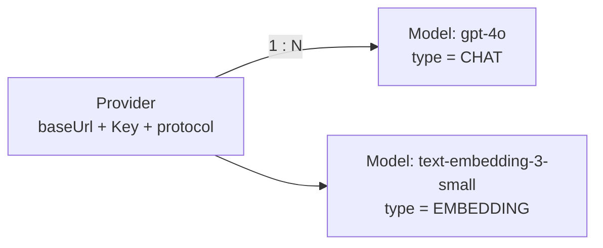

# 子方案 — Provider 与模型类型解耦（同一 baseUrl 同时挂对话与向量模型）

> 上游基准：`01-整体需求与实施步骤.md` §3.2（平台模型池）、`02-后端设计.md` §4.3（模型池契约）、
> `03-前端设计.md` §七（模型池管理页）、`shared/src/modelProvider.ts`、`shared/src/model.ts`、
> `backend/src/services/model.service.ts`、`backend/prisma/schema.prisma`。
> 触发：用户 2026-10-22 发现「Provider 模型池的同一个 baseUrl 往往同时提供对话模型与向量模型，
> 只是模型名不同」，而当前实现强制二者分属两个 Provider。
> 状态：🚧 **本次落地**（P1 补丁；契约/服务/前端/验收/文档一起改）。

---

## 一、问题（现状盘点）

### 1.1 现象

一个 OpenAI 兼容网关上同时暴露 `gpt-4o`（对话）与 `text-embedding-3-small`（向量）是**常态**
（自建 vLLM / one-api / new-api / 火山方舟 等都如此）。但当前实现下，管理员必须**建两个 Provider**：

| 现状后果 | 出处 |
|---------|------|
| `baseUrl` 抄两遍、API Key 存**两份密文**（AAD 按 `providerId` 绑定，密文不可互换） | `model.service.ts#providerKeyAad` |
| 轮换 Key 要改两处；漏一处 ⇒ 一半模型静默 401 | `02` §4.3 |
| 「拉取上游模型」抽屉探到的清单里混着向量型号，却只能按 Provider 的 type 批量建成对话模型 | `RemoteModelsDrawer.tsx#createSelected` |
| 改 Provider 类型被 409 锁死（有模型时） | `model.service.ts:354` |

### 1.2 根因：方案A 把一个**偶然的实现选择**固化成了数据约束

`c1bfe4f`（2026-09-30，嵌入模型增强）引入「方案A：模型 `type` 跟随 Provider 的 `type`」，
并在 `createModel` 里加了一致性硬校验（`model.service.ts:1012`）。
它建立在「Provider 是向量、模型却是对话 = 不一致配置」这个判断上 —— **但这个判断是错的**：

- `type` 是**模型自己的属性**（用来干什么：对话 / 向量化）；
- Provider 是**上游终点**（`baseUrl` + Key + 上游协议），它不定义"用途"，只定义"打到哪儿"。

一个上游终点同时承载两种用途的模型，与「一个数据库同时有"读"和"写"两种语句」一样正常。

### 1.3 它与仓库里两处**更早的**原始口径直接冲突

| 出处 | 原文 |
|------|------|
| `docs/02-后端设计.md:528` | 「**刻意不校验**「`type` 必须等于 Provider 的 `type`」……加一条"必须一致"会把那种配置挡在门外，**属自己发明约束**」 |
| `backend/prisma/schema.prisma:429` | 「`@@unique([providerId, modelName, type])`：同一型号名可能**既提供 chat 又提供 embedding**（如 bge 系列的兼容端点）是**合法**的」 |

方案A 把这两条同时推翻了，而**没有回写文档** ⇒ 文档与代码自相矛盾至今。

### 1.4 本次不采用「方案2」

方案2（保留方案A，仅让两行 Provider 共享同一份凭据）改动最小，但**双份密文、双份轮换、
探到通吃清单仍要人工分类**三个痛点原样保留 —— 治标不治本。**不采用**。

---

## 二、目标态

**`model_providers.type` 整列删除。** 类型成为**模型自己的属性**（`models.type`），
Provider 回到"纯上游终点"（`baseUrl` + Key + `protocol`）。



三条口径：

1. **同一个 Provider 下可以同时有 CHAT 与 EMBEDDING 模型** —— 建模型时 `type` 自选，
   Provider 上不存在任何类型字段可比。
2. **"改 Provider 类型"这条路消失** —— 列没了，也就没有"有模型就不许改"的 409。
3. **向量模型与上游协议的约束转移到"模型侧"** —— embedding 只有 `/embeddings` 一条路
   （`shared/src/modelProvider.ts:79`），所以规则从
   「`Provider.type = EMBEDDING` ⇒ 协议只能 OpenAI 兼容」
   改为**两条对偶判据**：
   - 建/改模型：`type=EMBEDDING` ⇒ 该 Provider 的协议必须 OpenAI 兼容；
   - 改 Provider 协议：该 Provider **下有 EMBEDDING 模型** ⇒ 协议只能是 OpenAI 兼容。

第 3 条是本次改造**最容易漏、也最关键**的一处：不新增它，就会出现"配了 Anthropic 协议的
Provider 里挂着一个永远调不通的向量模型"。

### 2.1 决策过程：为什么不"降级为默认类型"而直接**删列**

初版方案是"把 `type` 降级为**默认类型**（新建模型的预选值）"—— 零迁移、可回滚。
但落地时用户否决：**"感觉也没什么用"**。评估成立：

- 降级后 `type` 全仓只剩**一处**读法（新建模型表单的初值），且初值从 `CHAT` 起本来也最合直觉；
- 而它要一直占着：一个 DB 列 + 一个契约字段 + 一个前端选择器 + 三处校验/比较/文案 + 一份迁移。
- 收益（省一次下拉点击）远小于成本（一个字段在四层里长期存在、还要向用户解释"默认类型 vs 实际模型"）。

⇒ **整列删除**。唯一代价是一次迁移（`20261022120000_provider_drop_type`，一条 `DROP COLUMN`），
且 `type` 列不含任何无法从 `models` 推导的信息 ⇒ 删除无数据损失。

---

## 三、契约改动（`shared`）

### 3.1 `shared/src/modelProvider.ts`

| 改动 | 说明 |
|------|------|
| **删** `protocolAllowedForType(type, protocol)` | 判据不再挂在 Provider 的 `type` 上 |
| **删** `EMBEDDING_PROTOCOL_CONFLICT_MESSAGE` | 文案改口径，见下 |
| **增** `vectorModelRequiresCompatProtocol(hasEmbeddingModel, protocol)` | 「有向量模型 ⇒ 协议只能兼容」的**唯一实现**（改 Provider 协议 + 前端下拉共用） |
| **增** `embeddingModelAllowedOnProtocol(protocol)` | 同一判据的**另一视角**（建/改模型时问"能不能建在这个 Provider 上"）；两者逐字同判（`isEmbedding ⇒ protocol === 默认`） |
| **增** `VECTOR_MODEL_PROTOCOL_CONFLICT_MESSAGE` / `EMBEDDING_MODEL_PROTOCOL_CONFLICT_MESSAGE` | 两条对偶的中文说明（字段级文案与前端提示共用） |
| **增** `ModelProviderItem.hasEmbeddingModel: boolean` | 该 Provider 下**是否存在 EMBEDDING 模型**。前端据此把协议下拉锁成默认值、并在列表里给出副标 |
| **删** `ModelProviderItem.type` | 列已删除 |
| **删** `createModelProviderBodySchema.type` / `updateModelProviderBodySchema.type` | 同上 |
| **删** 两处 `superRefine` | 它们只为 `protocolAllowedForType` 而存在；判据移到服务层（要看库里的模型） |

> ⚠️ `hasEmbeddingModel` 与 `modelCount` 是**两个不同的读数**：前者是"协议是否被向量侧钉死"的
> 判据，后者是"这个 Provider 下有多少模型"的读数。不合并成一个。

### 3.2 `shared/src/model.ts`

- `ModelItem` / `ModelOption` / 建改 schema 的 `type` 注释：说明「**模型自己的用途**；
  Provider 上已无类型字段」。
- 建改模型 schema 的 `type` 新增服务层判据说明（`EMBEDDING` 要求 Provider 协议兼容）。
  **契约字段本身不变**。

---

## 四、服务层改动（`backend/src/services/model.service.ts`）

| 位置 | 现状 | 改法 |
|------|------|------|
| `createModel` | `input.type !== provider.type` → 400 | **删除**该守卫（`provider.type` 已不存在） |
| `createModel` | — | **新增**：`input.type === 'EMBEDDING'` 且 Provider 的 `protocol` 非 OpenAI 兼容 → 400（字段级 `body.type`） |
| `createModel` 的 provider select | `{ id, type, protocol, createdBy }` | 去掉 `type`（列已删），保留 `protocol` |
| `updateModel` | 无协议校验 | **新增**：`nextType === 'EMBEDDING'` 且 Provider 协议非兼容 → 400；provider select 加 `protocol` |
| `updateModelProvider` | 有模型时改 `type` → 409 | **整段删除**（连"改 type"这条路都没有了） |
| `updateModelProvider` | `protocolAllowedForType(合并 type, 合并 protocol)` → 400 | 改为：**该 Provider 下存在 EMBEDDING 模型**且合并后的 protocol 非兼容 → 400（字段级 `body.protocol`） |
| `PROVIDER_SELECT` / `toItem` / `ProviderRow` | 带 `type`、无 `hasEmbeddingModel` | 去掉 `type`、新增 `hasEmbeddingModel`；四个调用点（list / create / update / transfer）各补一次该读数 |
| 文件头口径 ④/⑤/⑥ | 方案A 的说明 | 整段重写为"Provider 无类型 + 协议约束在模型侧" |

**`hasEmbeddingModel` 的取法**（与既有 `userHasKey` 同款，避免 N+1）：

```ts
// 列表：一次查出"这批 Provider 里哪些挂着向量模型"
const embeddingSet = await embeddingModelProviderIds(ids)   // findMany + distinct providerId
// 单条（create / update / transfer）：一个 findFirst
const hasEmbeddingModel = await hasEmbeddingModelOf(id)
```

**`updateModelProvider` 的判据**（合并后判一次）：

```ts
if (!vectorModelRequiresCompatProtocol(hasEmbeddingModel, input.protocol ?? target.protocol)) {
  throw AppError.validation(VECTOR_MODEL_PROTOCOL_CONFLICT_MESSAGE, {
    fields: [{ path: 'body.protocol', message: VECTOR_MODEL_PROTOCOL_CONFLICT_MESSAGE }],
  })
}
```

> 为什么是 400 而不是 409：这是"字段值组合不合法"，与既有的 `protocol` 校验同族（前端把它挂在
> `protocol` 那个下拉上）；409 留给"有引用、不能改"那类**状态**冲突。

### 4.1 不受影响的地方（已按模型 type 过滤，天然正确）

- `listAvailableModels` 的 `type = query.type`
- `resolveChatTarget`（`type !== 'CHAT'`）、`resolveEmbeddingTarget`（`type !== 'EMBEDDING'`）
- `kb.service` 的 `resolveCaptionModelId`、`titleModel.service`、`agent.service`
- `probeModelChat` / `probeModelEmbedding`（按 `providerId + modelName` 探测，与 `type` 无关）
- 权限（`canEditAsset`）、egress 白名单（host 级）、`@@unique([providerId, modelName, type])`

---

## 五、前端改动

| 位置 | 现状 | 改法 |
|------|------|------|
| `adminModel.ts#modelTypeForProvider` / `defaultTypeForProvider` | 「类型跟随 Provider」/「默认取 Provider 类型」 | **删除**（Provider 无类型可借）。新建模型 `type` 初值 = `EMPTY_MODEL_FORM_VALUES.type`（`CHAT`） |
| `adminModel.ts#MODEL_TYPE_FOLLOWS_PROVIDER_REASON` | 锁定理由 | 换成 `MODEL_TYPE_HINT`：「类型是**模型自己的用途**；向量模型要求该 Provider 协议为 OpenAI 兼容」 |
| `adminModel.ts#providerTypeChangeBlocked` / `PROVIDER_TYPE_LOCKED_REASON` | 有模型 ⇒ 锁 | **删除**（连类型字段都没有了） |
| `adminModel.ts#protocolOptionsFor(type)` | 按 Provider 类型过滤 | 改为 `protocolOptionsFor(hasEmbeddingModel: boolean)`：有向量模型只剩默认协议 |
| `adminModel.ts#protocolAfterTypeChange` | 按 Provider 类型收口 | **删除**（协议不再随任何 Provider 类型联动） |
| `adminModel.ts#ProviderFormValues.type` / `EMPTY_PROVIDER_FORM_VALUES.type` / `providerEditValuesOf` | 带 `type` | **删除**这些字段 |
| `adminModel.ts#buildCreateProviderBody` / `buildProviderUpdateBody` | 构造 `type` | **不再构造 `type`** |
| `ModelFormModal.tsx` | 类型选择器**恒只读**（`typeLocked = true`） | 解开：可编辑；初值固定 `CHAT`（Provider 不参与） |
| `ModelFormModal.tsx` | 编辑态 `typeLockedReason` 「类型跟随所属 Provider，不可修改」 | 改为 `MODEL_TYPE_LOCKED_REASON`（仅"被 Agent 引用"这一条真锁） |
| `ModelFormModal.tsx` | — | **新增**：`type=EMBEDDING` 而该 Provider 协议非兼容时，提交前拦下并给 Alert 解释 |
| `RemoteModelsDrawer.tsx` | 批量创建用 `provider.type` 当类型、`provider.type==='EMBEDDING'` 决定要不要上下文 | 表格加一列**「建成类型」**：**每行**一个类型下拉（默认取按型号名的**保守推测** `guessedType`，可逐行改），批量创建按各行类型走（"对话"行才带入上下文长度）；选中行里有"向量"而协议非兼容时禁用创建按钮并解释。⚠️ 探到的型号行本身**不带类型**（上游 `/models` 不返回类型），推测只作**默认值**、不是判据（会误伤，故必须可改）。初版曾做成抽屉顶部一个「建成的类型」总单选（与"过滤型号名"并排、被读成筛列表）**已否** |
| `ProviderFormModal.tsx` | 有「类型」选择器、协议下拉按 `type` 过滤、改类型收口协议 | **删掉整个类型选择器**；协议下拉按 `provider.hasEmbeddingModel` 过滤（创建态 = 不限）；删掉 `protocolAfterTypeChange` 调用 |
| `ProviderFormModal.tsx` | 协议下方提示 | 有向量模型时说明「该 Provider 下已有向量模型，协议只能是 OpenAI 兼容」 |
| `ModelsPage.tsx` | Provider 列「类型」 | **删掉该列**；「上游协议」列的副标补「含向量模型」（`hasEmbeddingModel`） |
| `DeleteProviderModal.tsx` | 显示 `provider.type` | 改显示协议（`UPSTREAM_PROTOCOL_LABELS[provider.protocol]`） |

---

## 六、验收（唯一取证）

**必须有一条端到端证据同时覆盖两件事，缺它无法区分"改对了"与"改漏了协议守卫"：**

| # | 步骤 | 期望 |
|---|------|------|
| ① | **同一个 Provider**（一个 baseUrl + 一把 Key）下建一个 CHAT 模型 + 一个 EMBEDDING 模型 | 两条都创建成功（Provider 上已无类型可比） |
| ② | 分别对这两条**发一次真实调用**（对话 `probe-chat` / 向量 `probe-embedding` 或知识库入库） | 都成功 —— 证明一条 Key 确实同时服务两类模型 |
| ③ | 试图把该 Provider 的协议改成非 OpenAI 兼容 | **400**，字段级错误指向 `protocol`，文案点明"已有向量模型" |
| ④ | 建一个协议为 Anthropic 的新 Provider，在其下建 EMBEDDING 模型 | **400**，字段级错误指向 `type` |
| ⑤ | 迁移 `provider_drop_type` 在已有库上执行 | 成功；`model_providers` 无 `type` 列，既有模型/Provider 全部照常可用 |

静态层由 `frontend/scripts/verify-admin-ui.mjs` 的 E / K / J 组覆盖（判据函数 + 源码级守门，
已随本次改造更新：E 组改为"Provider 体绝不构造 type"、K 组改为"按 hasEmbeddingModel 过滤"、
J14 增加"Provider 表单不再有类型选择器"的源码级断言）。

---

## 七、文档回写清单

| 文件 | 位置 | 动作 |
|------|------|------|
| `docs/02-后端设计.md` | §4.3 契约增量 · Provider 字段表 | 删 `type` 行、补 `hasEmbeddingModel` 行 |
| 同上 | §4.3 契约增量 · 模型「刻意不校验」那条 | **恢复**原文口径（保留"不校验类型必须一致"） |
| 同上 | §4.3 · Provider 的 `protocol` 约束 | 改为"Provider 下有向量模型 ⇒ 协议只能兼容" |
| `docs/03-前端设计.md` | 模型池管理页形态 | 补"模型类型可编辑 + 拉取抽屉按行选建成类型 + Provider 表去掉类型列" |
| `README.md` | 前端 P0-1-37 那条 | 「`EMBEDDING` 类型不给选非兼容协议」改为「该 Provider 下已有向量模型时协议锁定」 |
| `backend/prisma/schema.prisma` | `ModelProvider` / `Model` / `enum ModelType` / `enum UpstreamProtocol` 注释 | 已同步（无 type 列 + 协议约束在模型侧） |

---

## 八、风险与边界

| 风险 | 处置 |
|------|------|
| 存量数据：某 Provider 下既有 CHAT 又有 EMBEDDING 模型 | 新判据对它更宽松，不会变非法（本次改造前只可能来自手工造数） |
| 删列迁移在任何环境失败 | 纯 `DROP COLUMN` + `DROP INDEX`，无数据依赖（`type` 无不可推导信息）；反向需重加列并回填默认值 |
| 前端 `hasEmbeddingModel` 是**派生读数**，并发下可能短暂过期 | 可接受：它只影响下拉的**预设可选值**与按钮禁用，最终判据在服务层（同一份纯函数） |
| 用户失去"Provider 默认类型"的便利 | 已论证（§2.1）：收益是一次下拉点击，成本是四层长期维护一个字段；不划算 |

---

## 九、同批补漏：删模型时漏检"被知识库 / 平台配置绑定"

用户 2026-10-22 报「模型池内向量模型被绑定在知识库，删除时没有检测到」。这是**类型解耦带出的邻近缺陷**（不是解耦本身引入，但同属"向量模型的引用完整性"），一并修。

**根因**：`knowledge_bases.embedding_model_id` 是 `ON DELETE SET NULL`。删单模型时，引用它的库
会被**静默**把该列清空 —— 库还在、但此后无法入库/检索；而 `removeModel` 的守卫只查了 Agent
（默认模型 + 模型池成员），**漏了知识库这一路**。

**引用的五处口径**（`removeModel` 逐条守卫，全部 `409`）：

| # | 引用 | 外键行为 | 不拦的后果 |
|---|------|---------|-----------|
| ① | `agents.model_id`（默认模型） | `SetNull` | 在线智能体被静默解绑 |
| ② | `agent_models`（模型池成员） | `Cascade` | 静默移出池 |
| ③ | `knowledge_bases.embedding_model_id`（向量模型） | `SetNull` | **整库无法入库 / 检索** |
| ④ | `knowledge_bases.caption_model_id`（图片描述模型） | `SetNull` | 图片描述入库 409 |
| ⑤ | `title_model_config.model_id`（平台会话标题模型） | `SetNull` | 会话标题退回确定性截断 |

**修法**（口径对齐）：

| 位置 | 改动 |
|------|------|
| `removeModel` | 三条守卫（③④⑤，2026-10-22 全补）+ 既有两条（①②） |
| `ModelItem` | 增 `knowledgeBaseCount` / `captionKnowledgeBaseCount` / `usedAsTitleModel` |
| `adminModel.ts#modelDeleteBlockedNotice` | 入参扩为四读数，任一命中即拦；文案按引用方分别说；`ModelsPage` Popconfirm 按引用方给链接（智能体 / 知识库 / 本页「系统模型」区） |
| `removeModelProvider`（删 Provider，级联） | **刻意不 409**（级联是该接口的既定语义），但**如实回报** `clearedKnowledgeBases`（去重：向量 ∪ 图片描述）+ `clearedTitleModel`（删除前数，与 `unboundAgents` 同款） |
| `getProviderBoundModels` / `providerBoundModelSchema` | 增 `captionKnowledgeBaseCount` / `usedAsTitleModel`；响应增 `knowledgeBaseTotal`（去重）/ `clearsTitleModel`；`DeleteProviderModal` 列出"哪些库 / 平台标题会被清空 + 危险说明" |

**为什么不把删 Provider 也改成 409**：它已是"级联 + 自动解绑 + 回报影响"的既定设计（`02` §4.3），
改成拦截会与"删 Provider 就是要把整块拆掉"的语义打架；而单删模型是**精确操作**，静默产生副作用才是真问题。

> ⚠️ **为什么 `SetNull` 也要拦**：既有先例 `agents.model_id` 就是 `SetNull` 却照样 409 ——
> "DB 层能自动解绑"不等于"业务上可以静默解绑"。③④⑤ 的后果比①更重（整库不可用 / 平台配置被清），
> 更该拦。判据统一为"有没有引用"，与 FK 的 onDelete 行为**无关**。