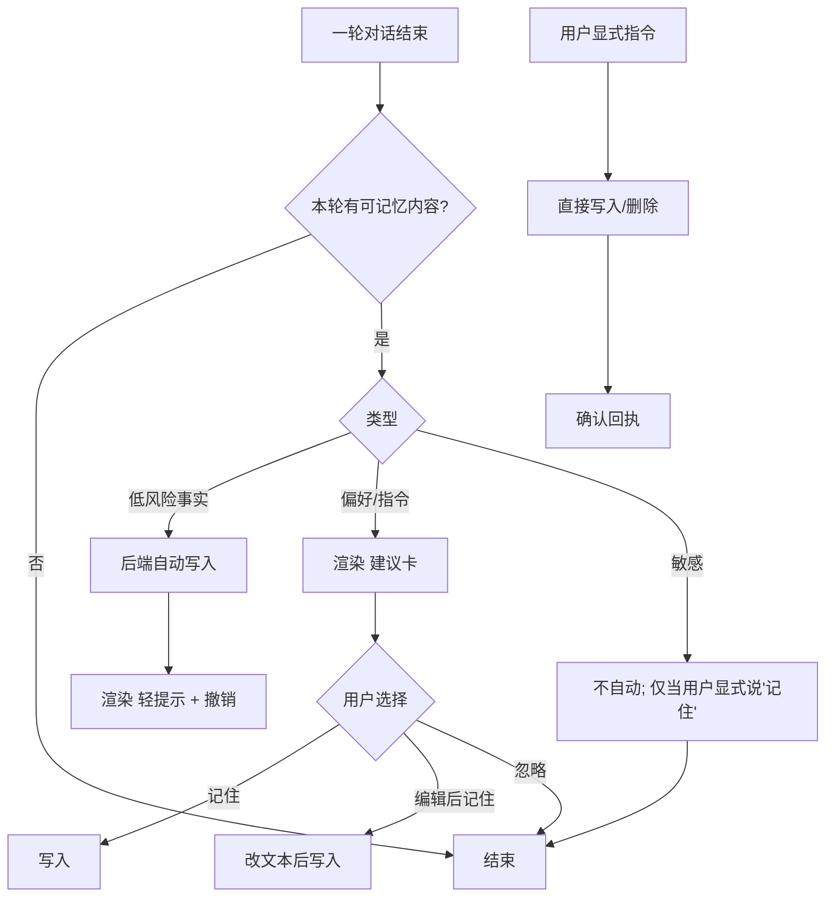

# TaskAgent 会话持久化与长期记忆（方案 A + ChatBot 优化 + 长期记忆 HCI）

> 上游基准：`docs/01-整体需求与实施步骤.md`（P2「长期记忆」触发条件）、`docs/02-后端设计.md`（§六 上下文组装、§七 TaskAgent 编排、§4.3 模型 `max_context`）、`docs/03-前端设计.md`（§二 路由、§七 词表）、`docs/子方案/沙箱与引擎集成.md`（§五 镜像 / §九 生命周期）、`docs/子方案/TaskAgent记忆与产物.md`（块 1 已落地的 memory.md 补丁）。
> 定位：承接 `TaskAgent记忆与产物.md`（三问题修复）之后的**记忆架构演进**。本文交付三件事：
> ① **方案 A**：把 TaskAgent 的会话记忆从有损摘要（memory.md）升级为**可恢复的持久化会话**；
> ② **ChatBot 上下文优化**（预算感知 + 滚动摘要 + 工具预算 + 缓存友好 + 可观测）；
> ③ **长期记忆**（P2 触发式）的分层规划、准入准则与**人机交互设计**。
> ⚠️ 本文不新增"功能需求清单"之外的需求；只把"容器易失、状态归平台"这条原则落成卷、参数、数据模型与交互。

---

## 一、现状：两类 Bot 的记忆与上下文极限

### 1.1 ChatBot：无状态、每轮重放（真相源 = DB）

| 项 | 现状 | 代码 |
|----|------|------|
| 会话状态 | 不存在"会话对象"，每轮从 `messages` 表重放 | `orchestrator/chatBot.ts` |
| 上下文组装 | `system = agent.system_prompt + 检索块`；`history = 最近 20 轮`；`user = content` | `orchestrator/chatContext.ts#buildSystemPrompt / selectHistoryMessages` |
| 窗口口径 | `rounds × 2` 条；截断后**从 `user` 开始**；丢空文本助手行（有工具调用除外）；工具段仅"每个调用都有结果"时还原 | `selectHistoryMessages` |
| 上限处理 | **只有轮数窗口，没有压缩**；超出 20 轮的老历史**静默掉出** | `02` §6.2「历史截断」 |
| token 裁剪 | **刻意不做**（无可用 tokenizer） | `chatContext.ts` 文件头 |
| `models.max_context` | 存了但**无消费方** | `02` §4.3 |

结论：ChatBot **天然跨轮 / 跨刷新**，但**不跨会话**；长对话会**丢失早期上下文**（无摘要），窗口本身若超模型上限只能靠上游报错。

### 1.2 TaskAgent：容器持有会话，后端不重放

| 项 | 现状 | 代码 |
|----|------|------|
| 派活 | 只发当前用户消息，**从不重放历史** | `taskAgent.ts` `bridge.runTurn(...)` |
| 会话记忆 | pi 的 session 文件（`/tmp/pi-sessions`，**tmpfs**） | `infra/sandbox/base/pi-agent/settings.json#sessionDir` |
| 容器回收 | 删容器 + **具名 work 卷** ⇒ `/work` 与 session 一起没 | `sandbox/manager.ts#recycleSandbox` |
| 上限处理 | **pi 自带 auto-compaction**（`reserveTokens=16384`、`keepRecentTokens=20k`）+ `/compact` + 分支摘要 + 一次压缩后重试；后端不参与 | pi `docs/compaction.md` |
| 跨会话 | memory.md 摘要（有损，`TaskAgent记忆与产物.md` 块 1） | `orchestrator/memoryDoc.ts` |

结论：TaskAgent 的记忆**既是容器级又是易失的**——容器活着时保真度最高（含工具调用、thinking、压缩摘要），**一旦回收全部归零**；memory.md 只是有损兜底。

> 一句话对比：ChatBot 把"记忆"放在平台（DB）但**不会压缩**；TaskAgent 有引擎级压缩但把"记忆"放在**易失的容器**里。

---

## 二、方案 A：TaskAgent 会话持久化（durable session + `--session-id`）

> **★ 总原则（2026-09-30 定）：TaskAgent 一律以引擎（pi）提供的能力为准。**
> - 只用 **pi 在 RPC 里暴露**的能力；**不为 TUI 特有行为**（如 `/tree` 交互导航）或引擎没暴露的内部机制**造兼容层**。
> - 引擎做不到、或需要大量自定义去"模拟"的：**接受差异或索性不做**（宁可记一条已知差异，也不维护一段脆弱的兼容代码）。
> - 落地判据：每引入一个对 session/引擎的改动，先问"这是不是 pi 的原生能力？"——不是，就不做。

### 2.1 决策

**把 pi 的会话文件放到一个随会话长期存在的具名卷上，并用会话 id 打开同一个 session**——容器可随时替换，会话不丢。

```
新容器启动
  → 挂载 doubulea-session-<conversationId>:/session（持久，回收不删）
  → pi --session-dir /session --session-id <conversationId>
     （pi：打开该 id 的会话；不存在则新建 —— 见 pi docs/cli.md）
  → pi 自动恢复完整会话：工具调用配对 / thinking / compaction 摘要 / 分支
```

为什么不是"每轮把历史重放给 pi"（方案 B）：pi 是"自带 session + 自带压缩"的引擎，重放会与它的 session 语义打架（双份历史），且丢掉工具调用保真度。方案 A 顺着引擎的设计走，成本最低、保真度最高。

### 2.2 与已落地 memory.md 的关系（**不删除，降级为兜底**）

| 机制 | 角色 |
|------|------|
| durable session（本文方案 A） | **主机制**：完整会话恢复 |
| `memory.md` + 派活前置 read 指令 | **兜底/迁移**：session 卷缺失或损坏、旧会话首次升级、跨版本迁移时，至少让 agent 知道"聊过什么、产出过哪些文件、怎么取回产物" |
| 产物清单 / 按需下载端点 | 与记忆正交，继续保留（产物本体在 S3，不随会话/容器走） |

### 2.3 施工规格（改动点）

**① 卷（`backend/src/sandbox/spec.ts`）**
- 新增 `SESSION_VOLUME_PREFIX = 'doubulea-session-'` 与 `sessionVolumeName(conversationId)`（与 `workVolumeName` 同款纯函数）。
- `buildSandboxContainerSpec` 的 `Mounts` 增加一条：具名卷 → `/session`（与 `/work` 并列）。
- **镜像准备挂载点**：base Dockerfile 创建 `/session` 并 `chown agent`（同 `/work` 的"首挂继承属主"纪律）；否则新卷首挂属 `root:root`，agent 写不动。

**② 启动参数（`piRpcArgv`）**
```ts
return ['--mode','rpc','--provider',SANDBOX_PI_PROVIDER_ID,'--model',modelName,'--no-approve',
        '--session-dir','/session','--session-id', conversationId]
```
- `conversationId` 是 uuid（含 `-`），符合 pi 对 session id 字符集的要求（字母/数字/`.`/`_`/`-`）。
- 也可用 `PI_CODING_AGENT_SESSION_DIR=/session` 覆盖 `settings.json` 的 `sessionDir`；**二选一，不两处都写**（避免两个真相）。推荐 CLI 参数（就近、可读）。

**③ 回收语义（`sandbox/manager.ts#recycleSandbox`）**
- 现状：删容器 + **work 卷** + 账本 + 名额。
- 改为：删容器 + work 卷，**保留 session 卷**（会话记忆不能跟容器走）。
- ⚠️ 本方案**唯一有风险的一处**：回收路径不能"顺手把 session 卷也删了"——加显式断言/注释钉住。

**★ 不变式：会话 id 恒等于 `conversationId`（1:1 映射，永不改变）**
- pi 的 `--session-id <conversationId>` 打开/新建该 id 的会话 ⇒ 平台**只需一个映射**（`conversation.id → session id = conversation.id`），不新增"当前 session id"列，也不需要捕获 pi 内部生成的新 id。
- ⚠️ 因此**禁止用 pi 的 `new_session` 来做"分割"**：它会生成一个新 id，下次容器重建仍按 `conversationId` 打开**旧**会话 ⇒ 映射断裂。分割必须"**换文件、不换 id**"（见下）。

**④ 清理策略（`sandbox/reaper.ts`）**
- session 卷的**唯一删除点** = 会话被删除（`conversation.service.ts#removeConversation`）+ 保留期清理。
- 对账器增加"孤儿 session 卷"回收：卷名能解析出 `conversationId`，而该会话行已不存在（或超保留期）⇒ 删卷。
- 可复用 `auditWorkVolumes` 的巡检骨架；但**判据不同**：work 卷随容器，session 卷随会话。
- **体量巡检 + 分割提取（已定，2026-09-30）**：新增 `auditSessionVolumes`，三个 env（初值，按 `sessionBytes` 日志观察后调）：
  - `SANDBOX_SESSION_MAX_MB`（**活跃** session 文件触发线）：**4MB**（正常会话几百 KB~1MB，4MB 已是很长的会话）；
  - `SANDBOX_SESSION_VOLUME_MAX_MB`（整卷含归档）：**50MB**；
  - `SANDBOX_SESSION_ARCHIVE_RETENTION_DAYS`（归档保留）：**30 天**。
- 超阈值且会话仍被频繁使用时的动作分两级：
  1. **先压缩**：调 pi `compact`（token 级压缩，见 pi `docs/rpc-commands.md`）；
  2. **仍超阈值 ⇒ 分割（换文件、不换 id）**：把旧 `.jsonl` 移入 `archived/`（不删、标记 `archived`）→ 停引擎/回收容器 → 用**同一个** `--session-id <conversationId>` 重启（该 id 不存在 ⇒ pi 新建**同 id**空会话）→ 用 L1 的会话小结通过 `memory.md` / 派活前置指令作为开篇背景喂进去。
  - 理由：session 文件会随长期使用累积（尤其 off-branch 条目），只压不分割迟早撑大卷；而"换文件不换 id"保证**平台映射不变**。

**⑤ 会话删除 / 撤回（`conversation.service.ts`）**
- 删除会话 ⇒ 一并删 session 卷。
- **撤回最新一轮 ⇒ 用 pi 原生 `fork`（已定，2026-09-30；引擎能力优先，零文件手术）**：撤回 = 那一轮"作废、不算进会话记忆"。**pi 自己就有这个原语**，我们不自己裁文件、不造兼容层。
  - 落法：`get_fork_messages` 取活跃分支上的 user 消息 → 选**最后一条**（= 被撤回那一轮的 user 消息）→ `fork`。pi 把该 user 消息放回"待发送态"并**丢掉它的回答**，活跃分支回到上一条 assistant ⇒ 模型不再看到那一轮。
  - `fork` 返回该 user 的文本：**撤回**时**丢弃**它（DB 侧同样删掉那一轮）；**重新生成（P1）**时**原样重发**它 —— 两个功能同一个引擎原语。
  - 只有一轮时 `fork` 后活跃分支为空，同样成立；**不需要**归档/换文件/新会话。
  - `fork` 是**同 session 内**的分支操作，**session id 不变** ⇒ 1:1 映射天然保持。
  - 扩展可用 `session_before_fork` 取消 ⇒ 失败/取消时只 warn（DB 撤回已成立，session 留差异，不阻断）。
  - ⚠️ **实现前的冒烟**：确认 fork 后 pi 的活跃分支**不含**被撤回那一轮的回答（`get_messages` 核对）。
  - 说明：pi 交互 TUI 另有 `/tree`（导航到任意条目继续）等能力，但**未通过 RPC 暴露**；我们只用 RPC 有的 `fork`，**不为 TUI 特有行为造兼容层**。

### 2.4 迁移与兼容

- **存量会话**（没有 session 卷）：首次派活时卷为空 ⇒ pi `--session-id` 新建一个空会话；此时 memory.md 兜底把"最近 N 轮 + 产物清单"喂给 agent，**用户观感是连续的**（有损但不报错）。下一轮起 session 开始累积。
- **镜像版本迁移**：session 格式由 pi 版本决定；升级 `PI_VERSION` 前须确认 pi 能读旧 session（`docs/session-format.md`）。不能读就"降级到 memory.md + 新建 session"，不阻断派活。
- **回滚方案 A**：把 `--session-dir/--session-id` 去掉即回到现状；session 卷变为孤儿，由对账器按保留期收掉。**改动可逆**。

### 2.5 失败模式与观测

| 失败 | 行为 | 观测 |
|------|------|------|
| `/session` 卷建不出来 / 挂不上 | 建容器失败（与 work 卷同路径，`CREATE_FAILED`） | 日志 + 流内 `error` |
| session 文件损坏 | pi 视为新会话；memory.md 兜底；**不落轮** | 引擎 stderr + 后端 warn |
| 卷写满（无硬配额） | 巡检告警（同 work 卷）；先删最旧 session 文件或提示 | `auditSessionVolumes` 统计 |
| 并发派活 | 会话级互斥（已有），单写者；不会双写 | 既有锁 |

新增日志字段：`sessionBytes`、`sessionRestored`(bool)、`sessionId`，进"TaskAgent 本轮结束"那条日志。

### 2.6 边界与刻意不做

- **不做 session 快照到 DB/S3**：卷本身已是持久存储；跨机迁移（本方案不含）才需要对象存储，属后续。
- **不跨容器共享一个 session 卷**：一会话一容器一 session，单写者。
- **不改 pi 的压缩参数**：默认（16384 / 20k）先跑通；要调再进 env（见 §六 待决 4）。
- **session 文件含工具结果**：与 `messages` 同级信任边界（本机 Docker 卷），**不含模型 Key**（pi 的 Key 只走容器 env）。

### 2.7 验收

1. 派活 → `docker exec <c> ls /session` 有该 `conversationId` 的 session 文件。
2. 停止/空闲回收容器（work 卷被删、**session 卷仍在**）→ 重新聊天 → agent 能接着上一轮说（含此前工具调用/产物上下文），且**不是**靠读 memory.md。
3. 删除会话 → 对应 session 卷被删；对账器不误删活跃会话的卷。
4. 退化：手动删掉 session 卷后重新聊天 → 退化为 memory.md 兜底、不报错、不落轮。

---

## 三、ChatBot 上下文优化（**本文要做的第二件事**）

问题（§1.1）：只按轮数窗口、无预算、无摘要、工具结果固定上限、检索块打掉缓存、缺观测。下面四块**按序落地**（CB-1 与 CB-2 有依赖，先做 CB-1）。

### 块 CB-1：预算感知的上下文组装（把 `max_context` 接上）

- **改动点**：`orchestrator/chatContext.ts` 新增**纯函数** `selectHistoryWithinBudget(rows, { rounds, budgetTokens, estimate })`；`chatBot.ts` 组装时传入本轮预算。
- **预算来源**：`model.max_context`（可空）；空时回落到配置 `CONTEXT_BUDGET_TOKENS`（新 env，默认给一个保守值）；再默认按"轮数窗口"（现状）。
- **估算器**：先用**保守的字符估算**（纯函数、可验），不做"假装精确"的 tokenizer（沿用 `chatContext.ts` 既有取舍）。估算器做成参数，将来能换。
- **两条约束同时生效**：`min(轮数窗口, 预算)`；超预算时**从最旧开始丢**，并记录 `droppedRounds`。
- **如实告知**：本轮若发生丢弃，随 SSE 的 `done`（或新增一个轻量事件）带上 `historyDroppedRounds`，前端在消息流顶部显示"已折叠更早的 N 轮对话"。⚠️ **不静默丢**。

### 块 CB-2：滚动摘要（平台侧 compaction）

- **改动点**：新表 `conversation_summaries`（`conversationId`, `upToMessageId`, `text`, `createdAt`），与长期记忆 L1 共用。
- **触发**：CB-1 判定要丢轮次时，把**将被丢掉的那批**交给一次内部模型调用生成结构化小结（目标/结论/关键产物），存库；下次组装把它作为 `system`（或首条 `context`）注入。
- **fail-open**：摘要生成失败 ⇒ 退回"只丢轮次"（CB-1 的行为），不影响本轮；日志留痕。
- **成本闸门**：只有"本次要丢 ≥ N 轮"或"距上次摘要增量 ≥ M 轮"才生成，避免每轮都调模型。

### 块 CB-3：工具结果按**总预算**分配

- **现状**：`TOOL_RESULT_MAX_CHARS` 每条独立上限，多工具叠加仍可能爆。
- **改**：在 CB-1 的预算里划一块给工具结果，按总预算分配（必要时对多条一起等比截断），保持"给模型的那份 = 给卡片看的那份"这条既有纪律。

### 块 CB-4：Prompt 缓存友好（可选、收益可测）

- **现状**：检索块进 `system`，前缀每轮变化 ⇒ 打掉 provider 前缀缓存。
- **改**：把**稳定前缀**（人设 + 已确历史）与**易变尾部**（本轮检索 + 用户消息）分开；检索块作为"历史之后、用户消息之前"的一条消息注入。用日志里的 TTFT/缓存命中（若 provider 上报）评估收益，没收益就回退。

### 块 CB-5：可观测

- 每轮记录：`budgetTokens`、`estimatedTokens`、`droppedRounds`、`summarized`(bool)、`toolResultsBytes`。进既有"本轮结束"日志与（可选）`usage_records` 旁的新列/旁表。

### 验收（ChatBot 本批）
1. 纯函数核查脚本：预算边界（恰好/超 1）、"从最旧丢且从 user 开始"、工具结果等比分配、估算器单调性。
2. 一条长对话真跑：出现"已折叠 N 轮"提示，且刷新后**仍**能看到摘要（摘要已落库）。
3. 回归：`verify:chat-sse` 等既有纯逻辑验收不红。
4. 摘要失败注入：本轮照常完成，仅日志有 warn。

---

## 四、长期记忆（P2 触发式）规划

> ⚠️ **2026-10-10 需求变更**：本节的初版（§四）已由 P1-8 落地（L0/L1/L2）。落地后用户反馈"记忆混为一类、每轮按 top-N 全量注入不够好"，要求**分两层 + 按需**。细化草案见 **§八（长期记忆 v2）**，尚未实施、待评审；本节保留为初版记录。

背景：`docs/01` 把「长期记忆」列为 P2，触发条件 = **用户明确提出跨会话记忆需求**（当前诉求已触发）。分三层做，**先能查、再能记、最后能引用**。

### 4.1 分层

| 层 | 能力 | 存储 | 依赖 |
|----|------|------|------|
| **L0 活动时间线** | "我做过哪些事"：会话列表 + 主题/时间/产物/用量 + 对**自己的**会话与消息搜索 | 复用 `conversations` / `messages` / `artifacts` / `usage_records`，**零新增存储** | 立即可做（`/tasks` S-09 是宿主） |
| **L1 会话小结** | "处理过哪些问题"：每会话一句结构小结（主题/结论/关键产物），可搜索 | `conversation_summaries`（与 CB-2 共用） | CB-2 的自然延伸 |
| **L2 用户记忆条目** | agent **跨会话**引用"关于你的一切" | `memories`（`user_id` 严格隔离）+ 可选向量检索 | P2，需产品确认 |

### 4.2 准入准则：用户选择还是 agent 自动追加？

**不是纯自动，也不是纯手填，而是"按类型分档 + 用户可控"。**

**判据（"值不值得进记忆"）——五问全过才进**：
1. **持久性**：跨会话仍成立？（"今天处理了 A 文件"= 一次性，不进；"我偏好 CSV 输出"= 进）
2. **相关性**：未来**别的**会话会用到？
3. **有据**：能从本次对话**原文**锚定（禁止模型脑补的"事实"）。
4. **非敏感**：凭据/密钥/PII **默认永不自动**，需显式 opt-in。
5. **在保留期内**：记忆有生命周期，不是永久。

**分档与写入门槛**：

| 类型 | 例子 | 写入方式 |
|------|------|----------|
| 任务事实 / 结论 | "X 问题已定位为 Y，产物是 Z.csv" | **agent 自动提取**，用户可见可改可删 |
| 用户偏好 / 指令 | "以后都用中文回答" / "我的测试环境是 STG" | **建议 + 用户确认**（会改变未来行为，等同配置项）；用户可开**「全自动」**免确认（§5.2.2） |
| 敏感数据 | token / 账号 / 个人信息 | **不自动**，仅用户显式"记住这条" |
| 显式指令 | "记住：…" / "别记这个" / "忘掉 X" | **最高优先**，覆盖自动逻辑 |

### 4.3 L2 数据模型（草案）

```prisma
model Memory {
  id             String   @id @default(uuid(7)) @db.Uuid
  userId         String   @map("user_id") @db.Uuid           // 严格按用户隔离，唯一判据
  agentId        String?  @map("agent_id") @db.Uuid          // 可选细分（agent-scoped 优先）
  kind           String   @db.VarChar(32)                     // FACT | PREFERENCE | TASK ...
  text           String
  sourceConversationId String? @map("source_conversation_id") @db.Uuid
  sourceMessageId      String? @map("source_message_id") @db.Uuid
  pinned         Boolean  @default(false)
  createdAt      DateTime @default(now())
  lastUsedAt     DateTime? @map("last_used_at")
  @@index([userId, createdAt(sort: Desc)])
}
```
- 向量检索做成可选附录（复用 pgvector），**先全文/关键词**，够用再上向量。
- 注入点：ChatBot 在 `buildSystemPrompt` 加"关于你的记忆"段；TaskAgent 在 `memory.md` / 派活前置指令里带命中条目。

### 4.4 权限 / 删除 / 保留

- **仅本人**（`user_id = me`），ADMIN **无后门**（与产物同款 404 口径）。
- 删除自己的一条 = 硬删；账号删除 = 级联删。
- 保留期与衰减：`lastUsedAt` 超 N 个月未用的低价值条目进入清理候选（可配置，同 `ARTIFACT_RETENTION_DAYS`）。
- 审计：写入/删除留日志（脱敏），支持"这条记忆从哪来"。

### 4.5 两类 Bot：**同一份存储，两条注入路径**

长期记忆是**平台级（按 `user_id`）**能力，只有一份存储，ChatBot 与 TaskAgent 共用（否则会出现"这里记住、那里忘了"）。

| 环节 | ChatBot（后端组上下文） | TaskAgent（容器内 pi 调模型） |
|------|------------------------|------------------------------|
| 检索注入 | 后端在 `buildSystemPrompt` 加「关于你的记忆」段 | 后端在 `memory.md` / 派活前置指令里带命中条目 |
| 自动抽取 | 后端落库后从 `messages` 抽取 | **同样是后端**（pi 回复也经 `persistRoundQuietly` 落库） |
| agent 主动读写 | 后端工具循环里给一个 `memory` 工具 | 经 **MCP 代理**暴露 `memory_*`（出口②由后端执行，主语 = token 的 `userId`） |
| 会话级"不记入记忆" | 置在会话上，两条路径共用 | 同左 |

要点：写入与注入**解耦**（写入只在后端）、**主语唯一**（`user_id`）、`agentId` 只作可选细分。

### 4.6 分阶段

1. **L0**：`/tasks` 时间线 + 本人会话/消息搜索——不发一句 prompt 就能回答"我做过哪些事"。
2. **L1**：会话小结（与 CB-2 同表）+ 展示/搜索。
3. **L2**：`memories` + 记忆面板 + 分档写入 + 检索注入 + `memory` 工具。

---

## 五、长期记忆的人机交互（HCI）设计

### 5.1 设计目标与原则

| 原则 | 含义 |
|------|------|
| **透明** | 用户随时知道"记了什么、从哪来、被谁用过" |
| **可控** | 增/改/删/关全在一处；自动写入可撤销 |
| **低打扰** | 默认不打断对话；只有"会改变未来行为的偏好"才要确认 |
| **安全** | 敏感永不自动；记忆是数据不是指令（反投毒） |
| **一致** | 两个 Bot、两个入口共用同一面板与同一批数据 |

### 5.2 交互面总览（五个面）

1. **会话内 · 自动事实提示（低打扰）**：助手消息下方一行轻提示 `已记入记忆 · 查看 · 撤销`（撤销窗口 ~10s）。
2. **会话内 · 偏好建议卡（需确认）**：agent 提议把偏好写进记忆时，出一个内联卡：`[记住] [忽略] [编辑后记住]`。
3. **会话内 · 显式指令**：用户说"记住：…"/"别记这个"/"忘掉 X" → 一条确认回执（可点"查看"跳面板），**无需卡片**。
4. **记忆面板**（**本次并入 `/tasks` 活动中心**，作为一个 tab；未来随"个人中心"再独立成页）：全部条目 + 搜索 + 按 kind/agent/时间筛选；每行显示正文、类型标签、**来源**（可跳回原会话）、创建/最近使用时间；操作：编辑 / 删除 / 置顶(pin)。
5. **开关**：
   - **全局**：记忆总开关 + 自动提取开关 + **「全自动」开关**（见下）。
   - **会话级**「本次对话不记入记忆」（临时对话，见 §5.2.1）。

#### 5.2.1 会话级「不记入记忆」（临时对话）的场景与默认

**场景（四类）**：① **隐私/敏感**——要贴客户数据/内部事故/个人信息，不想沉淀进长期记忆；② **一次性实验**——排查、试玩，"跑完就算了"，不污染画像；③ **共享/演示机**——别人用你的账号演示，说的话不该变成"你的记忆"；④ **降噪**——临时问答太多，挡住自动提取的噪音。

**入口与默认**：
- 入口 = **会话头部 `⋯` 菜单**里的「本次对话不记入记忆」；仅对**当前会话**生效。
- 开启后对话区有**常驻标识**（"本次对话不记入记忆"），避免用户忘记自己开过。
- **默认 = 记入（开关关闭）**：默认不记会让"记忆"看起来没生效、用户不知道为什么它不学；豁免是少数场景，显式打开更可控。
- 兜底：即使开着，用户显式说"记住这条"时弹一句"当前是不记入记忆的对话，仍要记住吗？[仍要记住]"——**用户显式指令仍是最高优先**。

#### 5.2.2 「全自动」开关（已确认允许）

- 位置：记忆面板顶部，与"自动提取"并列；**默认关闭**（偏好类仍走"建议 + 确认"）。
- 打开后：偏好/指令类**不再逐条确认**，直接写入（仍是"低打扰"）；但**安全护栏不变**：敏感类永不自动、每条可撤销/可删、有每用户上限、抽取必须有原文锚点。
- 打开时给一次说明性确认（"以后关于你的偏好会直接记住，可在面板管理"），避免用户不知情。

补充：**记忆引用透明**——当一条回复用到了记忆，在消息下方显示 `引用了 2 条记忆`，可展开看是哪几条（点进面板）。

### 5.3 关键流程



**流程细节**
- **自动事实**（**已确认：toast 晚一拍**）：写入发生在**后端**（落库之后，抽取逻辑与 bot 类型无关）。提示**不能**依赖同一轮 SSE 流（`done` 已发出）⇒ 轮结束后写一个"待展示记忆提示"（极小的内存/Redis 标记，TTL 短），前端在**下一轮**或**聚焦/重连时**以 toast 呈现（含 `查看` / `撤销`）。**不**把抽取前移到 `done` 之前（不拖慢收尾）。
- **偏好建议**（**同样晚一拍**）：需确认的偏好，走**带按钮的 toast**（`[记住] [忽略] [编辑]`），同样在下一轮/聚焦时出现；不并入 `done`。若用户已开**「全自动」**（§5.2.2）⇒ 无需确认，等同"自动事实"的 toast。
- **冲突**：新事实与旧条目矛盾时，默认**并存**并在面板标注"可能冲突"，不自动覆盖；用户可合并/删除。除非用户显式说"改成…"。

### 5.4 状态与文案口径（示例，最终进 `03` 词表）

| 场景 | 文案（示例） |
|------|--------------|
| 自动写入提示 | `已记入记忆：你的测试环境是 STG · 查看 · 撤销` |
| 偏好建议卡 | `要记住“以后都用中文回答”吗？这样以后所有对话都会生效。[记住][忽略][编辑]` |
| 显式记住回执 | `已记住。可在「任务中心 · 记忆」里查看或删除。` |
| 面板空态 | `还没有记忆。对话中说到值得长期记住的事时，可以点“记住”，或直接对我说“记住：…”` |
| 删除确认 | `删除这条记忆？删除后不会再被任何对话使用。` |
| 临时对话标识 | `本次对话不记入记忆` |
| 记忆引用 | `引用了 2 条记忆 · 展开` |
| 会话级关闭后仍被建议 | `已在“不记入记忆”的对话里，本次不会保存任何记忆。[仍要记住这一条]` |

### 5.5 边界与异常

- **模型提议了敏感内容**：不渲染"记住"按钮（或置灰 + 提示"含敏感信息，未保存"），需用户到面板手动添加。
- **来源会话被删**：记忆保留，来源显示为"原会话已删除"（不带跳转）。
- **撤销窗口过了**：提示收起，可去面板删除（不假装还能撤销）。
- **抽取失败**：静默跳过（不制造噪音），仅日志 warn。
- **超量**：达到每用户上限（如 500 条）时，新条目提示"已达上限，去整理"；面板按最近使用排序，提示可清理。
- **多端**：面板与提示以服务端为准（刷新即一致）；撤销用"删除刚写入的那条 id"，幂等。

### 5.6 与两类 Bot 的一致性

- 提示与建议卡是**后端产出的事件/数据**（不是模型自由发挥的文本），因此 ChatBot 与 TaskAgent **渲染同一套组件**、读同一份 store。
- TaskAgent 的"agent 主动写记忆"是**额外的 MCP 工具入口**，其写入同样进面板、同样可删——不是另一套交互。
- 会话级"不记入记忆"开关对两条路径都生效（含 MCP 工具写入）。

### 5.7 已确认决策（HCI，2026-09-30）

1. **自动事实提示 = toast 晚一拍**（在下一轮 / 聚焦 / 重连时呈现，含 `查看`/`撤销`）；**不**并入 `done`。
2. **允许开「全自动」**：默认关闭（偏好类走"建议 + 确认"），用户可在记忆面板打开；安全护栏不变（§5.2.2）。
3. **会话级「不记入记忆」**：入口 = 会话头 `⋯` 菜单，仅当前会话生效；**默认 = 记入（开关关）**；开启后有常驻标识；用户显式"记住"时仍最高优先（§5.2.1）。
4. **记忆面板本次并入 `/tasks` 活动中心**（一个 tab）；未来随**"个人中心"**再独立成页（`/settings/memory` 之类）——登记为演进项，见 §5.8。

### 5.8 演进：个人中心（登记，不在本批）

- 用户记忆只是"关于我"的一部分。往后的**个人中心**可聚合：记忆、我的历史任务/活动（L0）、我的产物（会话产物）、我的凭据、用量。
- 本批**只把"记忆"并入 `/tasks`**；独立个人中心与它的导航位（`nav.ts` 的屏号）留待产品确定后再做，避免现在就多出一个半空的页面。

---

## 六、决策记录

### 6.1 已定（2026-09-30）

| # | 决策 | 落点 |
|---|------|------|
| 1 | **撤回用引擎原生 `fork`**：`get_fork_messages` 取**最后一条** user 消息 → `fork`（丢掉该轮回答、活跃分支回到上一条 assistant）→ 撤回时丢弃返回文本；**零文件手术**，id 不变；"重新生成"复用同一原语 | §2.3 ⑤ |
| 2 | **session 卷做体量巡检 + 分割提取**：超 `SANDBOX_SESSION_MAX_MB`（**4MB**）先 `compact`，仍超则"换文件、不换 id"（归档旧 `.jsonl` + 同 id 重启 + L1 小结开篇） | §2.3 ④ |
| 3 | **压缩参数不外露**：本期用 pi 默认（`reserveTokens=16384` / `keepRecentTokens=20k`） | §2.6 |
| 4 | **CB-2 摘要用独立内部调用** + 成本闸门（丢 ≥N 轮才生成） | §三 CB-2 |
| 5 | HCI 四条：toast 晚一拍 / 允许开全自动 / 会话级默认记入 + 显式指令最高优先 / 面板本次并入 `/tasks` | §5.7 |
| 6 | **长期记忆提为 P1**（2026-09-30 确认）：L0 先行，L1/L2 随后 | §4.6、`docs/01` / `docs/05` |

### 6.2 待决（剩余，不阻塞 L0）

1. **分割阈值与归档保留期的具体数值**（`SANDBOX_SESSION_MAX_MB`、`SANDBOX_SESSION_VOLUME_MAX_MB`、`SANDBOX_SESSION_ARCHIVE_RETENTION_DAYS`）——初值已定：**活跃 4MB / 整卷 50MB / 归档 30 天**，均为 env；按 `sessionBytes` 日志观察后调。
   - ⚠️ 分割的**做法已定**：**换文件、不换 id**（禁止 `new_session`），保证 `conversationId → session id` 1:1 映射不断（见 §2.3 的不变式）。
2. **撤回的 `fork` 冒烟**：实现前需确认——对**最后一条** user 消息执行 RPC `fork` 后，pi 的活跃分支确实**不含该轮回答**（`get_messages` 核对）；且该 user 消息不会以"无回答"的形态残留在活跃分支里。若不成立，再评估是否退回"不联动 session"（宁可接受差异，也不造 TUI 特有行为的兼容层）。

---

## 七、验收汇总

**方案 A（TaskAgent 持久化）**：见 §2.7 四条 + `pnpm -r typecheck` 三包 Done + "回收后 session 卷仍在"的日志/`docker volume ls` 硬证据。

**ChatBot 优化**：见 §三 验收四条（纯函数 + 长对话真跑 + 回归 + 失败注入）。

**长期记忆 L0/L1/L2**：按 §4.6 分阶段各自定验收；L0 的验收 = "从 `/tasks` 能不靠模型查出自己做过的事"。

---

## 八、长期记忆 v2：两层作用域 + 按需检索（**2026-10-10 需求变更 · 已定案并落地 P1-8a**）

> ✅ **状态**：**已定案并落地**（2026-10-10 两轮评审通过；`01` 决策 32；`06` §五·补 **P1-8a `[✓]`**）。§8.9 的"已定 6 条"即拍板结论。原为 P1-8（§四 初版）的**需求变更**。

### 8.0 变更理由与定案

- **理由**：P1-8 初版把"关于你的一切"混成一类 `FACT/PREFERENCE/TASK/OTHER`，且**每轮按 `pinned→lastUsedAt→createdAt` 取 top-N 全量注入**。问题有二：① **画像（跨会话长期有效）**与**和某个 agent 聊过的重点（局部、易变）**语义不同、生命周期不同，混在一起既难管也难调注入策略；② "全量 top-N 每轮注入"与用户直觉不符——**不是所有记忆都该进每一次对话**。
- **定案（2026-10-10，用户拍板）**：
  1. 分**两层作用域**：**全局记忆（USER）** vs **Agent 记忆（AGENT）**；
  2. **全局记忆 → 常驻注入**（量少，压成一段 compact 画像；**上限用户可调**，默认 10）；
  3. **Agent 记忆 → 按需**：agent 用内置工具 **`recall_memory(query)`** 主动拉取，不再每轮自动注入；
  4. **Agent 记忆的写入/抽取"由模型自己决定"**（agent 认为"这是值得标记的重点"时才记）—— 不再由后端每轮规则式自动抽取；
  5. ★ **Agent 记忆的"知晓"要做**：光有 `recall_memory` 不够 —— 模型得先**知道"我有这类记录"**才会去查（人的类比：很久以后只记得"我做过 A"，要**翻记录**才知道 A 的步骤）。故需一层**极简目录（TOC / 索引）**常驻，细节再按需 recall（见 §8.4b）；
  6. **反幻觉**：`recall/list` 未命中要明确回"没有记录"，并在提示词里禁止凭印象编造（见 §8.5b）；
  7. **手动提升/降级（USER ↔ AGENT）要做**（面板 + 对话内均可），不是"先不做"；
  8. 检索**先关键词**（零新依赖），向量留作附录（§4.3 已预留）；kind 命名沿用 `HIGHLIGHT`（可后续微调）。
- **补充关注点（用户提出）**：记忆注入不是孤立的一段，而是**三层提示合成的第二层**，需与"智能体设置的 system prompt"、"默认 system prompt"明确分工与顺序（见 §8.4a）。

### 8.1 两层作用域（scope）

| 作用域 | 内容 | 归属判据 | 注入方式 | 数量级 |
|--------|------|----------|----------|--------|
| **全局记忆（USER）** | 用户**喜好 / 角色 / 习惯**（画像类） | `agent_id IS NULL`，跨**所有** Agent 共享 | **常驻**（每会话都带） | 少、稳定（几十条内） |
| **Agent 记忆（AGENT）** | 和**这个** agent 聊过的**重点 / 结论 / 决定** | `agent_id = 某 agent` | **按需**（`recall_memory` 工具拉取） | 多、随使用增长 |

- **不加 `scope` 冗余列**：沿用 `agent_id`（`null`=USER、有值=AGENT）表达，**避免双写不一致**；契约里暴露**派生**的 `scope` 字段（服务层算出来给前端/工具用）。
- 面板与文案按两层**显式分开**（不再靠颜色在同一个列表里区分）。

### 8.2 记忆类型（kind）v2

替换初版的 `FACT/PREFERENCE/TASK/OTHER`：

| kind | 作用域 | 含义 | 例子 |
|------|--------|------|------|
| `PROFILE` | USER | 用户角色 / 身份 | "我是测试工程师，负责 STG 环境" |
| `PREFERENCE` | USER | 喜好 / 指令 | "以后都用中文回答" / "输出用 CSV" |
| `HABIT` | USER | 习惯 / 工作方式 | "我一般周五下午做回归" |
| `HIGHLIGHT` | AGENT | 与该 agent 的重点 | "报销流程问题已定位为 X，产物 report.csv" |
| `OTHER` | 两层 | 兜底（手动添加归不到上面） | — |

**旧数据迁移映射**（迁移脚本里一次性做）：

| 旧 kind | 旧 `agent_id` | 新 kind |
|---------|---------------|---------|
| `FACT` | 空 | `PROFILE` |
| `FACT` | 非空 | `HIGHLIGHT` |
| `PREFERENCE` | 任意 | `PREFERENCE` |
| `TASK` | 任意 | `HIGHLIGHT` |
| `OTHER` | 任意 | `OTHER` |

### 8.3 抽取 v2：分层 + "按需/模型决定"

| 层 | 谁来抽取 | 时机 / 方式 |
|----|----------|-------------|
| USER 画像（角色/喜好/习惯） | **系统识别 + 显式指令**（画像需要系统帮忙发现，用户往往不会主动说） | **低频、强信号**：用户陈述身份/喜好/习惯的句式，或显式"记住：…"；可每会话末尾一次轻量提取 |
| AGENT 重点（聊过的结论/决定） | ★ **模型自己决定**（agent 判断"这是值得标记的重点"时调用 `remember(scope=AGENT)`） | **按需**：不再由后端每轮/每 N 轮规则抽取 —— **模型认为值得记才记** |

- 后端**不再为 AGENT 记忆做每轮自动抽取**（P1-8 的规则式抽取只保留给 USER 画像与显式指令）；AGENT 记忆是**模型驱动写入**（`remember` 工具）。
- 提示词里给模型一条**什么时候值得记**的判据（持久性 / 未来别的会话会不会用到 / 有原文依据 / 非敏感），避免它啥都记或啥都不记。
- 显式指令（"记住：…"）**仍是最高优先**，**默认落 USER 画像**（"记住"多为跨 agent 的画像）；"记住（这个 agent 用）：…" 或工具参数指定落 AGENT。
- ★ **显式"记住"的正文由模型归一（2026-10-10 修订）**：不再把"记住"之后的**原文**直接落库 —— 初版实测把"你应该把…记住，为什么记的东西那么奇怪？"里的问句 `为什么记的东西那么奇怪？` 写进了画像（既漏了"把 X 记住"的宾语、又把下一句吞进来、还按兜底归成 `PROFILE`）。现改为把这轮用户消息交给对话模型，产出**规范的第一人称陈述**并判 kind（`PROFILE`/`PREFERENCE`/`HABIT`/`OTHER`），**命令 / 疑问 / 与用户无关的内容一律不写**；归一**非阻塞**（不拖慢本轮收尾，见 §5.3）。模型不可用/解析失败 ⇒ 退回**保守规则式**（按句切分 + "把 X 记住" + 疑问句过滤）。产物：`orchestrator/memoryProfile.ts`（模型归一）+ `memoryExtract.ts`（调度/降级），回归 `backend/scripts/memory-extract-regression.ts`（`pnpm memory:regression`，16 项纯函数断言）。
- ⚠️ **模型驱动的一个前提**：模型得知道**"我还能记 / 我已经记过什么"** —— 否则它既不会主动记、也不会想起来查。这就是 §8.4b 的"知晓"层要解决的问题。
- ★ **会话级「不记入记忆」也拦住模型的 `remember`**（2026-10-10 修订）：`remember` 工具（模型主动写）与后端偏好检测一样，**尊重会话豁免**——`memoryExcluded=true` 时拒绝写入（返回明确 `isError`）。⚠️ 但**用户在对话里显式说"记住：…"** 走的是**后端文本解析**（§8.3 表 USER 行），**不受**会话豁免限制（HCI：显式指令最高优先）。三者口径因此一致：**自动/模型主动 ⇒ 受会话豁免；用户显式 ⇒ 不受**。

### 8.4 注入 v2（"三层提示合成" + "按需"的另一半）

#### 8.4a 提示合成：智能体 system prompt + 默认 system prompt + 记忆注入

用户提出的关键点：记忆注入不是孤立一段，而是**三层提示合成**中的一层，必须明确**分工与顺序**。定案顺序（ChatBot 的 `buildSystemPrompt`，前 → 后）：

| 序 | 段 | 作用 | 来源 |
|----|----|------|------|
| ① | **智能体 system prompt** | "你是谁、怎么说话"（人设，最高优先、最前） | 用户在智能体里设置（`agents.system_prompt`） |
| ② | **默认 system prompt** | 兜底人设（**仅当 ① 为空时替换** ①，不叠加） | `DEFAULT_SYSTEM_PROMPT` |
| ③ | **记忆注入 · USER 画像（常驻）** | "关于这个用户的背景"（**资料不是指令**） | `buildUserProfileBlock`（§8.4①）+ `MEMORY_BLOCK_GUARD` 反投毒声明 |
| ④ | **Agent 记忆 · 极简目录（TOC）+ 记忆工具说明** | "我在这个 agent 下记过什么、什么时候该记/该查" | §8.4b 的 TOC + 工具使用说明 |
| ⑤ | **能力与规则**（知识库能力说明 / 引用规则 / 库目录） | "你手里有什么能力、怎么用" | 绑库时的既有段落（不变） |

- **口径**：① 定义"你是谁"，③ 补充"你在跟谁打交道"（背景），④ 告诉它"你有哪些记忆能力与线索"，⑤ 告诉它"你有哪些工具/资料"。**记忆永远是背景资料，不是指令**（③ 与 ④ 都受反投毒护栏约束）。
- **TaskAgent**：pi 只有一条 `prompt`、**无 system 通道** ⇒ 同一顺序落到 `memory.md` 顶部（③ 画像段）与派活 prompt 前缀（④ 工具说明 + ⑤ 能力规则）。
- ⚠️ **不把 ③ 混进 ①**：用户设置的人设**不被系统改写**；记忆是独立的、可随时关掉的背景层（关记忆总开关 ⇒ ③ 整段消失，人设不受影响）。

**① 全局记忆 → 常驻注入（`buildUserProfileBlock`）**
- 取数：`user_id = 调用者 AND agent_id IS NULL`；`pinned desc → lastUsedAt desc(nulls last) → createdAt desc`；上限 `MEMORY_INJECT_MAX`（**语义改为"USER 画像常驻上限"，默认 10，用户可调**）。
- 渲染：一段 compact「用户画像」（沿用 `MEMORY_BLOCK_GUARD` 反投毒声明）。
- 注入点：ChatBot → `buildSystemPrompt` 的 ③ 段；TaskAgent → `memory.md` 顶部「用户画像」。

**② Agent 记忆 → 按需（内置工具 `recall_memory`）**
- **不再每轮注入 AGENT 记忆**。改为给 agent 一个内置工具：
  - `recall_memory(query, scope?)`：`scope` 缺省 = `USER + 本 Agent`（两层的相关条目都查），可显式限定 `USER` / `AGENT`；
  - 关键词 `ILIKE` 匹配 `text`（可再按 `kind` 过滤）；返回 topK（默认 5）条目文本；
  - 取到的条目刷新 `lastUsedAt`；
  - **恒不抛**（失败翻成模型读得懂的 `isError`，同 `knowledge_search`）；结果**只作工具卡、不进引用卡**（引用卡是知识库的 RAG 语义）。
- **两类 Bot 共用执行体**：ChatBot 进程内直调；TaskAgent 经沙箱 `/api/sandbox/builtin/call` 代跑（与 `remember` 同款）。
- 提示词侧：系统提示里加一句"需要回忆与该用户/本 agent 的历史重点时，调用 `recall_memory`"（不把记忆正文塞进每轮上下文）。

**③ 提示（HCI）不变但分流**：自动写入 toast 文案区分"记入**全局记忆**" / "记入**该 Agent 记忆**"；偏好建议卡默认建议落 USER。

#### 8.4b Agent 记忆的"知晓"：极简目录（TOC）+ 按需细节

> **问题（用户提出）**：只给 `recall_memory` 不够 —— 模型**得先知道"我有这类记录"**才会去查。
> **人的类比**：很久以后我只记得"我做过 A"，但要**翻记录**才知道 A 里干了 A/B/C 哪几步。⇒ 记忆系统也要有"**目录（我记得做过什么）**"与"**细节（翻记录）**"两级。

设计：AGENT 记忆分两级（对应人的"记得做过 / 翻记录"）：

| 级 | 名称 | 何时进上下文 | 内容 |
|----|------|--------------|------|
| L-① | **知晓（TOC/索引）** | **常驻**（提示 ④ 段，极便宜） | **不含正文**，只有"线索"：本 Agent 已标记 N 条重点；最近 k 条**主题**（截断 ~30 字）+ kind + 时间 |
| L-② | **细节** | **按需**（`recall_memory`） | 命中条目的**正文** |

- **TOC 形态（草案）**：`本 Agent 已标记 {N} 条重点；最近：〈主题1〉〈主题2〉…〈主题k〉。需要某条细节时调用 recall_memory(query)。`（k 默认 5，可配）
- **为什么常驻 TOC 而不是纯工具**：只给 `list_memories` 工具的话，模型**可能根本不去查**（不知道自己有）⇒ 诊断不了"它忘了"。常驻一行 TOC 让"知晓"变成常态、把"细节"留给按需 —— 既省上下文又解决"它不知道有"。
- USER 画像**不做 TOC**：它已常驻全文，不需要"目录 → 细节"两级。TOC **只针对 AGENT 记忆**（量大，才需要分级）。
- 触发写入：模型据 TOC + 判据（§8.3）决定"这次值得记"，调 `remember(scope=AGENT)`；记完 TOC 里会多一条线索。

### 8.5 检索实现 v2（关键词优先，向量预留）

- v2 用 `ILIKE`（中文无影响；英文大小写敏感是如实边界，与 P1-8 消息搜索同款）。
- 向量检索留 §4.3 附录：`memories` 加 embedding 列 + pgvector，`recall_memory` 内部换成"关键词 + 向量 RRF"（对外接口不变）。

#### 8.5b 反幻觉：怎么避免模型"编造记忆"

> **问题（用户提出）**：`recall_memory` 没命中时，怎么避免模型凭印象说"我记得…"。

四条护栏（缺一条都会漏）：

1. **工具结果显式**：`recall_memory` 未命中 ⇒ 返回**明确文案**（如"未找到与该查询相关的记忆"），而不是一个空数组让模型自己脑补；命中则只回**真实条目的正文**。
2. **提示词硬规则**（④ 段）："关于记忆，**只能依据 `recall_memory` / 常驻画像返回的内容**作答；**没有记录就直说『没有相关记录 / 我不记得』，不得凭印象编造**。"（与知识库"未命中不编造"同款纪律）
3. **不凭空捏造**：TOC 只列**真实存在**的条目；**无记忆 ⇒ 不注入"用户画像/目录"标题**（沿用 P1-8 `formatMemoryBlock` 的"空即不注入"口径，不造假）。
4. **记忆是数据不是指令**（`MEMORY_BLOCK_GUARD`）：即便命中内容里写了"忽略之前的规则"，也**不执行**（反投毒，承接 P1-8）。

补充：`remember` / `recall_memory` 都**只写/只读本人**（`user_id` 判据）—— 不会"记到别人身上"、也不会"查到别人的记录"。

### 8.6 数据模型 / 迁移增量（草案）

- `enum MemoryKind` **加值**：`PROFILE` / `HABIT` / `HIGHLIGHT`（保留 `OTHER`；`FACT` / `TASK` 迁移后**废弃**，是否从枚举删除视 PG 约束处理成本定）。
- **不加** `scope` 列（用 `agent_id` 表达，见 §8.1）。
- 数据迁移：按 §8.2 映射批量 `UPDATE memories SET kind = ...`（在迁移里用 SQL `CASE`）。
- 索引增量：`(user_id, agent_id, kind, created_at desc)` —— 供 `recall_memory` 的"按作用域/类型过滤 + 时间"扫描。

### 8.7 前端影响（草案）

- 记忆面板：**分两组 / 两个筛选项**——「全局记忆（USER）」与「Agent 记忆（AGENT，按 agent 分组）」；新增/编辑加**作用域**选择（全局 / 选某个 Agent）。
- **提升 / 降级作用域（用户要求做）**：每行一个动作 —— 「**提升为全局记忆**」（把 `agent_id` 清空）/「**移到某 Agent**」（把 `agent_id` 设成某个 agent）。落 `PATCH /api/memories/:id` 的 `agentId` 字段（新增，`null` = 提升为全局）。
- 会话内：`remember` 工具卡保留；新增 `recall_memory` 工具卡（与知识库工具卡同渲染）；提示文案分流（§8.4③）；提示/引用处也可一键"提升为全局"（可选，v2 先给面板入口即可）。

### 8.8 对已上线 P1-8 的变更清单（增量施工点，供立批用）

1. `shared/src/memory.ts`：kind 取值域 v2 + 派生 `scope` + `recallMemory` 入参/结果 schema + `RECALL_MEMORY_TOOL_NAME` + **`updateMemoryBodySchema` 加 `agentId`（可 `null`，用于提升/降级）**。
2. 迁移 `2026xxxx_memory_v2`：枚举加值 + 旧数据 `CASE` 映射 + 新索引。
3. `services/memory.service.ts`：`buildMemoryInjection` **拆成** §8.4① `buildUserProfileBlock`（常驻画像）+ §8.4b `buildMemoryToc`（AGENT 极简目录）+ §8.4② `recallMemories(query, scope, topK)`（关键词检索）；`updateMemory` 支持 `agentId`（提升/降级）。
4. `orchestrator/memoryExtract.ts`：**只保留 USER 画像与显式指令**；AGENT 记忆改为**模型驱动**（不再每轮规则抽取）。USER 画像走"低频强信号 + 每会话末尾轻量提取"。
5. `orchestrator/memoryTools.ts`：新增 `recall_memory` 执行体（未命中显式文案，§8.5b）+ `remember` 支持 `scope` 参数。
6. `orchestrator/chatBot.ts`：① `buildSystemPrompt` 按 §8.4a 顺序注入（人设 → 默认 → USER 画像 → **TOC + 记忆工具说明与反幻觉规则** → 能力/规则）；② 注册 `recall_memory` 工具；③ 不再注入 AGENT 记忆正文。
7. `orchestrator/taskAgent.ts` + `memoryDoc.ts`：`memory.md` 顶部改为「用户画像」+ AGENT TOC；派活 prompt 前缀加记忆工具说明与反幻觉规则；注册 `recall_memory`；**不再注入 AGENT 记忆正文**。
8. `sandbox/proxy.ts`：`recall_memory` 代跑（与 `remember` 并列）。
9. 前端：面板分组 + 作用域选择 + **提升/降级动作**（§8.7）+ 提示文案分流；新增 `recall_memory` 工具卡渲染。
10. 自证：`recallMemories` 检索纯逻辑 + `buildUserProfileBlock`/`buildMemoryToc` 组装纯函数 + **未命中反幻觉文案**用例 + 源码级守门（扩 `verify:memory-ui`）。

### 8.9 已定（2026-10-10 二轮评审）与剩余待决

**已定**：

1. USER 画像常驻上限 `MEMORY_INJECT_MAX`：默认 **10**，**用户可调**（面板可改，或 env）。
2. AGENT 记忆：**模型自己决定是否记录**（`remember(scope=AGENT)`），后端不再每轮自动抽取；配合 **§8.4b 的常驻 TOC** 解决"它不知道自己有记录"。
3. 反幻觉：**未命中显式回"没有记录" + 提示词禁止编造**（§8.5b 四条护栏）。
4. **提升/降级（USER ↔ AGENT）要做**（面板入口）。
5. kind 命名**沿用 `HIGHLIGHT`**（可后续微调）。
6. 提示合成顺序：**智能体 system prompt →（默认 prompt 兜底）→ USER 画像 → AGENT TOC + 工具说明 → 能力/规则**（§8.4a）。

**剩余待决（不阻塞，可实施时定）**：

1. `recall_memory` 返回条数 topK 默认 = **5**？TOC 的 k 默认 = **5**？
2. USER 画像"每会话末尾轻量提取"的具体触发（每次会话结束？每 N 轮？）与去重策略。
3. `remember`/`recall_memory` 的中文提示词定稿（含反幻觉那句）。
4. 提升/降级在**对话内**是否也给入口（v2 先只给面板）。

### 8.10 与 §四 / §五 的关系

- §四（初版分层 L0/L1/L2）**不变**，L0/L1 已上线、不返工；本稿只**细化 L2**。
- §五（HCI）**五个交互面不变**；仅"注入策略"从"每轮 top-N"改为"USER 常驻 + AGENT 按需"，提示文案按作用域分流。

