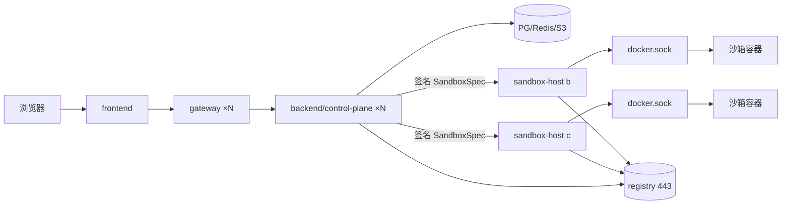

# 子方案 — 沙箱制品与部署解耦（4 角色 + 制品中心 + sandbox-host）

> 上游基准：`01-整体需求与实施步骤.md`、`02-后端设计.md`、`子方案/沙箱与引擎集成.md`、`子方案/沙箱多机部署.md`、`子方案/Skill能力.md`、`子方案/Code模式工作区.md`、`deploy/docs/部署-总览.md`、`deploy/docs/分角色部署.md`。
> 定位：**把“一个小改动就要全量重建镜像、全节点重新部署”的路径收敛掉**。不新增产品需求，只重排部署形态与制品边界。
> 状态：📝 设计讨论稿（2026-11-20，用户已确认方向，未开工）。

---

## 一、目标与验收标准

| 项 | 内容 |
|---|---|
| 部署形态 | 拿到代码只需部署 4 个角色：`gateway` / `frontend` / `backend` / `sandbox-host`（+ 可选基础服务、registry） |
| 运行时节点 | **没有源码、没有 Node/pnpm、没有构建上下文**，只 pull 制品 |
| 改 backend | 只滚动控制面（必要时 gateway/frontend），**sandbox 节点不动** |
| 改沙箱工具/扩展 | 只发对应沙箱制品，节点 sync 后新容器生效，**backend 不动** |
| 子容器/变体 | egress / relay / docker-cli / base / common / toolkit / runtime / agent **全部由平台目录 + 节点代理解决** |
| ChatBot | N 台控制面水平扩展，与沙箱节点数量解耦 |
| 构建 | 只在公司构建机/CI 构建一次，多机部署只做 pull + 重建容器 |

**一句话**：节点永远不构建；构建只发生在 CI；节点只在“新节点/升版本”时 pull。

---

## 二、现状：三类放大路径

| 反模式 | 后果 |
|---|---|
| 会独立变化的代码/配置烤进了最贵的镜像层 | base 改一行 → toolkit → 全部 runtime |
| 一个版本号同时代表多个不相关制品 | 改 backend 把 gateway/frontend 的 tag 一起推走 |
| 后端镜像里带着沙箱/运维的构建上下文 | 改沙箱脚本也动了后端镜像 |

### 2.1 容器侧代码/配置（改一行 → base → toolkit → 全部 runtime）

| 改动点 | 现在触发 | 证据 | 建议 |
|---|---|---|---|
| `skills` 扩展（工具注册、manifest、路径/分页） | base 全链路 | `infra/sandbox/base/Dockerfile:131` | request/proxy 工具走 builtin；read 工具走后端 S3 或 agent 制品 |
| `mcp-bridge` 扩展（清单、refresh、代理路径） | base 全链路 | 同上 | 挪到 agent 制品 |
| `workspace` 扩展（read/write/edit 覆盖） | base 全链路 | 同上 | 纯代理部分可进 builtin（需 bridge 支持 promptSnippet/覆盖内置名）；否则挪到 agent 制品 |
| `settings.json` | base 全链路 | 同上 | 作为 agent 配置挂载/下发 |
| `gen-models.mjs`（模型清单生成） | 脚本逻辑改动 → base；**模型数据本身走 env，不需重建** | `base/Dockerfile:155` | 脚本保持稳定；常改则挪到 agent 制品 |
| `entrypoint.sh`（播种逻辑） | base 全链路 | `base/Dockerfile:145` | 保持稳定；常改则挪到 agent 制品 |
| `apt-source.sh`（base/toolkit/runtime 各一份） | 改镜像源逻辑 → 三层全重建 | 三个 Dockerfile 都 `COPY` | 收敛成一份共享构建上下文；镜像源走 build arg |
| toolkit 的 git/ssh helper（3 个 `.mjs`） | toolkit → 全部 runtime | `toolkit/Dockerfile:83` | 放 agent 制品（挂载）或 common 层 |
| toolkit/runtime 的 `selfcheck.sh` | 改一条断言 → 对应层重建 | `toolkit/Dockerfile:74`、`runtime/Dockerfile:94` | 改成外部校验工具/独立制品 |

### 2.2 runtime 层：一处改动 → 全部 11 个变体

| 改动点 | 现在触发 | 证据 | 建议 |
|---|---|---|---|
| 任一 `install-*.sh` / `runtime/selfcheck.sh` | `RUNTIME_LAYER_VERSION` 是**全局**版本，+1 后所有变体换 tag、全重建 | `infra/sandbox/versions.mjs:192`、`:264` | 每变体独立版本/内容哈希，只重建受影响变体 |
| base/toolkit 变更 | runtime tag 只有 `<variant>-v3`，**不包含** base/toolkit 版本 ⇒ 要么静默旧镜像，要么必须全量重建重打 tag | `runtimeImageRef()` | tag 带上游版本（如 `<variant>-c<common>-v<runtime>`），或 OCI label + digest 校验 |
| 新增/删除一个变体 | 默认 `SANDBOX_RUNTIMES` 全建 | `versions.mjs:216` | CI 用 `--runtime` 只建变更变体；节点按需 pull |

### 2.3 平台镜像：一个小改动推走三个 tag

| 改动点 | 现在触发 | 证据 | 建议 |
|---|---|---|---|
| 只改 backend | `PLATFORM_LAYER_VERSION` 由 backend/gateway/frontend **共用** ⇒ 三个 tag 全变 | `versions.mjs:296-311` | 拆成 per-image 版本或直接 digest |
| 只改沙箱 Dockerfile/脚本 | 后端镜像 `COPY infra`、`COPY deploy` ⇒ 后端镜像内容也变 | `infra/router/Dockerfile:52,113-114,121` | registry 落地后删掉 `/app/infra/sandbox`、`/app/infra/scripts`、`/app/deploy` |
| 改 `sandbox-build.mjs` / `egress-up.sh` / `relay-up.sh` | 这些被拷进后端镜像（一键初始化用） | `router/Dockerfile:113-114` | CI 工具只放发布机；节点侧改成挂载/制品 |
| 改 `deploy/` 脚本 | 被 `COPY deploy` 进后端镜像 | `router/Dockerfile:121` | 只走部署包 |

### 2.4 跨边界契约/常量（隐蔽但会逼出重建）

| 改动点 | 现在触发 | 证据 | 建议 |
|---|---|---|---|
| 工具名 / manifest schema | 容器扩展解析，改形状 → 镜像 | `shared/src/skill.ts` vs `skills/contract.ts` | 容器侧“通用执行器 + 版本化 schema”；request 类走 builtin |
| 环境变量名/路径（`SANDBOX_TOKEN`、`DOUBULEA_SKILLS_DIR`、git helper 路径） | 后端与扩展各写一份，改名 → 两边都改 + 镜像 | `backend/src/sandbox/spec.ts:318-368` | 由 shared 生成/下发；扩展优先读 env，不硬编码路径 |
| 代理端点路径（`/api/sandbox/mcp/tools`、`/mcp/call`、`/builtin/call`） | 扩展里写死，改路径 → 镜像 | `mcp-bridge` / `skills` 常量 | 后端通过 env/契约下发 base/path；端点保持稳定 |
| runtime 变体 id / 语言顺序 | 构建侧 JS 与 `shared` 各一份，改约定 → 后端 + 所有镜像 tag | `versions.mjs:203`、`shared/src/runtime.ts` | 生成一份或契约测试；避免改 tag 约定 |

### 2.5 已经解耦的（照这个模式做）

- **builtin 工具目录**：知识库/记忆/通知/MCP 网关，动态增删 + `/doubulea:mcp-refresh`，不改镜像。
- **MCP 工具热更新**（P1-21）：绑定/缓存变化即重发清单。
- **ChatBot 工具**：全在后端，天然不碰镜像。
- **egress / relay 脚本**：`deploy/docker/*.mjs` 是**挂载**进容器的，改完重启容器即可（`deploy/scripts/up.sh:265-290`）。
- **运行时 / egress / relay / docker-cli 镜像**：由 env 指定，节点 pull，不 build。
- **`up.sh` / compose / deploy.env**：改部署参数只重启容器，不碰业务镜像。

### 2.6 必须重建、但只在 CI 重建的

OS / Node / pi 版本、apt/npm 包、语言运行时、镜像结构、安全补丁。目标不是“零重建”，而是“**只重建真正变化的那一层，并且只构建一次**”。

---

## 三、目标架构



### 3.1 四个部署角色

| 角色 | 内容 | 依赖 | 扩缩 |
|---|---|---|---|
| `gateway` | 路由、粘性、负载感知、内部回调入口 | Redis | N |
| `frontend` | 静态站 + `/api` 反代 | gateway | N |
| `backend` | API/DB/LLM/编排/调度/制品目录/节点客户端 | PG/Redis/S3/registry | N |
| `sandbox-host` | node-agent + egress/relay + 制品缓存 + 本机工作区 | docker.sock、registry | M |
| 基础服务 | PG / Redis / MinIO（可外部托管） | — | 可选 |
| registry | 所有平台/沙箱制品（443） | — | 必需 |

`deploy/` 从 `MODE=all|node` 改为按角色：

```bash
deploy/scripts/up.sh --role sandbox-host --manifest release.json
deploy/scripts/up.sh --role control-plane --manifest release.json
```

### 3.2 职责边界

| 控制面（backend） | 执行面（sandbox-host） |
|---|---|
| 会话 / Agent / Skill / 模型 / 产物元数据 | Docker 生命周期（create/start/stop/exec） |
| 调度（owner 粘性 / 容量 / 队列） | 本机工作区 FS API（read/write/edit/list/stat/watch） |
| 生成 `SandboxSpec`（image digest、挂载、env、limits） | 制品 pull / digest 校验 / 版本卷 / GC |
| 回调路由、工具代理、S3/DB 访问 | 沙箱 → 控制面的回调中转 |
| 期望状态 / reconcile / 管理页 | 实际上报 digest / agent contract / 容量 |
| **不碰 docker.sock、不跑容器** | **不连 PG、不跑 Prisma/业务编排** |

### 3.3 ChatBot 与沙箱解耦

现在每个沙箱节点都跑完整 backend，导致“改后端要动所有节点”。拆分后：

- gateway 上游 = 控制面 backend 副本；沙箱节点**不再是上游**；
- ChatBot 仍在控制面副本之间水平扩展（沿用 `shared/router.ts#selectUpstream` / `ROUTER_LOAD_AWARE`）；
- 任意控制面副本都能通过签名 API 管理任意节点上的沙箱，不再要求“请求命中沙箱所在那台”；
- 回调由 `sandbox-host` 中转，gateway 用会话亲和或内部路由送回负责该会话的控制面副本。

---

## 四、制品与版本轴

| 制品 | 内容 | 变动频率 | 消费方 |
|---|---|---|---|
| `platform/backend` | 控制面 | 高 | backend |
| `platform/gateway` | 路由 | 中 | gateway |
| `platform/frontend` | 静态站 | 中 | frontend |
| `sandbox-host` | node-agent | 低 | sandbox 节点 |
| `sandbox-base` | OS + Node + pi | 极低 | 沙箱 |
| `sandbox-common` | 公共工具 + git helpers | 低 | toolkit / runtime |
| `sandbox-toolkit` | 脚本 + selfcheck（薄层） | 中 | 沙箱 |
| `sandbox-runtime-<variant>` | common + 语言 | 中 | 沙箱 |
| `sandbox-agent` | extensions / settings / gen-models | **高** | 沙箱 |

发布产物是一份 `release.json`（**digest，不是 tag**）：

```json
{
  "platform": { "backend": "sha256:…", "gateway": "sha256:…", "frontend": "sha256:…" },
  "sandbox": {
    "host": "sha256:…",
    "base": "sha256:…", "common": "sha256:…", "toolkit": "sha256:…",
    "runtimes": { "node22-v3": "sha256:…", "python312-v3": "sha256:…" },
    "agent": { "version": 7, "contract": 3, "digest": "sha256:…" }
  },
  "contracts": { "agent": [2, 3], "sandboxSpec": 1, "hostApi": 1 }
}
```

版本规则：

- 每个制品**独立版本**；平台 backend/gateway/frontend 不再共用一个 `PLATFORM_LAYER_VERSION`；
- runtime tag 必须能表达上游依赖（`<variant>-c<common>-v<runtime>` 或 digest）；
- 构建机只构建变化制品；节点只按 manifest pull。

---

## 五、代码分层

```text
shared/
  sandboxContract.ts      工具名 / manifest / 契约版本
  sandboxSpec.ts          SandboxSpec（控制面 → 节点）
  hostApi.ts              host 签名 API 契约

backend/                  控制面
  sandbox/
    scheduler.ts           选节点（owner 粘性 / 容量）
    hostClient.ts          签名调用 sandbox-host
    catalog.ts             制品目录 / 期望 digest / 契约校验
    bootstrapJob.ts        只编排 sync，不执行 Docker
  orchestrator/skillTools.ts   Skill 读工具（S3）
  workspace/               元数据 + 调度；文件字节走 host API
  services/ routes/        API / DB / LLM

sandbox-host/             新增（独立包、独立镜像）
  server.ts                签名 API
  docker/                  容器生命周期
  workspace/               本机 FS API + S3 冷备
  artifacts/               pull / digest 校验 / 版本卷 / GC
  agentBundle.ts           agent 制品物化
  callback/                沙箱 → 控制面中转
  capacity.ts              心跳 / 负载 / 实际 digest

infra/sandbox/
  base/ common/ toolkit/ runtime/   只放 OS / 包 / 脚本
  agent/                            容器侧代码（独立制品）

release/                            构建、push、release.json、签名
deploy/                             4 角色模板
```

依赖规则：

- `shared` 是唯一契约源；`sandbox-host` 与 `agent` 不 import backend；
- 只有 `sandbox-host` 碰 docker.sock；
- `infra/sandbox` 只被 CI 使用；生产 backend 镜像不携带构建上下文。

---

## 六、Skills 工具专项

### 6.1 工具 = 注册 + 执行

```text
工具 = 注册（name / description / JSON Schema）  +  执行（execute 函数）
        ↑ 可动态（manifest / builtin）              ↑ 代码跑在哪，决定能不能动态
```

- 纯代理工具（`request_skill_*`）：执行体在后端 `/api/sandbox/builtin/call` ⇒ 只发 backend。
- 本地读工具（`list_skills` / `load_skill` / `read_skill_file`）：当前执行体在容器扩展 ⇒ 改逻辑要换镜像。

### 6.2 推荐分界

| 类型 | 放哪 | 更新方式 |
|---|---|---|
| 后端执行（草稿 / 记忆 / 知识库 / 网关） | `catalog.builtins` + `builtin/call` | 只发 backend，老容器下一轮 refresh |
| 读平台 Skill（S3 有权威内容） | 后端 `skillTools.ts`（S3 + 缓存） | 只发 backend |
| 容器本地执行（脚本、二进制、特殊解析） | agent 制品 | 只发 agent 制品，不重建 base/toolkit/runtime |

### 6.3 S3 与本地镜像的关系

- **S3 = 权威内容**；本地 `$HOME/.skills` = `skillSync` 生成的按会话镜像，只读挂载，供脚本/bash 使用。
- 两边必须用**同一份快照**（skillId + version + overrideRevision）定位，避免“工具读 v3、bash 读 v2”。
- 派活前 `skillSync` 是硬闸：S3 复制失败 ⇒ `SKILL_SYNC_FAILED`，不带着旧副本继续跑。
- 若工具改为后端读 S3：S3 对象已回收 ⇒ `409 SKILL_VERSION_PURGED`（与 ChatBot 一致）；不要用本地镜像静默兜底，否则两端行为不同。

### 6.4 `read_skill_file` 的两种落地

- **方案 A（推荐）**：后端代理读 S3，复用 `backend/src/orchestrator/skillTools.ts`（含 LRU 缓存、快照/覆写、分页、路径判据）；为 TaskAgent 增加 `allowScripts: true`，保留“可读 `scripts/**`”的差异。
- **方案 B**：保留容器本地执行，但把扩展从 base 移到 agent 制品；改工具只发 agent 制品。

### 6.5 工作区里 npx 装的 skills

- 那是**工作区文件**（`/work/...`），不是平台 Skill；`read_skill_file` 不读它。
- 当前任务用 `bash` / workspace 工具读；要进平台体系就走 `request_skill_from_workspace`（目录/zip）→ 草稿 → 保存 → S3。
- 不建议把未上传的 workspace skill 自动并进 `list_skills`：同名、版本、审计、只读保证都会被破坏。

### 6.6 迁移步骤（不改镜像）

1. `skillSync` 的 manifest 工具集合排除新工具（或排除整个 `SKILL_REQUEST_TOOL_NAMES`）。
2. 把 request 工具描述符加入 `computeSandboxMcpCatalog` 的 `builtins`。
3. `builtin/call` 复用现有 `isSkillRequestToolName` 分支。
4. 老容器：`taskAgent` 检测 builtin 名字集合变化 → 注入 `/doubulea:mcp-refresh` → mcp-bridge 注册。
5. 彻底版：manifest 只留 read 工具；全部 request 工具走 builtin；manifest 工具集合变化时也注入 `/doubulea:skills-refresh`，让旧 skills 扩展摘掉旧工具，避免重复注册。

### 6.7 类似 Skills 的其他容器侧功能

判断方法只有一条：**执行体在哪**。执行体在容器里且只是代理 ⇒ 可 builtin；执行体在容器里且做本地工作 ⇒ agent 制品；新增系统依赖 ⇒ 镜像。

| 功能 | 执行体 | 现在改什么会触发重建 | 可动态化路径 |
|---|---|---|---|
| Skills request 工具（`request_skill_*`） | 后端 | 工具名/注册/manifest | builtin，**已可无镜像** |
| Skills 读工具（`list_skills` / `load_skill` / `read_skill_file`） | 容器本地 FS | 读取/分页/路径/删改 | 后端 S3（复用 `skillTools.ts`）或 agent 制品 |
| Workspace 工具（`read` / `write` / `edit`） | 容器内薄代理 + 本地版本跟踪 | 工具 schema、prompt、覆盖逻辑 | builtin（需 bridge 支持 `promptSnippet` / `promptGuidelines` / `constrainedSampling` / 覆盖内置名）；或 agent 制品 |
| MCP bridge（工具清单/刷新/调用） | 容器适配器 | 注册/refresh/端点路径 | agent 制品；清单本身已动态 |
| Git 凭据 helper（3 个 `.mjs`） | 容器内可执行脚本 | 认证/代理逻辑 | agent 制品（挂载）或 common 层 |
| `entrypoint.sh` / `settings.json` | 容器启动 | 播种/配置 | 低频；可归入 agent 制品 |
| `gen-models.mjs` | 容器启动 | 脚本逻辑 | 模型数据已由 env 动态；脚本可归入 agent 制品 |
| `selfcheck.sh` / `install-*.sh` | 构建/诊断 | 断言/安装逻辑 | 构建期必须；可改成外部校验工具 |

**Workspace 的特别说明**：

- 它的三个工具**全部**走 `/api/sandbox/workspace/{read,write,edit}`，容器侧只做 `lastReadVersion` 跟踪、行切片、错误回喂 ⇒ 本质上和 skills request 一样是代理。
- 但它是**同名覆盖**核心工具，必须带 `promptSnippet` / `promptGuidelines` / `constrainedSampling`，否则内置工具在系统提示里的条目会消失；当前 `mcp-bridge` 的 `builtinTools` 描述符不带这些字段。
- 因此有两条路：
  1. **一次性升级 mcp-bridge**，让 builtin 描述符支持上述字段与覆盖内置名；之后 workspace 工具逻辑改动只发 backend；
  2. **把 workspace 扩展移到 agent 制品**，改 prompt/schema 只发 agent 制品。
- 版本跟踪也可以上移到后端：`read` 返回 version，`write/edit` 带 `baseVersion`，由后端做 CAS ⇒ 容器侧不再保存状态，builtin 化更彻底。

## 七、发布与升级

### 7.1 构建（公司构建机/CI）

```bash
# 平台镜像（各自独立 tag/digest）
pnpm backend:build-image -- --push
pnpm gateway:build       -- --push
pnpm frontend:build-image -- --push

# 沙箱镜像（只建变化层/变体）
pnpm sandbox:build -- --push --docker-registry harbor.corp/doubulea \
  --runtime node22,python312

# 生成 release.json（digest + 契约范围）
pnpm release -- --write-manifest
```

### 7.2 部署

- 控制面：逐台摘流 → pull → 重建 → 健康检查 → 恢复；N 副本滚动。
- gateway/frontend：滚动。
- sandbox 节点：只 sync 制品，不重建 host；host 版本变了才滚动。
- 一键初始化 = 按 `release.json` 做 `pull + 物化 agent + 复检`，不再本地构建。
- 回滚 = 切回上一份 manifest 的 digest。

```bash
deploy/scripts/rollout.sh --role control-plane --manifest release.json
deploy/scripts/rollout.sh --role sandbox-host --manifest release.json
```

---

## 八、分阶段落地

| 阶段 | 内容 | 规模 | 风险 |
|---|---|---|---|
| **P0** | registry + 全制品 pull-only + `release.json` + skills request 工具走 builtin + 平台版本拆开 + 后端镜像去掉沙箱构建上下文 | 中 | 中 |
| **P1** | common/toolkit/runtime 重新分层；runtime `FROM common`；per-variant 版本/复合 tag；agent 独立制品（extensions/settings/gen-models） | 中大 | 中高 |
| **P2** | 抽 `sandbox-host`，双模式运行（节点可跑旧 backend 或新 host） | 大 | 高 |
| **P3** | 节点彻底去 backend；控制面 N 副本；deploy 改 4 角色；删构建上下文 | 中大 | 中高 |
| **P4** | reconcile / GC / 离线包 / 契约观测 / 回滚演练 | 中 | 中 |

### P0 文件级清单

| 文件 | 改动 |
|---|---|
| `infra/scripts/sandbox-build.mjs` | `--push` / `--docker-registry` / `--platform`；输出 digest |
| `infra/sandbox/versions.mjs` | registry ref 生成；平台三镜像独立版本 |
| `backend/src/sandbox/proxy.ts` | request 工具加入 `catalog.builtins` |
| `backend/src/sandbox/skillSync.ts` | manifest 排除 request 工具（或只留 read 工具） |
| `backend/src/sandbox/imageExpectation.ts` | registry ref 纯函数 + pull 源 tag 校验 |
| `backend/src/sandbox/nodeBootstrap.ts` | pull-first；修正普通分支 pull 源不校验 tag 的问题 |
| `backend/src/config.ts` + `infra/.env.example` | `SANDBOX_IMAGE_REGISTRY` / `SANDBOX_IMAGE_PULL_MODE` |
| `deploy/scripts/up.sh` / `up.ps1` / `_lib.sh` | 透传 registry；docker 凭据挂载 |
| `infra/router/Dockerfile` | 生产镜像去掉 `infra/sandbox` / `infra/scripts` / `deploy` |
| `backend/scripts/node-bootstrap-regression.ts` | registry ref / tag 校验用例 |

### P1 文件级清单

| 文件 | 改动 |
|---|---|
| `infra/sandbox/base/Dockerfile` | 移除 `COPY pi-agent/`；只留 OS + Node + pi + 稳定 entrypoint |
| `infra/sandbox/common/Dockerfile` | 新增：公共工具 + git helpers |
| `infra/sandbox/toolkit/Dockerfile` | 变薄：脚本 + selfcheck |
| `infra/sandbox/runtime/Dockerfile` | `FROM common`，不再 `FROM toolkit` |
| `infra/sandbox/agent/` | 新增：extensions / settings / gen-models |
| `infra/sandbox/versions.mjs` | `COMMON_LAYER_VERSION` / `AGENT_LAYER_VERSION` / `SANDBOX_CONTRACT_VERSION`；per-variant runtime tag |
| `backend/src/sandbox/spec.ts` / `manager.ts` | agent 卷挂载 + 版本/契约校验 |
| `dist`/agent 物化 | 复用 `materializeInfraDir` / 命名卷模式，或 OCI artifact |

---

## 九、目标状态下的变更影响

| 改动 | 现在 | 目标 |
|---|---|---|
| backend only | 平台镜像 + 可能 gateway/frontend tag | 只 backend 镜像 |
| extensions / settings / gen-models | base → toolkit → 全部 runtime | agent 制品（MB 级） |
| toolkit 脚本 / selfcheck | toolkit → 全部 runtime | 只 toolkit |
| git helper / 公共工具 | toolkit → 全部 | common → toolkit + runtime（频率低） |
| 某个语言运行时 | 全部变体（全局版本） | 只该变体 |
| OS / Node / pi | 全部 | 全部（不可避） |
| skills request 工具 | base 全链路 | builtin，backend-only |
| skills read 工具 | base 全链路 | 后端 S3（backend-only）或 agent 制品 |
| workspace read/write/edit | base 全链路 | builtin（backend-only）或 agent 制品 |
| egress / relay 脚本 | 无（挂载） | 无（保持） |
| deploy 参数 | 无（重启容器） | 无（保持） |

---

## 十、风险与待决

| 风险/待决 | 说明 |
|---|---|
| 公司是否已有 K8s/Nomad | 有则先评估用标准编排替代自研 host/rollout；没有则自研 sandbox-host |
| 工作区 FS/SSE 迁移 | `backend/src/workspace/*` 的文件字节、watcher、SSE、冷备要迁到 host 或经 host API |
| 回调路由 | N 控制面下，sandbox → 控制面的回调需要会话亲和或内部路由 |
| 密钥分发 | 控制面下发 `SandboxSpec` 时如何携带/轮换 LLM、git 等短期凭据 |
| 版本偏斜 | backend / host / agent / 镜像契约的兼容范围与拒绝策略 |
| 多架构 | arm64 dev 与 x86 节点需要 buildx 多架构 manifest |
| registry | 443 + TLS + 只读账号；HTTP/insecure 只用于封闭内网 |
| 容量/保留 | toolkit 685MB、runtime 0.7–1.6GB/变体；registry/Harbor 需要 GC 与保留策略 |
| S3 purged 语义 | 工具读 S3 与本地镜像可能出现行为差异，需要统一 |
| 真实镜像验证 | 按仓库纪律：不自建探测工具，真机 E2E 留手动 |

---

## 十一、验证

- `pnpm node-bootstrap:regression`：registry ref / pull 源 tag 校验；
- `pnpm config:check`：新 env 与配置；
- 新增 `sandbox-contract:regression` / `release:check`：契约版本、manifest、digest；
- `pnpm router:regression`：控制面多副本与回调路由；
- 改动文件 `eslint`；
- 手动验证（不在 CI）：加一个 builtin 工具后老容器下一轮出现；push/pull；节点无源码、无构建；回滚到上一份 manifest。

---

## 十二、落地顺序建议

1. **P0 先做**：registry + pull-only + skills request 工具 builtin + 平台版本拆开 + 后端镜像去构建上下文。
2. **P1**：common/toolkit/runtime 分层 + agent 制品；把“扩展改动要全量重建”彻底消掉。
3. 观察一段时间，量“backend 发布时节点重启”的实际影响。
4. **P2/P3**：sandbox-host 抽取与节点去 backend；这是“改 backend 不重启 B/C”的唯一完整解。
5. **P4**：reconcile / GC / 离线包 / 契约观测。

> 不在本次范围：K8s/Nomad 迁移、共享工作区（NFS/S3FS）、从页面触发 push（push 只走 CI/发布机）、节点本地构建。